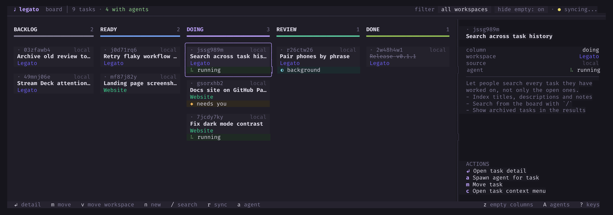
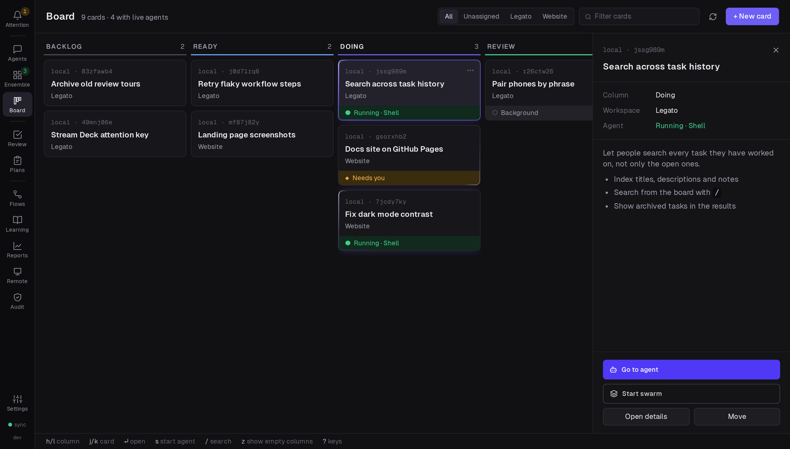

# Legato

A keyboard-driven board for your tasks and the AI coding agents that work on them. See what every agent is doing, answer the ones that need you, and review what they made, from the terminal, the browser or your phone.

**Documentation: <https://cpave3.github.io/legato/>**



## Key features

- **A board in your terminal.** A kanban board you drive with the keyboard. Keep local tasks, or pull tickets from Jira and push your moves back.
- **Agents on every task.** Start Claude Code, Codex or Chimera on a task in its own tmux session. Each card shows whether its agent is running, needs you, or is idle.
- **Web UI and phone.** The same board and agents in the browser, with each agent's conversation in a native panel. Pair your phone with four words and answer agents away from your desk.
- **Attention and approvals.** One queue of everything that needs you: permission requests and questions, plans to approve, reviews to read, failed workflows, pull requests with a red check.
- **Plans and reviews.** Agents propose a plan before they write code, and take you through the change afterwards with a review tour.
- **Workflows and swarms.** Run repeatable recipes of Legato steps and agent work, or let a conductor agent split a task between workers.
- **Credentials and sandbox.** Agents use your SSH keys and API keys without holding them, with each use approved by you. A bubblewrap sandbox hides the rest of your machine.
- **GitHub and more.** CI, review and comment status of linked pull requests on the cards, plus Staccato, Yggdrasil, Argus, ntfy and Manticore integrations.
- **Updates itself.** A release build installs new releases, by default after it asks you.



## Quick start

You need Linux (x86-64 or ARM64) or macOS on Apple silicon, tmux, git and at least one agent tool.

```bash
# Linux on x86-64. For other machines use legato-linux-arm64 or legato-darwin-arm64.
curl -fLO https://github.com/cpave3/legato/releases/latest/download/legato-linux-amd64
curl -fLO https://github.com/cpave3/legato/releases/latest/download/SHA256SUMS
sha256sum --check --ignore-missing SHA256SUMS
install -m 755 legato-linux-amd64 ~/.local/bin/legato

legato                                     # first run: sets up the board
legato hooks install --tool claude-code    # in each project, so cards show agent state
```

On the board, press `n` to make a task, `a` to start an agent on it, and `?` for all the keys. [Install and first use](https://cpave3.github.io/legato/start/install/) has every step, including the web UI and your phone.

## Documentation

- [What is Legato?](https://cpave3.github.io/legato/start/what-is-legato/)
- [Ways to run Legato](https://cpave3.github.io/legato/running/workstation/): on your workstation, as a web server, on a server of its own
- [Using Legato](https://cpave3.github.io/legato/using/board/): the board, agents, the web UI, Attention, plans, reviews, workflows and swarms
- [Agent tools](https://cpave3.github.io/legato/agent-tools/claude-code/) and [integrations](https://cpave3.github.io/legato/integrations/jira/)
- [Security](https://cpave3.github.io/legato/security/credential-broker/): credentials, the sandbox, web access
- Reference: [configuration](https://cpave3.github.io/legato/reference/configuration/), [CLI](https://cpave3.github.io/legato/reference/cli/), [keyboard shortcuts](https://cpave3.github.io/legato/reference/keyboard/)

The site's source is in [`site/`](site/).

## Build from source

Building from source needs Go (see `go.mod`), [Task](https://taskfile.dev) and pnpm.

```bash
git clone https://github.com/cpave3/legato.git && cd legato
task build:full    # the web UI, then the Go binary with it embedded
task test
```

A build from source reports version `dev` and does not update itself. [Build from source](https://cpave3.github.io/legato/contributing/build/) and [Architecture](https://cpave3.github.io/legato/contributing/architecture/) have the details.

## License

MIT
