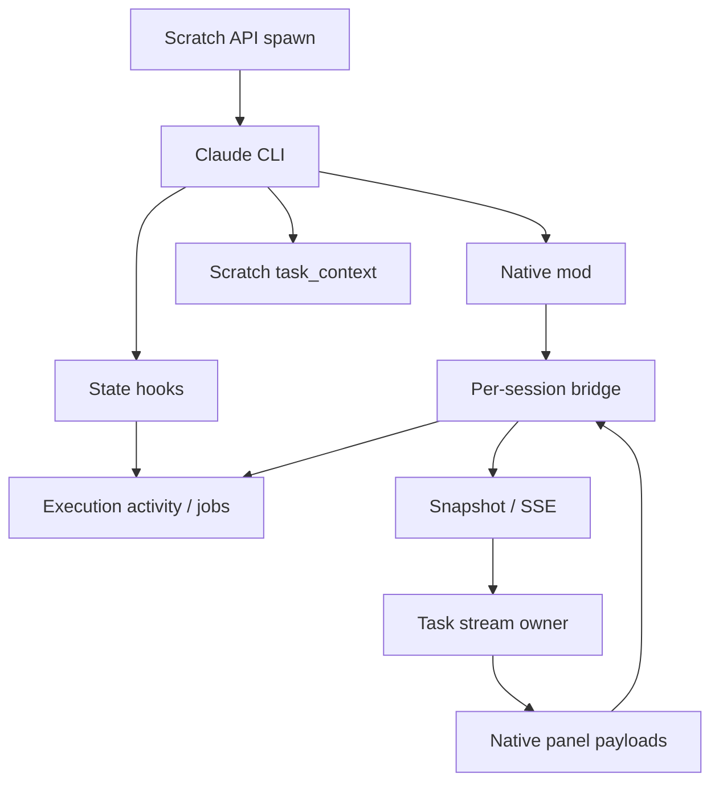

# Agent integration health pass — 3jhyll8b

## Scope and exact baselines

Follow-up commissioned after the Chimera tightening merged. Both worktrees were
clean. Fetched origin, verified previous integration heads are ancestors of
origin/main, switched to local main and fast-forwarded without reset or force,
then created `legato/3jhyll8b-agents-health` in each clone.

- Legato: `e3c753f71f30e7277940935424bbd8bfc46b4da2` (merged PR #93).
- Chimera: `0733a563dd7645599bf6e4f0e2d2e50fbf6a4691` (merged PR #7).
- Claude Code available: **2.1.322**, checked under isolated HOME.
- Codex absent on PATH initially. A pinned scratch-only package installation
  completed during baseline builds; operator then explicitly narrowed focus to
  Claude. No Codex agent scenario is claimed; static mapping is not live proof.

No production configuration, sessions, task/broker authority or shared installs
are used. All test descendants use the established environment-whitelist runner,
private HOME/CLAUDE_CONFIG_DIR/config/database/runtime/tmux, independent loopback
ports and synthetic nonsecret model credentials. Heavy commands use the shared
`$HOME/.nuget/packages/.legato-heavy.lock` acquired before HOME isolation.

## Public boundaries commissioned for testing

1. Built Legato API spawn → actual Claude CLI → installed mod/state/tools plugins
   → actual bridge/store → native API/WebSocket and compact list.
2. Actual Claude Anthropic-compatible loopback requests and tool results, not a
   replacement mod/bridge. Assertions compare provider requests, native snapshot,
   live events, aggregate activity and persisted resume identity.
3. Actual UI permission/question HTTP/WebSocket payloads, MCP task_context,
   interrupt/reload/reconnect and clean-stop delivery.
4. Real bridge HTTP/SSE boundary regressions and engine plugin-host tests for
   minimized failures/timing which cannot be exercised deterministically live.
5. Built Chimera full scratch driver against newly merged main as regression.

## Architecture and ownership



Claude child calls share the parent bridge but must not take parent identity.
State hooks own normal working/waiting/background/idle transitions; the bridge
supplements interrupted/error turn completion. Native requests are raised only
with bridge SSE viewers, unlike Chimera's pending-request model. The shared
fanout retains SSE briefly after browser detach: verify actual viewer behavior,
not just documentation. Reload replaces execution but resumes provider identity.

Claude supports native tool/question/permission interaction, background jobs,
children and resume. Chimera-style modes are unsupported (409), elicitation and
some native menus remain terminal-owned, and readable thinking depends on the
engine/model. Background daemon handoff has documented MCP environment ownership
limits; do not use a production daemon to test it.

## Scenario matrix

Pending means not yet exercised, not passing. Before/after and limits will be
updated with evidence, root cause, owner and regression paths.

| ID | Expected outcome | Claude actual / result | Evidence / ownership / regression |
| --- | --- | --- | --- |
| A0 | Provider canary uses real CLI with no real auth/config | Pass: isolated `claude -p`, one loopback model call, canary reply, exit0 | claude-provider-probe.log; transport prerequisite only |
| A1 | Actual launch binds once; correct saved identity/MCP task | Pass: actual CLI launch, native binding, real task_context result | claude-steering-reload-baseline.log; launcher/mod/bridge |
| A2 | Native snapshot/events/list agree across clean turn and idle append | Pass for final reply/idle and subsequent input | Same live driver; state hooks + shared projection |
| A3 | Supported child lifecycle; parent independent | Confirmed false live completion for always-async Agent; bridge fix passes race suite and real child assertion. 2.1.322 schema no longer offers foreground execution. Child failure/stop not yet exercised | claude-background-red.log, claude-background-contract-red.log, claude-background-green-build.log; bridge-owned |
| A4 | Concurrent messages and steering across tool/clean-stop boundaries exactly once | Pass: 3 cycles × 4 concurrent messages at clean-stop, exactly once in native history and actual provider input; tool-boundary timing remains plugin-host coverage | claude-steering-reload-baseline.log; mod held/folded queues |
| A5 | Permission allow/deny/cancel and multiple/custom/dismissed questions via UI payloads | Pass: allow/deny control actual canary execution; two questions with choice/custom answer and dismissal via native WS/tray HTTP. Permission dismissal and multiselect not claimed | claude-requests-baseline.log; requests/approval service |
| A6 | Disconnect/replay/expired cursor, no silent loss or stale callbacks | Pass: 3 live reconnect/replay cycles, no duplicate IDs. Cursor eviction/long outage not yet exercised | claude-steering-reload-baseline.log; bridge + shared stream manager |
| A7 | Reload/resume and scratch-server restart retain identity/MCP, fence old execution | Pass: reload creates new execution, retains conversation/history/MCP, persistent viewer follows it. Scratch-server restart not yet exercised for Claude | Same live driver; BridgeHost / restart |
| A8 | Interrupt/failed startup/error/cleanup visibly reconcile | Pass: active interrupt→native/aggregate idle and scratch cleanup. Confirmed missing native explanation for completed API400 error; investigating. API401 was still retrying at timeout, not a stuck-turn defect | claude-background-green/{scratch-native-pane.txt,snapshot-diagnostic.json}; CLI/mod/bridge |
| A9 | Endpoint/credential canaries never appear in diagnostics | Pending | Shared client / bridge logs |
| A10 | Unsupported modes/elicitation/pickers remain explicitly unsupported | Pending | Capability/terminal paths |
| C1 | Merged Chimera full smoke remains green | Pass: 20 full scenario checks + 14 bootstrap/authentication/recovery outcomes | chimera-main-smoke.log; existing full scratch runner |
| X1 | Codex health | Deferred by operator; no live result | Static mapping only |

## Initial evidence and limitations

- Actual Claude plugin validation passes. Directory-publication license/icon
  notices are not runtime validation failures and are outside this pass.
- Provider probe: `{exit:0, model_calls:1, canary_received:true, stderr:""}`.
- Expired Burnlite CLI login remains an unresolved tracker follow-up; not a
  blocker for engineering. No ticket closures or inferred resolutions.
- Exact LEG-157 mismatch remains unreproduced; CHIM-86 remains unfixed; the MCP
  request_access channel root cause remains unknown absent new evidence.

## Confirmed fix: async launch is not child completion

Real Claude 2.1.322 advertises an `Agent` schema without `run_in_background`;
its description says subagents run asynchronously. The launch result returns
while the child runs. Legato's bridge only omitted `result.reason: stop` when
the removed input flag was true. The resulting live `tool_call_result` made
the web reducer finish a still-running child, while native snapshots retained
the explicit running lifecycle.

Before: real scratch scenario fails `async launch reported child stopped before
completion`; minimized `TestAnImplicitlyBackgroundSubagentLaunchIsNotItsCompletion`
fails against the actual bridge HTTP/SSE boundary. After: the bridge uses the
observed active child as well as the older explicit flag; the full bridge race
suite and real child assertion pass. Child completion still comes only from its
own lifecycle. Aggregate state hooks already correctly reported background.

The first child probe used an obsolete input flag and looked for a top-level
snapshot child list; those were harness mistakes, corrected from the actual
advertised schema and `toolCalls[].subagent`, not product defects.

## Repeatable live command

```sh
python3 internal/cli/testdata/chimera-mod/isolated_run.py \
  python3 internal/cli/testdata/agent-health/claude_end_to_end.py \
  --legato /absolute/path/to/locally-built-legato \
  --artifacts /absolute/path/to/private-evidence
```

Acquire the shared heavy lock for the build, before HOME isolation. The driver
uses a synthetic provider, not real provider credentials, and removes only its
own scratch processes and private root. WebSocket credentials travel on stdin,
not argv. This is transport/mod integration proof, not real-model reasoning or
a visual browser test. Claude's plugin-host baseline is 51 pass / 0 fail;
targeted Go adapter/bridge/CLI/service/server contracts pass. Daemon handoff,
compaction, full sandbox operation and Codex are not claimed by these results.
