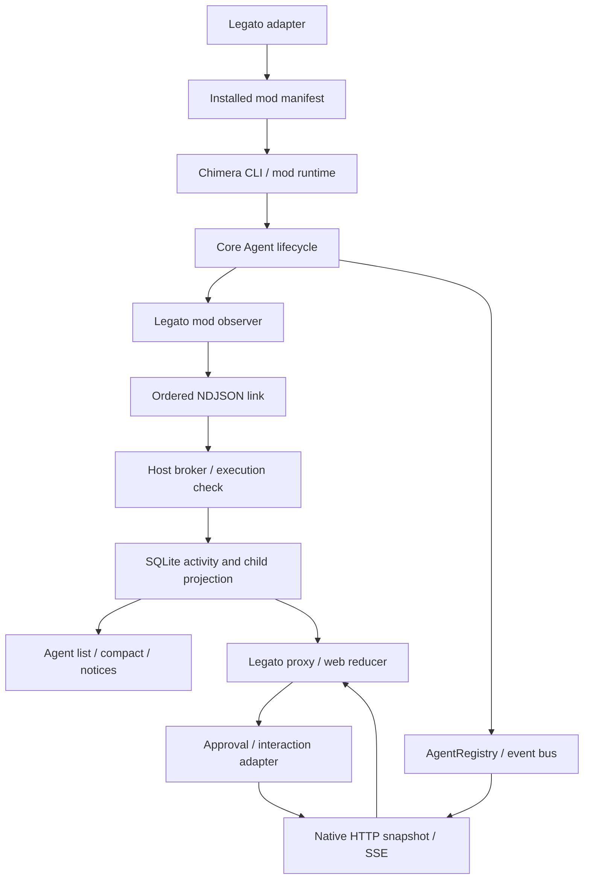

# Chimera–Legato failure-oriented investigation (3jhyll8b)

## Scope and isolation

Baselines: Legato `d9536f87402ac93a6b14eebd45cc1a8e98d95d08`; Chimera
`99d44f9d3c4b75ab14132534fc0414c84402e5c5`. One owner, one draft PR per
changed repository. No production LEG-157 access or mutation. All live scenarios
use locally built binaries, empty scratch HOME, separate configuration/database/
data/runtime/tmux sockets, loopback model fixtures and independent ports.

The operator verified the investigating agent's native context window as
1,050,000, output cap 32,768; default compaction stays enabled at 85%.
Tracker CLI fallback returned npm 404; no retries. Reeve independently confirmed
CHIM-93 Ready: background completion missing from clients and parent snapshots.
Existing CHIM-91 startup fix and LEG-194/196/question adapters were tested first.

## Architecture and event ownership



- Launch/capabilities/manifest and saved conversation binding: Legato adapters,
  installer and `RunChimeraLink`; execution identity must fence old writers.
- Canonical parent run state and child execution: Chimera core and subagent
  manager. Registry publishes run stream to SSE and subscribes to idle events; lifecycle
  observers separately drive mods. These paths now agree outside a parent run.
- Aggregate list activity/jobs: Legato `ApplyChimeraHook`, real broker/store;
  independent of conversation snapshot's run state. Parent idle with active
  background children should aggregate as background, not working.
- Child metadata repair: Legato stores mod spawn/finish by child agent ID and
  conversation; proxy augments only older snapshots that lack canonical child state. Native
  snapshots now retain and persist exact child lifecycle and tool/session IDs.
- Requests: Chimera holds actual permission/question promises; mod permission
  interception precedes automatic arbitration. Legato polls human-pending
  snapshot before reporting waiting. Question adapter normalizes IDs and maps
  panel keyed answers back to Chimera's canonical HTTP answer shape.
- MCP/resources: launch manifest/tool environment and session factory; verify
  actual advertised tools and execution after launch/reconnect/resume.
- Context: Chimera usage/compaction events and snapshot; Legato context watcher
  and UI projection. Compaction does not alter execution ownership.

## Test seams

Commissioned public boundaries: built Chimera CLI/mod/server; Legato API
spawn/compact/conversation/approval paths; real link→broker→SQLite; web panel
payloads. Scripted loopback model output is controlled external input, not a
mock of integration implementation. Regression tests are added one failing
vertical slice at a time. Existing CHIM-91/LEG-194/LEG-196/question fixes must
be exercised before proposing another fix.

## Scenario matrix

Results distinguish a **live** built-CLI/mod/API run from a **contract** test
through the relevant real module. Neither implies a browser was manually driven.
Evidence names below are under `/tmp/integration-3jhyll8b/evidence`; the important
sanitized outcomes are retained in this document and task notes.

| ID | Scenario / expected | Actual / result | Evidence | Root cause / owner | Regression |
| --- | --- | --- | --- | --- | --- |
| B1 | Build/start real CLI, mod preflight and MCP round trip | Live pass: installed mod binds; actual task_context returns scratch task | baseline-smoke.log; stream-reload-green.log | Both | end_to_end.py |
| B2 | Broken mod/bootstrap and compatibility diagnostics | Live mod-list registration error visible; --no-mods skips it. Contract tests cover unsupported API, missing folder/helper, rollback, older host fallback | mod-bootstrap-smoke.log; full suites | No new product defect | mods/loading + hooks/chimera tests |
| L1 | Parent final + completed child: compact/native agree, no stale job | Exact LEG-157 aggregate mismatch NOT reproduced. Baseline lacked native child snapshot; fixed | baseline-child.log; isolated-baseline-snapshot-red.log; stream-reload-green.log | Chimera canonical child state; Legato snapshot precedence | server/app + proxy + reducer |
| L2 | Foreground/background success/error/timeout/explicit stop | Live pass, separate parent/child activity; stopped child leaves jobs list | expanded-live.log; stream-reload-green.log | No additional confirmed defect | real child driver |
| L3 | Nested child identity and completion | Live pass; baseline mod dropped parentCallId/childSessionId, now preserved | isolated-baseline-cli-red.log; stream-reload-green.log | Chimera mod-runtime | mod-runtime identity regression |
| E1 | Idle native SSE/snapshot/list agreement | Baseline real shell exit missing from server bus despite mod notification; fixed, no duplicate run events | isolated-baseline-cli-red.log; idle-event-green.log | Chimera Agent idle branch + registry | real background shell/SSE |
| E2 | Duplicate/lost/reordered/replay/reconnect | Five live disconnect/replays: no missing, duplicate or reordered events. Contract race/replay/unknown-cursor tests pass; ten race-detector fanout repetitions pass | stream-reload-green.log; stream-replacement-stress.log | Existing replay semantics retained | server SSE race + Legato fanout |
| E3 | Replacement execution stops old upstream and resets cursors | Live persistent panel failed after reload, then passed. Changed/reused endpoint, stale callback and same event ID contract tests pass | stream-reload-red/green.log; stream-replacement-red/green.log | Legato task-keyed stream cached old owner | NotifyAgentsChanged + reconnect regressions |
| M1 | Startup/steering/concurrent append accepted exactly once | CHIM-91 startup regression preserved. 5×4 live concurrent appends + queued WS steering pass. New clean-stop/commit-window stranding reproduced/fixed | isolated-baseline-stop-window-red.log; stop-window-append-green.log; queue-retry-red/green.log | Chimera drain/admission; Legato bounded 409 retry | actual HTTP/lifecycle + public adapter |
| M2 | Idle context append does not invent a turn | Native HTTP and actual web reducer both failed before; fixed. Live WS remains idle | idle-append-server/ui-red/green.log; stream-reload-green.log | Chimera missing append marker; Legato unconditional busy | HTTP and reducer entry points |
| Q1 | Real UI payload: multiple/choice/custom/invalid/cancel/dismiss | Live tray HTTP and native-panel WebSocket payloads pass; old-schema regression not reproduced | expanded-live.log; stream-reload-green.log | Existing question adapter correct | question contract + actual driver |
| Q2 | Automatic arbitration vs human wait; allow/deny/dismiss | Live human approval outcomes pass; real broker/SQLite arbitration regression passes | stream-reload-green.log; Go suite | Existing LEG-194 contract retained | chimera_permission_test.go |
| T1 | MCP/resources launch, reconnect, resume | Live task_context, resource path with space, reload/resume tool/resource use pass | stream-reload-green.log | Existing bundle launch retained | end_to_end.py |
| R1 | Interrupt/crash/kill/reload/resume | Live child stop, /exit cleanup, scratch-server restart and agent reload/resume pass; registry shutdown/interrupt/deadline contracts pass. Arbitrary SIGKILL at every checkpoint NOT exhaustively tested | stream-reload-green.log; server suite | Limited coverage, no new crash defect claimed | shutdown contracts + live driver |
| C1 | Compaction/context + failure recovery | Live manual compaction, unavailable summary warning/recovery, preserved child lifecycle and resumed context agreement pass. Investigator context 1050000 confirmed; no compaction disabled | stream-reload-green.log | Existing compaction recovery retained | actual /compact, events and /context |
| D1 | Unavailable endpoints show useful safe errors | Baseline 502 and transport/wrapped/SSE errors leaked endpoint path canary; fixed; connection-refused and operation still visible | isolated-baseline-legato-red.log; endpoint-canary-green.log | Legato common native client boundary | API + client methods/retries/cancellation |
| S1 | Nonsecret canaries; no inherited agent authority in fixtures | Baseline synthetic mod invoked dummy helper twice; after isolation zero. No real secrets read. Sandbox controls unchanged | isolation-before/red/green.log; portable-isolation-green.log; go-isolation-red/green.log | Both test runners inherited extension/identity environment | child-env + portable synthetic probe |
| O1 | MCP request_access vs same credential broker CLI | MCP generic failure twice; supported CLI reached normal pending ap-2bbd90a1. Root cause NOT reproduced/fixed; authorization pending | Task notes, timestamps below | Unknown MCP-specific channel | Follow-up, not speculative patch |

## Reproduction and validation

Commands run from the parent workspace. Always acquire the shared worker lock
**before** the runner replaces HOME; never substitute a private `/tmp` lock.

```sh
RUN=legato/internal/cli/testdata/chimera-mod/isolated_run.py
LOCK="$HOME/.nuget/packages/.legato-heavy.lock"

# Build workspace dependencies before tests import their dist entry points.
flock "$LOCK" python3 "$RUN" pnpm -C chimera install --frozen-lockfile
flock "$LOCK" python3 "$RUN" pnpm -C chimera -r build
flock "$LOCK" python3 "$RUN" go -C legato build -o /tmp/integration-3jhyll8b/bin/legato ./cmd/legato
# bin/chimera is a private wrapper around this clone's built CLI and configured Node.
python3 "$RUN" python3 legato/internal/cli/testdata/chimera-mod/end_to_end.py \
  --legato /tmp/integration-3jhyll8b/bin/legato \
  --chimera /tmp/integration-3jhyll8b/bin/chimera \
  --artifacts /tmp/integration-3jhyll8b/evidence/final-live --scenario full

# Targeted regression entry points.
flock "$LOCK" python3 "$RUN" pnpm -C chimera --filter @chimera/cli test \
  test/background-lifecycle.test.ts test/mod-runtime.test.ts test/environment-isolation.test.ts
flock "$LOCK" python3 "$RUN" pnpm -C chimera --filter @chimera/server test test/app.test.ts
python3 "$RUN" go -C legato test ./internal/server ./internal/engine/chimera \
  -run 'ChimeraSnapshot|TransportFailures' -count=1
python3 "$RUN" go -C legato test ./internal/service \
  -run TestChimeraQueueMessageRetriesASealedTurnWithoutLosingTheMessage -count=1
python3 "$RUN" go -C legato test -race ./internal/server -run '^TestChimeraStream' -count=10 -timeout=45s
python3 "$RUN" pnpm -C legato/web exec vitest run src/lib/__tests__/nativeAgentSync.test.ts
python3 "$RUN" node chimera/scripts/check-test-isolation.mjs

# Full bounded validation. Initial suite failures are described below.
flock "$LOCK" python3 "$RUN" go -C legato test -short ./internal/... ./config/... ./cmd/... -timeout=10m
CHIMERA_TEST_E2E=1 CHIMERA_TEST_TMUX=1 flock "$LOCK" python3 "$RUN" \
  pnpm -C chimera -r test --testTimeout=20000
CHIMERA_TEST_MOD_BINARY=1 flock "$LOCK" python3 "$RUN" \
  pnpm -C chimera --filter @chimera/mods test test/runtime.test.ts -t 'compiled host'
flock "$LOCK" python3 "$RUN" pnpm -C chimera typecheck
flock "$LOCK" python3 "$RUN" pnpm -C legato/web exec vitest run
flock "$LOCK" python3 "$RUN" pnpm -C legato/web build
```

### Before/after evidence

Fresh archived baselines with **only** isolated regression fixtures reconfirmed
product failures, without importing the real launching mod. Product tests fail
if the real implementation is removed; these are not assertions on constants.

| Failure before | Observed before | Passing after |
| --- | --- | --- |
| `isolated-baseline-cli-red.log` | Real background shell exit: expected 1 server event, got 0. Mod lifecycle missing exact child/tool identities | `isolated-cli-green.log`; real native Node/Bun mod host + full CLI suites |
| `isolated-baseline-snapshot-red.log` | Native HTTP snapshot missing canonical child states after idle finish/resume | `child-snapshot-green.log`; live nested/foreground/background/reload |
| `isolated-baseline-legato-red.log` | Proxy overwrote canonical finished child with running mod state; HTTP/SSE/wrapped transport failures disclosed nonsecret endpoint canary | `isolated-legato-green.log`; full server/client suites |
| `foreground-repair-red.log` | Reducer could not find in-flight foreground child by canonical parentCallId | nativeAgentSync and full web suites |
| `idle-append-server-red.log`, `idle-append-ui-red.log` | Native append lacked context-only marker; reducer invented busy even when marked | both green logs; live idle native stream |
| `isolated-baseline-stop-window-red.log` | Accepted append remained absent until another explicit turn; sealed checkpoint append incorrectly accepted | `stop-window-append-green.log`; full native server suite |
| `queue-retry-red.log` | Public queue adapter returned on both 409s rather than retaining unaccepted steering | `queue-retry-green.log`; public adapter cancellation/acceptance regression |
| `stream-replacement-red.log`, `stream-reload-red.log` | Persistent client never subscribed to replacement endpoint/execution; live new turn absent after 6s | `stream-replacement-stress.log`: race detector ×10; `stream-reload-green.log`: actual reload |
| `isolation-before.log`, `go-isolation-red.log` | Synthetic inherited mod invoked dummy helper twice; fixture child inherited extension identity | portable probe reports fixtureTestExit=0, syntheticHelperCalls=0; Go child isolation passes |
| `compiled-mod-red.json` | Explicit compiled-host flag silently removed by new isolation: 0 passed, 5 pending | `compiled-mod-green.json`: 1 passed, 4 filtered; real compiled Bun mod host |

### Completed broader validation

- Full Go short suite: **exit 0**, including actual SQLite/broker, server,
  adapter, CLI and PTY fixtures. Service package took 482s, server 121s,
  handoff 132s. An initial 180s package cap was too small, not a demonstrated
  deadlock; the bounded 10m rerun passed. Isolated zsh startup originally opened
  its first-run wizard; an empty `.zshrc` is now created in disposable homes only.
- Recursive Chimera suite: **2,628 passed, 6 skipped**, exit 0 with 20s per-test
  budget. The initial 5s timeout in the existing multi-process HTTP MCP CLI
  fixture disappeared with that explicitly larger bounded budget; CLI 402 pass.
  The optional compiled-host test was then separately enabled and passed.
  Remaining optional skips are four Docker scenarios and unavailable shellcheck.
- Chimera `tsc -b`: **exit 0**.
- Full Legato web suite: **219 files / 1,616 tests passed**. Web typecheck and
  production bundle/PWA build: **exit 0**. Existing chunk-size and stale
  Browserslist-data warnings remain; no dependency/CI changes made for them.
- Targeted stream replacement/reconnect race detector: **10 repetitions passed**.
- Full scratch scenario passed after stream fix: **20 grouped scenarios** plus
  **14 bootstrap/auth/restart/cleanup checks**; final rebuilt-bundle rerun also passed (`final-live.log`, repeated after diagnostic sanitization in `final-driver-live.log`), after embedding the
  freshly built web bundle. Five cycles × four accepted concurrent appends and five live
  replay/reconnect cycles are bounded; all accepted markers appear exactly once.

Failure artifacts and raised driver errors redact scratch authentication tokens
and endpoint URLs. A deliberately failing executable still reports its startup
error but no longer includes the nonsecret endpoint canary (`failed-driver-red`
versus `failed-driver-green`). Existing own scratch diagnostic artifacts were
sanitized too; no real credential values were inspected or printed.

### False leads and isolation incident

The first concurrent-append driver failure was an observation race: HTTP
accepted a new turn before native status became running. Waiting only for idle
mistook pre-start idle for finished. The driver now waits for the actual model
request and accepted markers. That is distinct from the later minimized,
baseline-reproduced clean-stop/commit-window injection defect.

Before test isolation was fixed, the operator observed its own task projection
change unexpectedly. Tests inherited the launching mod and broker identity;
a synthetic-only probe proved that authority could escape fixture boundaries.
The operator restored its binding using supported discovery. No production
restart or state edit was performed by this investigation. The original changed
started_at remains unexplained; do not claim that particular write was proved.

### Operational finding: credential MCP channel

At approximately **2026-11-14T15:48:40Z**, the single operator-directed exact-scope
MCP retry returned only:

```text
MCP tool legato/request_access failed; check server connection or authorization
```

Other Legato MCP calls continued to work; Reeve found no corresponding credential
error in production logs. At **15:52:07Z**, the explicitly directed supported
CLI equivalent returned normal `credential.request` **access_pending**, exit 4,
approval **ap-2bbd90a1**, through the same broker/rules. No alternate credential,
secret inspection, push attempt or additional access request was used. Root
cause remains unconfirmed and no speculative production patch was made.

## Remaining risks and delivery

- Exact historical **LEG-157 compact=working vs conversation=idle** was not
  reproduced on the requested baselines; CHIM-93-related missing native evidence
  was reproduced independently and fixed. LEG-157 was not touched or messaged.
- These live runs use a loopback scripted model and **unsandboxed disposable
  agents**, not the whole Docker sandbox matrix. No sandbox/security controls
  were weakened as a fix. CHIM-86's historical real environment/proc exposure
  was not re-probed with real secrets; bootstrap argv/tmux and transport probes
  used scratch credentials/nonsecret canaries only.
- Question/permission tests send the actual web payloads through HTTP/WebSocket
  and exercise real model tool results. This is not a manual browser tour.
- Arbitrary crash timing, total event loss under every restart phase, unusually
  large concurrent request sets and long-running real-provider sessions remain
  non-exhaustive. Existing registry shutdown/interruption contracts supplement
  the live reload/restart/child-stop scenarios.
- Cameron approved `ap-2bbd90a1`; both `legato/3jhyll8b-integration` branches
  were pushed through the configured credential broker. Consolidated draft PRs:
  [Legato #93](https://github.com/cpave3/legato/pull/93) and
  [Chimera #7](https://github.com/cpave3/chimera/pull/7), paired in their bodies.
  No merges, deployments or CI edits.
