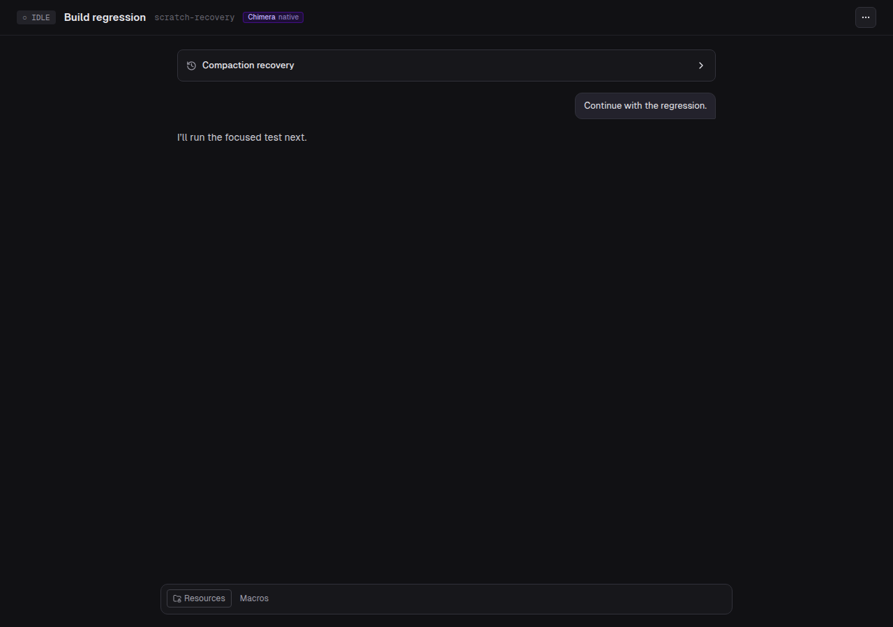
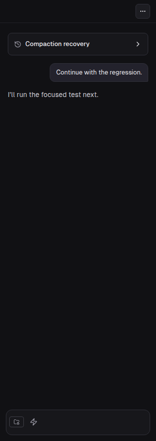
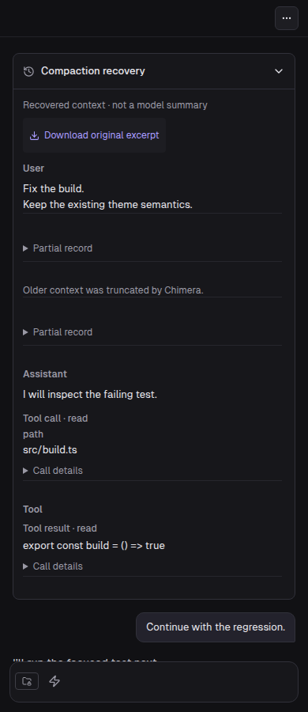
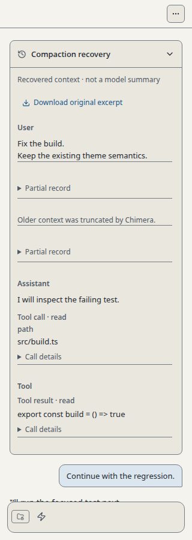
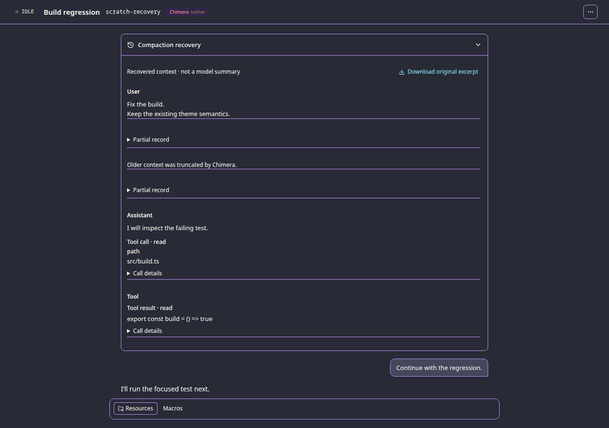

# Native Chimera recovery excerpt — verification

Task `2ghzgdju`, 2026-11-15. Base: Legato `c4d31787` (recent native integration
PR #93 and agent-health PR #96 included). Separate branch:
`legato/2ghzgdju-recovery-context-ui`.

## User path and scope

Chimera `packages/compaction/src/compactor.ts:282,324` produces an assistant
summary beginning with the exact recovery envelope, serialized conversation and
sometimes files/tasks/archive blocks. `boundText` may cut through JSON strings.
`core/src/events.ts` emits `compaction_finished` with summary/warnings; the
snapshot exposes ordinary role/content messages, **no recovery metadata**.
Legato's native stream and snapshot proxy already pass these through.

The native panel now refreshes on the explicit completion event, including
manual compaction without a run end. Its existing snapshot/replay machinery
supplies the actual rewritten conversation; the UI does not append an extra
summary or duplicate the previous conversation. A narrowly anchored historical
fallback recognizes the generated assistant envelope only for Chimera. No
arbitrary substring matching, new wire metadata or upstream changes.

The collapsed **Compaction recovery** row opens a bounded, keyboard-scrollable
view: role-labelled prose, named tool calls/results and context records. Partial
serialized fragments remain separately folded and the truncation gap is marked.
The download is exactly the original supplied excerpt. Recovered text is inert.
Ordinary messages and streaming keep their existing rendering paths.

**No live instance writes/restarts, model-input changes, compaction changes,
backend changes, CI edits or theme-file edits.**

## Tests and checks

- Initial full web suite: **219 files / 1,622 tests passed**. A final full repeat
  had **1,621 passed / 1 failed** in the unchanged Reports sorting test
  (`ReportsPage.test.tsx:129`, expected descending, observed none); that file's
  isolated rerun passed all 9 tests. Reports and its dependencies do not import
  this component. Its mount-time sort-reset effect is a possible timing cause,
  not a proved diagnosis. No retries/timeouts/assertions or unrelated code were
  changed to hide the failure. The final whole-suite repeat is **not all green**.
- Final focused panel + native sync tests: **119 passed**.
- TypeScript build, ESLint, production Vite/PWA build: **passed**. Existing large
  chunk and stale Browserslist warnings remain.
- Both new rendering/lifecycle regressions **fail with only the panel integration
  removed**, then pass after exact restoration. The readable tool-label assertion
  also failed before the structured content refinement.
- Test audit: three declarations / six new cases retained; no test-only production
  exports or injection seams. Distinct contracts: historical rendering/toggle;
  completion + truncated download + replay/reconnect; ordinary/provider isolation.
  Existing streaming/native sync tests remain unchanged. No redundant tests cut.
- `git diff --check`, generator/browser-script syntax checks: passed.
- Actual upstream compactor invocation generated complete and byte-truncated
  fixtures in an isolated temporary home; source provenance is in
  `contracts/chimera-recovery/README.md`.

Commands use the installed `web/node_modules` executables directly. The normal
pnpm command tried to auto-install and could not open its out-of-sandbox SQLite
store; no package or lockfile changes were made to bypass that.

## Inspected Chromium evidence

`web/src/test/recovery-preview.html` mounts the **real NativeAgentPanel**, with
fixture-only API replies and a scratch WebSocket origin. No real Legato server or
agent is used. `scripts/verify-chimera-recovery.mjs` launches a private headless
Chromium and enforces a loopback-only fixture URL.

**15 width/theme cases passed**: task baseline Legato at 1280/390/320px, and
pinned #97 head at those widths in Legato/Dracula/Ocular Light/Ocular Dark.
Each checks default collapse, keyboard expansion, readable retained records,
closed partials, partial expansion, bounded height, horizontal overflow,
body/muted/link contrast >=4.5:1, visible >=2px focus with >=3:1 contrast, and exact
original-text download. A complete
(untruncated) excerpt is also expanded on each source tree. Results:

- [Task baseline results](chimera-recovery-evidence/default-results.json)
- [Pinned theme PR results](chimera-recovery-evidence/theme97-5db3018-results.json)

Inspected captures (not native shell/device screenshots):











To reproduce against a private Vite server (never a live Legato origin):

```sh
# Terminal 1, from web/: no live app is needed by this fixture.
node node_modules/vite/bin/vite.js --host 127.0.0.1 --port 4197 --strictPort
# Terminal 2, from repository root; Playwright must be installed.
# PLAYWRIGHT_MODULE can name its absolute index.mjs; CHROMIUM_PATH selects Chromium.
node scripts/verify-chimera-recovery.mjs http://127.0.0.1:4197 /tmp/recovery-evidence
```

The recommended `autopilot-playwright` distrobox was absent. The installed
Playwright CLI also defaulted to unavailable Chrome; verification instead used
installed Playwright Core with cached Chromium, through approved host tool calls.
No browsers attached to an operator profile.

## Theme coordination and limits

Theme evidence is pinned to PR **#97 head
`5db3018e154a50cf267eb3f61f9c499742693c72`**, not its newer material refinements.
A disposable source copy of that head plus this recovery diff passed **87 panel
and conversation-theme tests**. The #97 native panel patch applies cleanly to
this work; the theme PR's existing test assertion was retained in the combined
copy (copying the old whole test file initially overwrote it; applying only the
recovery test diff resolved that test-assembly error).

Agent `k9oh81yb` confirmed that its current head remained `5db3018`, refinements
were uncommitted, and this component's role vocabulary is correct: panel
`lw-surface`, hover `lw-raised`, contrast-safe `text/text-2/link`, strong control
border, ordinary decorative separators, unchanged focus role. No shared theme
files were touched. The new controls use named-theme `--theme-focus`, with the
existing brighter Legato accent as the default fallback (the incumbent
`lw-accent-ring` was only 2.47:1 against this panel). The theme agent confirmed
this local fallback is appropriate. The minimum measured focus contrast across
the pinned-theme matrix is 3.90:1.

**Those unpushed material refinements are not verified here;
these screenshots do not establish parity with them.** Delivery does not wait
for that separate work.

Other exact limits: this is actual Chromium rendering of real compactor output
from synthetic input, **not a production transcript, live-provider compaction,
new live-server integration run, native desktop/WebKit or physical mobile test**.
The fixture-level API/WebSocket boundaries are controlled, while panel rendering
and native synchronization are real code. No full Go suite was run (no Go
changes); no site build (site dependencies are not installed in this clone).
Malformed partial JSON cannot reconstruct context already discarded
upstream; fragments remain accessible and the source download is lossless with
respect to what Chimera supplied. A future upstream metadata contract can
replace the exact-envelope historical fallback. Scratch Vite/browser processes
and disposable theme folders are cleaned up after verification.
