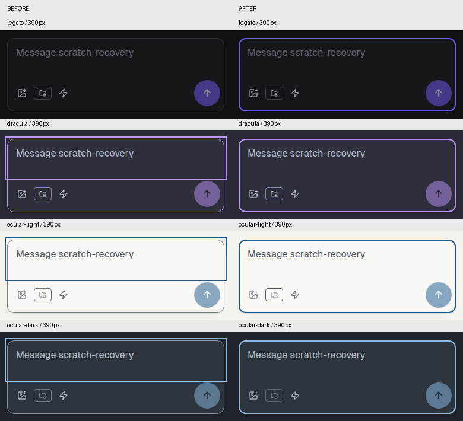
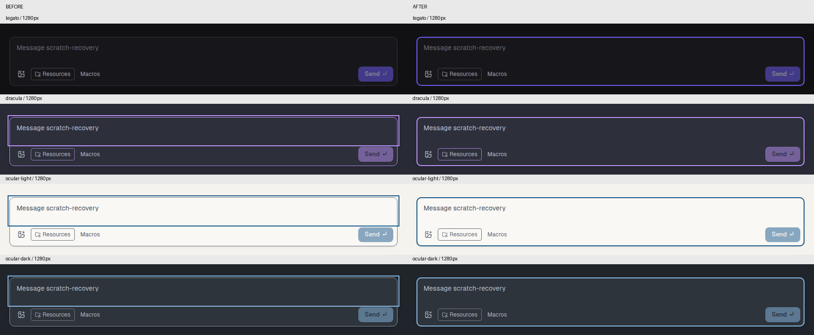

# Native composer focus — xlrktw1r

## Finding and fix

Reproduced in real Chromium with the production `NativeAgentPanel` and application CSS, using the existing isolated recovery fixture with its composer enabled. No live Legato API, agent, configuration or running process was changed.

The named-theme selector `:root[data-theme]:not([data-theme="legato"]) :focus-visible` has higher specificity than the textarea's `focus:outline-none`. It paints a 2px outline with a 3px outward offset around the square textarea, which is only the upper portion of the rounded composer. This creates the reported bright rectangle beyond both sides of the control. The default Legato theme instead had no explicit text-focus cue.

The fix scopes a textarea override to `.native-agent-composer` and transfers its visible-focus cue to that compound control's existing rounded boundary: a 2px solid inset outline, offset -2px, using the shared theme focus role (existing Legato accent fallback). It does not alter the global focus rule, toolbar focus, border/status styles or panel shadows. No overflow clipping or blanket focus removal.

## Before / after

Each row is a theme; before is left and after is right. These are crops of actual keyboard-focused screenshots, not mock-ups. The original pasted image was not mounted in this checkout; the operator confirmed that this independent reproduction matches it.





## Verification

- Browser regression first failed on the unfixed production styles: the rounded control had no focus cue. The before captures also reproduce the square outward outline in all three named themes.
- `scripts/verify-composer-focus.mjs`: **12 cases passed**, four themes × 1280/390/320px; real Tab/Shift+Tab focus, editable text, Tab into a toolbar button with its own visible outline, cleared parent cue on blur, mouse/touch focus, no horizontal overflow, rounded inset geometry and focus contrast ≥3:1. No browser page errors.
- Focus/surface contrast: Legato **3.90:1**, Dracula **5.50:1**, Ocular Light **7.16:1**, Ocular Dark **6.20:1**.
- `pnpm -C web test`: **226 files / 1,668 tests passed**.
- `pnpm -C web exec tsc -b`, `pnpm -C web lint`, `pnpm -C web themes:check`: passed.
- `pnpm -C web exec vite build --outDir /tmp/composer-build`: passed; existing chunk-size and stale Browserslist warnings. Build output was disposable, not live embedded assets.
- `git diff --check`: passed.
- Test audit: one parameterized browser regression kept (12 cases), no duplicate jsdom/source-string assertions added. It exercises the actual rendered composer and CSS cascade; replacing the component with an unimplemented body fails. The fixture reuses its existing controlled API/WS boundaries.

Re-run from the repository root (Playwright must be installed, or supply `PLAYWRIGHT_MODULE` and optionally `CHROMIUM_PATH`):

```bash
# Terminal 1: isolated fixture server, not a running Legato.
pnpm -C web exec vite --host 127.0.0.1 --port 4197 --strictPort
# Terminal 2:
node scripts/verify-composer-focus.mjs http://127.0.0.1:4197 /tmp/composer-after
# --capture-only records appearance without enforcing the new outline contract.
```

## Limits

Chrome for Testing 155.0.8059.12, isolated browser profiles and fixture-only networking. The recommended distrobox was unavailable, so the installed Playwright Core and cached Chromium were used instead. Mobile checks use touch-enabled browser emulation, not physical phones, native WebViews, Safari/WebKit or a live backend. No Go code changed and no Go suite was run. The site build was not run because its dependencies are not installed in this clone. The standalone browser regression is explicitly invoked, following the existing verification-script pattern; it is not part of Vitest. The scratch server/browser are stopped after verification. No live rebuild/restart or global config edits.
