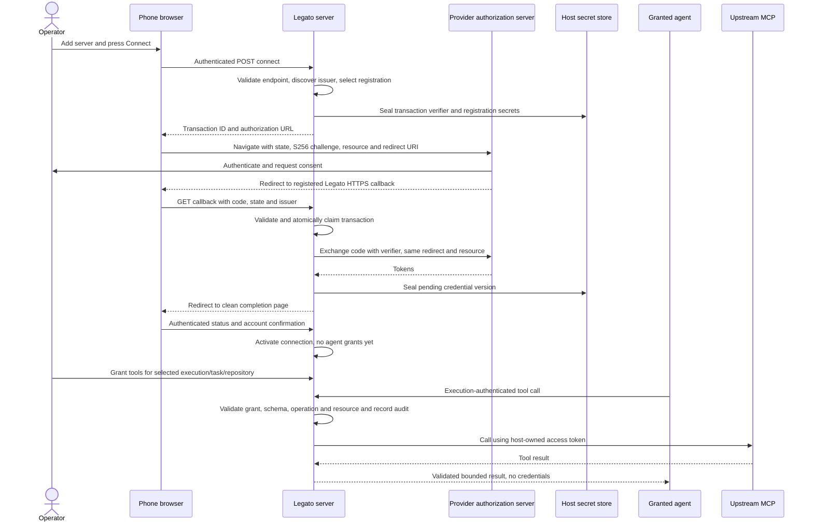

# LEG-199: instance-owned MCP broker and phone-safe OAuth

Status: historical investigation; its direct public HTTPS callback recommendation is superseded by [the app/local-web decision](leg-199-app-local-callbacks.md) and proposal revision 3. No implementation or approval.
Evidence date: 2026-11-15. Repository baseline: `8e577f8f6051f03aa2a06857dd43a27c405973d9`.

Scenario follow-up: [executed observations and design corrections](leg-199-mcp-scenarios.md). The revised plan makes callback declaration automatic through usable CIMD/DCR. Manual provider registration is an advanced compatibility branch. Canonical-address setup is once per instance, available from phone Settings when no pinned address exists. No feature implementation has started.

## Recommendation

Legato should act as the OAuth client and MCP broker. The phone is only the operator interface and consent browser. Legato creates each OAuth transaction, receives the callback, exchanges the code, and keeps credentials in its existing host secret store. Agents receive permitted tool definitions and execution-bound broker access, never upstream credentials.

Use a trusted canonical HTTPS callback origin once per instance, normally a pinned `web.public_url`. If none exists, the revised plan adds operator-approved origin setup through Settings, not a required host-file edit. Legato generates each redirect URI and declares it through CIMD or DCR; normal setup has no manual per-MCP redirect field. Do not infer authority from `Host`, `Forwarded`, or `X-Forwarded-*`. Start with remote Streamable HTTP MCP servers and local controlled agents. Keep worker forwarding and arbitrary subprocess servers disabled until their separate security work is approved.

**A phone can complete this flow without copying codes or callback URLs.** The phone browser must reach the configured Legato callback. The provider redirects the browser; it does not deliver the callback through a provider-to-Legato network connection. CIMD has a separate requirement: the provider must fetch a public HTTPS client metadata document.

## Scope and evidence limits

Cameron supplied the authoritative LEG-199 text in this investigation. Native Burnlite calls failed with the separate Chimera JSON Schema 2020-12 error. The documented CLI was unavailable in this environment. No further access attempt is needed.

LEG-199 asks for named server administration, centralized OAuth, controlled Claude/Chimera/Codex injection, real caller audit, and clear failure states. Central authentication must not grant every agent every tool. The latest requirement makes server-owned phone callbacks mandatory.

This investigation read repository code and architecture, credential, OAuth/integration, configuration/settings, sandbox, native agent, desktop, web, sync, and worker documentation. Two read-only subagents inspected integration seams. No live provider registration, login, credential access, deployment, configuration change, install, or running-instance test occurred. Provider compatibility below is documented, not measured against a live account.

## What exists and what must change

| Existing evidence | Consequence for this design |
| --- | --- |
| `internal/server/burnlite_settings.go:37-43,68` derives the callback from `r.TLS` and `r.Host`. | Burnlite web OAuth already exchanges on the server, but its redirect origin is not configured or proxy-safe. Do not copy this origin logic. |
| `config/config.go:303-306,563-566` defines `web.public_url` and only checks HTTP(S) plus host. `cmd/legato/approval_runtime.go:167-188` uses it for links. | Reuse its intent, but apply stricter OAuth validation: HTTPS, fixed authority, no userinfo/query/fragment; first version supports origin-root deployment only. Setting this value does not configure DNS, routes, certificates, or a proxy. |
| `internal/service/burnlite_settings.go:69-77,126-157` keeps attempts in a process-local map for ten minutes and consumes by state. | Use shared durable transactions, atomic single-use settlement, instance binding, and connection generations across web processes and restarts. |
| `internal/server/burnlite_settings.go:77-89` puts `err.Error()` in a second redirect URL. `internal/engine/oauthclient/errors.go:42-65` includes provider descriptions. | Return stable safe error codes. Never reflect provider descriptions, codes, tokens, or raw response bodies into URLs or logs. |
| `internal/engine/oauthclient/oauthclient.go:40-119`, `register.go:35-81`, `authorize.go:180-204` implement root PRM discovery, DCR, state and PKCE. | Current helper is not a complete current-spec client: add challenge/path PRM and OIDC discovery, registration options, strict S256 checks and callback issuer checks. Prefer shared SDK primitives rather than another independent OAuth implementation. |
| `internal/service/integration_connect.go:139-163` seals refresh/client secrets but requires a refresh token. `internal/service/oauth_tokens.go:55-122` refreshes with a local mutex and rereads after `invalid_grant`. | Reuse custody, but support providers without refresh tokens, serialize across processes, and prevent stale attempts from replacing a connection. |
| `internal/service/credential_secrets.go:24-73` owns lazy master-key loading and sealed storage. `internal/service/credential_broker.go:784,1022,1081` owns access requests, authorization and consumption. | Extend the credential broker with host-only MCP connection profiles and scoped tool operations. Do not fork storage or expose OAuth material through `credential exec`/read. |
| `internal/cli/mcp_broker.go:15-84` already relays `mcp.list`/`mcp.call` through the host broker. `internal/cli/broker.go:54-77` resolves execution from a hashed broker token. | Extend this trusted caller path. Do not trust task/execution IDs supplied inside tool arguments. |
| `internal/engine/mcpserver/server.go:145-161` relays raw schemas and sets destructive/open-world hints false. | This is suitable for trusted internal relay only. An upstream relay needs separate untrusted-schema/result handling and conservative annotations. |
| `internal/engine/hooks/chimera_mod.go:21-43`, `codex.go:160-172`, `claudemod/tools/.mcp.json:1-8` inject Legato MCP. | Keep the existing adapter channels. Do not inject upstream OAuth configs or create independent per-agent connections. |
| `docs/ai/agent-mcp.md:405` documents startup-only discovery. Claude's tool hook auto-allows the Legato namespace. | Revocation must be enforced host-side immediately. Do not treat namespace auto-allow as operation approval. Additions can require explicit agent reload; no automatic disruption. |
| `internal/server/server.go:500-555` uses the shared full web bearer token and leaves non-API paths public. | Callback needs no bearer token, but gets only transaction authority. Administration must explicitly require operator authority, not generic agent/Reeve/scoped tokens. |
| `web/src/lib/serverPages.ts:6-11` excludes `/oauth/` from SPA fallback; `web/vite.config.ts:64-78` caches API responses. | Keep callbacks server-only. Exclude all MCP auth/admin/status responses from service-worker runtime caching, regardless of `no-store`. |
| `internal/server/integrations.go:76-115`, `internal/service/integration_tokens.go:139-150` restrict paired mains to handoff/Reeve scopes. | Pairing is not MCP delegation. No implicit new scope, token copying, or cross-instance ownership. |

## Current specification and official implementation findings

The current released MCP revision is **2026-07-28**, identified as latest by the official specification [S1–S5]. The older 2025-11-25 page is useful for deployed compatibility, not the current baseline.

- Authorization is optional. The specified OAuth flow applies to HTTP transports; STDIO does not automatically use this OAuth scheme [S1].
- Discover protected-resource metadata from `WWW-Authenticate.resource_metadata`, otherwise the path-specific then root well-known location. Discover the selected issuer through RFC 8414/OIDC fallbacks. Validate exact issuer identity [S2]. Do not invent `/authorize`, `/token`, or `/register` endpoints.
- Use supplied pre-registration first, advertised CIMD next, and advertised DCR as a compatibility fallback [S3]. DCR is deprecated, not universally available. Registration can require prior authorization or administrative approval.
- CIMD requires an HTTPS URL with a path, matching `client_id`, client name, and exact redirect URI list. The provider fetches it and may apply trust/domain restrictions [S3]. A private VPN-only metadata URL normally fails this requirement for an Internet provider. Do not publish wildcard instance callbacks in a shared vendor document.
- For a server-owned remote web callback, register `application_type: web`. Native loopback deployment uses `native` where appropriate. OIDC servers can enforce different redirect restrictions [S3]. Never retry with a misleading application type to bypass policy.
- Redirects must be registered and match exactly, apart from applicable native loopback-port rules. Arbitrary callbacks, private hostnames, self-signed TLS, and custom schemes are not universally accepted [S3,S4,S8].
- Verify advertised PKCE **S256** support. Send `resource` for the configured MCP audience in authorization and token requests, including refresh. Keep tokens bound to issuer, client registration, resource and connection [S1,S4]. A general API token is not automatically an MCP token.
- Record the exact discovered issuer before redirect. Validate `iss` before code exchange, including error responses. If issuer metadata advertises `iss`, absence is an error. Otherwise absence is permitted; a present value must match exactly without normalization [S1].
- Use challenge scopes for the requested operation. Without a challenge, follow PRM scopes, omitting scope when unspecified. Show requested scopes to the operator. Step-up requires consent, bounded retries, and scope union; it does not widen agent grants [S1]. Request `offline_access` only when the issuer advertises it and refresh is wanted. Refresh tokens are not guaranteed.

### SDK selection

Legato already pins official Go SDK **v1.8.0** (`go.mod:22`). Its cached source has `auth.AuthorizationCodeHandler`, `AuthorizationCodeFetcher`, `RedirectURL`, registration choices, `InitialTokenSource` and `NewTokenSource`. This supports a server-owned adapter; the SDK does not require a phone-local listener [S6].

Do not enable SDK defaults without checking them:

- v1.8.0 `auth/authorization_code.go:76-83,545-594` tries CIMD before pre-registration. Configure the selected strategy explicitly to preserve the specification's priority.
- `AcceptUnadvertisedIss` defaults false (`:127-131,630-651`); the current spec requires comparing and accepting a matching present issuer even when unadvertised. Configure this policy and test it.
- `oauthex/auth_meta.go:161` checks for a nonempty PKCE method list, not specifically S256. Enforce S256 at the boundary.
- DCR registration persistence and no-refresh expiry need explicit tests. Official issues #1416 and #1417 describe v1.8.0 failure paths; they now show closed, but that does not patch the repository's pinned version [S7].
- The SDK's code fetcher owns verifier state inside an authorization call. It is not by itself a durable cross-process transaction store. Use its discovery/registration primitives behind a service-owned transaction engine, or add a persistence adapter with verified guarantees. Do not keep only a goroutine waiting for consent.
- The pinned SDK falls back to guessed `/authorize`, `/token` and `/register` endpoints when authorization-server metadata is absent (`auth/authorization_code.go:310-338`). The follow-up scenario reproduces this behavior. Strict discovery preflight must prevent this legacy downgrade; using the SDK alone does not enforce the proposed policy.
- Negotiate protocol revisions. July 2026 uses stateless discovery and request metadata; 2025 clients use initialization/session behavior. Keep transport lifecycle separate from durable OAuth connection state [S5,S6].

## Phone → provider → Legato sequence

All route names below are **proposed Legato routes**, not claims about existing routes or provider endpoints.

1. **Initiate.** An authenticated operator posts the configured connection ID, not arbitrary endpoints, to Connect. Legato checks administration authority and expected connection version. Use request forgery protection and strict JSON/body limits. Agents cannot call this operation.
2. **Create.** Legato generates independent cryptographically random transaction ID, state and PKCE verifier. Persist state hash, sealed verifier, operator authority/generation, instance ID, connection ID/version, exact issuer, resource, redirect URI, selected client registration/version, requested scopes, expiry and allowed completion destination. Default expiry: ten minutes. State contains no identity or credential data.
3. **Navigate.** Return an authorization URL to the operator UI only. It includes state and challenge, never verifier or client secret. Open a top-level provider browser, not an agent conversation or an embedded credential form. Store no upstream auth material in localStorage, sessionStorage, analytics or crash reports.
4. **Receive.** The provider redirects the phone browser to the registered HTTPS callback on the initiating instance. The callback is public because a provider navigation cannot send Legato's bearer header. Validate the configured callback authority at routing, strict parameter cardinality, transaction state, expiry, instance, issuer, connection generation and registered redirect. Ignore arbitrary `return_to`, host and token endpoint inputs.
5. **Settle once.** Claim the transaction atomically across processes. Reject unknown/replayed/expired states without revealing connection details. On a valid denial, mark denied without token exchange. An issuer mismatch is rejected before displaying provider error text or contacting any token endpoint.
6. **Exchange.** Legato sends the code, sealed verifier, same redirect URI, client ID, resource and registered client authentication method to the pinned validated token endpoint over HTTPS. The callback's browser disconnect must not cancel a claimed exchange. Bound work by a server-owned timeout. Codes stay in memory; do not persist raw callbacks.
7. **Stage and confirm.** Seal the token bundle as a pending credential version. Redirect immediately with `303` to a clean fixed completion URL carrying only a non-authorizing transaction handle. An authenticated operator then sees the connection/resource, scopes and provider account/workspace where supported, and presses **Use connection**. Only that authority can activate it. If provider identity cannot be established, say so and require explicit confirmation of the intended account. Callback possession alone cannot activate tools.
8. **Grant separately.** Activation authorizes Legato to use the upstream account. An explicit local tool grant is still required for every controlled agent. OAuth scopes are not agent permissions.

### Operator identity and cross-device resume

Current web authentication is one shared instance bearer token, not a multi-user account system (`web/src/lib/auth.ts`, `internal/server/server.go:500-555`). Do not claim individual identity from it. First version binds to the instance's operator authority and its credential generation; record a verified device ID when available. A rotated/revoked operator authority invalidates pending attempts. True per-person multi-user ownership needs separate authentication work.

No callback cookie is required. A PWA, native shell, or desktop can start consent in an external browser with no Legato login. That browser can settle only the bound pending transaction. The original authenticated UI polls status on foreground/reload and confirms activation. Another already-authenticated device with the same operator authority can resume from Settings. Never transfer the bearer token or callback code to make this work. A completion handle is not a login or an activation capability.

Final confirmation also limits account-injection/login-CSRF from a shared authorization URL. Treat the authorization URL and state as sensitive even though they are not tokens. Require fresh authenticated activation; show the resource/account before replacement. Do not silently attach the callback browser's account to an active connection.

### Secret and URL hygiene

Use the existing sealed store and key sources for verifier, client secret, refresh token, and any persisted access token. Keep access tokens in broker memory where possible. Providers without refresh tokens need sealed access/expiry if restart continuity is promised; otherwise explicitly require re-auth after restart. Do not make these secrets readable through generic agent credential operations.

Send `Cache-Control: no-store`, `Referrer-Policy: no-referrer` and restrictive CSP on callback/completion responses. Serve the callback before the SPA, with no third-party scripts/assets and no service-worker interception. Never cache auth status/admin APIs. Suppress callback query strings, authorization headers, token exchange bodies and provider error descriptions in application, proxy and tracing logs. Test this with secret sentinels.

The provider's standard frontchannel callback necessarily contains a short-lived code/state in its request URL. A fast redirect to a clean URL limits exposure; Legato cannot guarantee that the browser or provider erases every historical entry. Do not copy those values into another URL, local storage, logs or conversation. Deployment documentation must require query redaction at TLS-terminating proxies too. A trusted proxy can see the callback code even with PKCE; proxy compromise remains a trust risk.

## Reachability and registration tradeoffs

| Deployment | Phone flow | Conditions and limits |
| --- | --- | --- |
| Configured public HTTPS origin with existing reverse proxy | Recommended where already available. | Phone reaches callback; Legato reaches provider/MCP. Proxy must forward exact callback path and redact query logs. Never trust arbitrary forwarded headers to construct redirects. Adds public attack surface; no proxy deployment is authorized here. |
| LAN/VPN HTTPS origin | Valid when provider permits that registered redirect. | Phone's system browser, not just the paired app, needs DNS, network route and trusted TLS to Legato. Provider need not reach callback. CIMD may need a separately public metadata document or pre-registration/DCR instead. |
| Self-signed TLS accepted only by paired app | Not sufficient by itself. | App certificate pinning does not transfer to the external phone browser. Use browser-trusted TLS or explicitly establish browser trust outside this implementation. Do not disable verification. |
| Loopback-only server, browser on the same computer | Can support native loopback registration. | Loopback is that browser's machine. This is not phone-safe and must not be offered as the phone solution. |
| Phone cannot reach Legato callback origin | Direct callback cannot complete. | Restore a supported network route, or use an explicitly supported alternative. Do not suggest pasting the failed callback. A browser retry can work before expiry if reachability returns. |
| Supported device authorization | Optional later provider-specific adapter. | RFC 8628 requires provider support and an allowed grant/client/resource. Legato keeps device code and polls; phone uses provider verification URI, optionally complete URI. No callback needed, but not core universal MCP auth. Codes never enter conversation. Respect `authorization_pending`, `slow_down`, denial and expiry [S9]. |
| Hosted relay | Separate design, not first version. | Provider must accept relay redirect. Relay becomes available and trusted infrastructure that sees code/state and connection metadata. Use authenticated instance-bound outbound delivery, PKCE kept on owning instance, replay/expiry checks, and no browser-chosen destinations. Plain redirect from relay to unreachable LAN origin solves nothing. No existing Legato relay was verified. |

CIMD and callback reachability are independent. A public metadata host can describe a fixed private callback only if the provider permits it. That host must not let strangers amend redirect lists. A vendor-wide metadata document cannot safely cover arbitrary private instance URLs without an ownership/registration service and a new trust model.

### Desktop, PWA and instance ownership

Legato desktop is a client for paired servers, not an OAuth authority merely because it runs locally (`docs/ai/desktop.md`, `desktop/src-tauri/src/links.rs`). Its external links open the system browser. The selected server instance owns callback and secrets, even when the shell and server happen to share a machine. No special desktop token exchange or phone-local callback is needed.

The PWA can return in a different browser context. Keep consent progress on the server and resume on foreground; do not depend on `window.opener` or `postMessage` token delivery. Development proxying must explicitly send the callback to the scratch backend; current Vite development proxy does not provide that path.

A worker's connection is worker-owned; a main's connection is main-owned. In the first version the operator must connect on the instance that will execute the tools. UI labels show the instance ID/name, callback origin and secret owner. Main/worker pairing does not share accounts, secrets, grants or OAuth transactions.

Later worker forwarding can keep a main's tokens on the main, but needs a separate MCP delegation protocol. The owner must authorize the paired worker, handoff, execution, tool and resource. Use pinned transport, short-lived audience-bound capability, expiry, replay protection, both-instance audit and immediate unpair revocation. The owner must independently map the handoff identity; worker-supplied task IDs are not proof. Current mains initiate all worker connections, so a worker-to-main RPC requires explicit network/routing design, not reuse of an assumed reverse path. A compromised worker remains within its delegation blast radius; never claim it can be fully trusted to attest its own agent behavior.

## Connection lifecycle and concurrency

Store configuration, authorization and runtime health separately:

- **Configured:** named endpoint/transport and policy exist; enabled is a separate switch.
- **Authorized:** active credential version has issuer/resource/scopes and expiry. `pending`, `awaiting_confirmation`, `reauth_required` and `revoked` are explicit states.
- **Connected:** MCP discovery/transport recently succeeded. A token alone does not establish this.
- **Usable for this execution:** enabled + authorized + healthy compatible tool + a valid local grant. UI must explain the failing condition.

Concurrent attempts have independent state/verifiers. Activation uses compare-and-swap on the connection generation. A stale attempt never overwrites a newer activation; the operator can start over deliberately. Reload reuses server status, not a new registration. Persist transactions across web processes; only the lock-owning broker exchanges/refreshes, with durable claims/fencing for owner takeover.

Cancellation invalidates the attempt and removes staged secrets; a late callback is refused. Expiry sweeps verifier and staged tokens. A valid provider denial has a safe visible status. Provider/network/discovery errors have bounded retries and distinct safe error codes. If a process fails after code exchange but before storing tokens, do not repeatedly redeem the code: require a fresh attempt and report the interrupted state.

Persist registration per instance/issuer/redirect/client-auth configuration. Do not register on every agent spawn or refresh. Origin or issuer changes require new validation/registration and explicit consent; never send an old secret to a new issuer. Respect registration/client-secret expiry and supported authentication method (`none`, `client_secret_basic`, `client_secret_post`, or separately supported key auth). Burnlite's current forced-secret behavior is a provider compatibility case, not a universal method.

Refresh has one owner and a per-connection critical section. Persist rotated refresh state before publishing access tokens. Cross-process fencing and secret/database version checks prevent old owners from restoring old credentials. On `invalid_grant`, mark re-auth required; on transient failure, show retryable status rather than forgetting credentials. Without a refresh token, permit the session until access expiry and then require operator re-auth. Do not launch a browser from an agent call.

Disable/disconnect first increments generation, revokes local grants and blocks new dispatch. Cancel pending attempts, close transports and discard cached catalogs/access tokens. Use an advertised revocation endpoint where supported; report provider revocation as confirmed, pending or unsupported. Local disconnect is not proof of upstream revocation. In-flight mutations may already have happened; do not claim rollback. After local credentials are removed, direct the operator to the provider's documented account controls if necessary. DCR client deletion needs supported registration management; it is not implied by token revocation.

## Broker authorization and injection

Use the existing host broker as the authority. A service-layer MCP connection manager owns configuration, OAuth lifecycle, tool catalog and policy; engine transport/discovery packages remain independent. Store APIs own persistence. CLI MCP and server handlers call the service, never implement parallel policy. Wire the same manager into TUI-embedded and standalone web processes, routing work to the current broker owner.

Reuse credential broker approvals, grants, limits, read-only enforcement and audit. Add host-only MCP credential profiles that support tool usage but prohibit raw-secret operations. Model an operation as a stable connection/tool identity, with optional reviewed argument-to-resource extractors. A grant contains execution, task, repository, tool/operation, resource constraints, expiry/use limits and approval provenance. Combine constraints by intersection. No grant means denial. Persistent task/repository templates create new execution grants only after policy evaluation; they are not reusable session bearer tokens.

Tool names are namespaced by stable connection identity. Keep operator-facing names separate from stable IDs. Never let an upstream tool shadow Legato administration or local tools. Check grants both on discovery and on **every** call, including manually constructed or stale catalog calls. Audit denied/unknown calls too, with bounded safe IDs. Attribute instance, execution, task, slot, repository, connection, tool, decision and outcome. Avoid raw arguments/results in audit; provider audit will generally see one operator connection, while Legato records agent attribution. Do not promise upstream per-agent identity support.

The Claude hook and Chimera trusted tools currently suppress native prompts for Legato tools. Host-side operation approvals must remain authoritative. Never classify arbitrary upstream tools as safe because they share this namespace, or trust upstream `readOnlyHint`. Read-only sessions receive only reviewed read operations; unknown/mutating operations are refused regardless of annotation. A tool grant is not an unrestricted HTTP proxy or credential-read grant.

### Claude, Chimera, Codex and live sessions

Keep each adapter's existing `legato mcp serve` entry. Route upstream calls through execution-authenticated host relay for sandboxed and unsandboxed controlled sessions. Fail closed when broker identity is missing; do not fall back to direct database/token access.

First version: catalog additions/definition changes are visible on **new sessions or an operator-requested reload**. Existing sessions show “Reload agent to update tools.” No automatic restart, interruption, or reload. Removal/revocation takes effect immediately at host dispatch even if the model still sees stale definitions. Reload/resume gets a new execution and reevaluates grants without OAuth login. Validate this separately for Claude plugin, Chimera mod/legacy path and Codex launch overrides. If an installed client cannot represent a schema, show unsupported instead of claiming injection succeeded.

Later live catalog work can use protocol-version-appropriate change notifications/subscriptions, but only after proving each installed agent refreshes its model tool set. Sending a notification alone is not end-to-end support. A generic unrestricted `call_any_tool` is not a fallback.

## Untrusted upstream boundaries

- Treat endpoint entry as operator-authorized server egress. Default remote upstreams to HTTPS. Reject userinfo/fragments; bound ports, redirects and metadata sizes. Apply policy at every metadata, registration, token, revocation, MCP and redirect hop. Pin DNS resolution to the validated dial address, handle IPv4/IPv6/mapped forms and rebinding, and never forward bearer auth across origin redirects. Block cloud metadata, loopback, link-local and private networks by default; allow precise private endpoints only through explicit operator policy for LAN services. A metadata-advertised URL is not automatically trusted.
- An OAuth endpoint can legitimately use a different issuer host. Validate discovery relationships, show that host, and require policy rather than assuming all hosts match or allowing arbitrary destinations. Proxy environment behavior must not bypass egress controls.
- Leave subprocess transport out of the first version. Later require explicit executable/argv/cwd, no shell interpolation, reviewed binaries, restricted environment and filesystem/network sandbox, bounded output and process cleanup. Never run `npx`/package install from an imported MCP config. Local subprocesses are executable code, not just URLs.
- Validate upstream protocol envelopes, catalog count/size, tool names, input/output schemas and content block types. Support JSON Schema 2020-12 with local references and no network `$ref` resolution. Bound schema complexity and validation time. Preserve upstream semantics; do not blindly strip nullable types or constraints to satisfy a model provider. Keep original validation and an explicitly tested client-compatible representation; reject tools that cannot be represented safely.
- The current Chimera `$schema` resolver error is separately assigned. LEG-199 must not depend on it disappearing: test supported/unsupported schema paths and show per-tool diagnostics without hiding the whole connection. The existing relay does not supply this validation.
- Validate arguments before dispatch and structured results against declared output schema. Bound text/images/binary payloads and timeouts; do not fetch arbitrary result URLs. Preserve MCP errors in a safe structured form. Do not claim schema validation makes returned text trustworthy or guarantees a malicious upstream cannot leak its own data. Suppress known credential material, but minimize upstream trust because generic text cannot be proven secret-free.
- Treat tool descriptions, server instructions, annotations and results as untrusted data. Do not merge upstream instructions into privileged system guidance. Changes to approved tool definitions invalidate/review affected grants. Disable sampling, roots, automatic elicitation, arbitrary URL opening and server-driven credential collection initially. No upstream prompt can grant itself more tools or network access.
- Do not automatically retry mutating calls after ambiguous transport failure, auth step-up or broker restart. Surface “outcome unknown” unless provider idempotency establishes safe retry. Check policy again on any retry.

## Compatibility examples and limits

**Burnlite:** repository integration proves server code exchange, a fixed read scope, a client-secret compatibility case and sealed refresh custody. Ticket-source OAuth currently asks `read:tasks`; LEG-199 agent operations may require different scopes. Do not assume that source connection permits task mutations. First implementation must inspect discovered Burnlite capabilities and verify two granted agents against a fake or separately approved scratch server; real provider permission tests need later authorization.

**Notion:** official client guide documents Streamable HTTP, PKCE, discovery, CIMD/DCR, resource binding, refresh and secure storage [S10]. It demonstrates a viable remote flow, not acceptance of every Legato callback, TLS certificate or client trust domain. Its MCP token is not a Notion REST API token. Workspace/account identity can be shown when returned by the provider.

**GitHub:** official setup docs describe OAuth access-policy restrictions on each client's OAuth App [S11]. Existing Legato GitHub App/proxy access does not automatically register a GitHub MCP OAuth client. No claim of DCR/device-flow support follows from this source.

No universal promise covers arbitrary providers, redirect origins, DCR, CIMD, refresh tokens, revocation, device grants or live tool reload. Present unsupported capability as an actionable limit, not a silent empty tool catalog.

## Acceptance: phone end to end (future test, not executed)

Use an isolated Legato with its own database, config, key source, runtime directory, tmux server and port. Use a fake OAuth authorization server and MCP resource with browser-trusted HTTPS on a pre-authorized test network. No production accounts or running-instance changes.

1. Open the scratch Legato from a phone-sized browser and from a real phone before release. Authenticate as its operator. Add the fake Burnlite-like server and press Connect.
2. Assert the server creates the transaction. Inspect the provider request: registered server HTTPS redirect, S256 challenge, state, intended scopes and resource. Assert it contains no verifier/client secret. Assert no phone-loopback URL is offered.
3. Consent in the external provider browser. Assert the browser requests the Legato callback, the server alone posts the code/verifier to the token endpoint, and then the URL becomes clean. Check network and storage evidence without printing secrets.
4. In the original PWA/shell or another authenticated device, resume the attempt, verify account/resource and confirm. The callback browser need not have a Legato token. An unauthenticated device cannot activate or read transaction details. No callback copy/paste occurs.
5. Grant a read tool to two controlled scratch executions. Both discover and call it through Legato without upstream tokens or another browser login. A third execution, an ungranted tool, forged task ID and wrong repository are denied and audited before upstream dispatch.
6. Repeat discovery/calls through each supported Claude/Chimera/Codex adapter and sandbox boundary. Revoke while an agent retains stale schemas: its next call fails. Add a tool: an existing session reports reload needed; an explicitly reloaded session gains only approved tools without OAuth.
7. Exercise denial, cancel, expiry, page reload, two tabs/attempts completing out of order, callback replay, duplicate parameters, wrong `iss`, missing advertised `iss`, changed origin/issuer and connection removal. No stale activation is permitted.
8. Stop/restart only scratch instances. Complete a pending flow on a different web process sharing that instance store. Refresh concurrently and transfer broker ownership: exactly one valid credential generation survives. Simulate failure between exchange and persistence and report recovery honestly.
9. Test rotated refresh persistence, `invalid_grant`, no-refresh expiry, locked/unavailable secret store, provider outage, unsupported registration, discovery errors and malformed/schema-incompatible tools/results. Distinguish authorized/connected/usable and show recoverable errors.
10. Disable/disconnect: no new call dispatch; pending attempts cannot reactivate it; provider revocation success/failure/unsupported is visible. Simulate an in-flight mutation and report unknown outcome rather than retrying it.
11. Inspect sentinel scans of logs, redirects beyond the callback, API responses, model prompts/configs, subprocess args/env, browser local/session storage, service-worker caches and tool payloads. Only the necessary callback request may contain code/state; tokens/client secrets/verifier never enter those surfaces.
12. Test TLS-terminating proxy with spoofed Host/forwarded headers, VPN-only callback with DCR/pre-registration, CIMD unreachable to the provider, and phone-off-network failure. Preserve the configured redirect; never fall back to pasted codes or disable TLS verification.
13. A paired main/worker cannot call or administer the other's MCPs through existing handoff/Reeve tokens. Tool result/description attacks cannot bypass host grants or invoke hidden capabilities.

Automate service/store/HTTP and MCP stdio integration with local fake providers, then UI tests through Settings. Follow TDD in vertical slices. Browser and installed-client acceptance use scratch instances only and require the explicit test authorization that implementation currently does not include.

## Proposed phases and provisional tickets

These are proposed slices, not newly filed tracker tasks. Sizes use the project's Small/Medium/Large scale; uncertainty describes estimation confidence. Do not close LEG-199 on research alone.

| Slice | Observable outcome | Dependencies | Size / uncertainty |
| --- | --- | --- | --- |
| A. Callback origin and durable transaction | Phone flow reaches configured server; confirmation and concurrent/restart semantics proven through fake-provider HTTP tests. | Approved origin/authority decisions | Large / High |
| B. Registration and credential lifecycle | Pre-registration/CIMD/DCR selection, issuer/resource/S256 checks, sealed versioned credentials, refresh/re-auth/disconnect work. | A | Large / High |
| C. Controlled broker tracer | Two execution-authenticated agents use one authorized connection; default-deny grants, approvals and audit enforce each call. | B | Large / Medium |
| D. Schema/result and egress policy | Malicious URLs, schema changes and invalid results fail visibly before unsafe dispatch. | B, C; security gate before any real upstream | Large / High |
| E. Operator Settings and phone return | Add/inspect/enable/disable/remove, Connect, confirm, status/recovery and grants work without secret exposure or cached auth data. | A–D | Large / Medium |
| F. Adapter/reload and release acceptance | Claude/Chimera/Codex new-session/reload contract, scratch phone/proxy tests, docs and restart validation. | C–E | Large / High |
| G. Worker delegation design | Explicit owner/caller/routing and unpair behavior agreed; no credential distribution. | First local release | Meta research, unestimated |
| H. Worker forwarding and subprocesses | Separate implementation tickets only after G/security design approval. | Separate decisions | Not estimated |

A–F total **48 story points**, roughly **18 nominal engineering days** under the tracker guide, not a delivery commitment. Initial LEG-199 X-Large/High remains provisional. Split each Large slice into test-first vertical tickets before starting it. Risks: provider registration policy, SDK behavior, multi-process token persistence, real phone TLS and adapter schema support. Work can overlap only after contracts are fixed; do not sum points into a guaranteed date.

## Decisions required before implementation

1. **First release:** recommend remote Streamable HTTP and local controlled agents only; defer subprocesses, relay and cross-instance forwarding.
2. **Origin contract:** recommend a trusted canonical root HTTPS address once per instance, reusing pinned `web.public_url` or adding operator-approved phone Settings setup when absent. Legato automatically declares the callback through usable CIMD/DCR; static-only providers get advanced client setup. Loopback-only mode is same-machine only. No networking/DNS/proxy setup is implied.
3. **Activation:** recommend authenticated account/resource confirmation after callback, including external-browser and cross-device flows. Current identity is the shared instance operator authority, not separate people.
4. **Catalog:** recommend explicit operator reload for additions, immediate host denial for revocation. No automatic running-agent restart.
5. **Secret lifecycle:** recommend versioned sealed records plus single-owner/fenced exchange and refresh. Reuse the credential broker's storage/grant/approval/audit behavior, not raw read/exec.
6. **Burnlite reuse:** investigate sharing an existing compatible read authorization only through explicit operator selection and issuer/resource/scope checks. Default first version may create a named broker connection; do not silently elevate the ticket-source connection.

## Exact sources

Official pages and cached official SDK source were read on 2026-11-15. Current web pages can change; pinned repository dependency facts above refer to v1.8.0.

- **S1:** MCP 2026-07-28, Authorization — scope strategy, issuer-response matrix, resource, refresh and step-up: https://modelcontextprotocol.io/specification/2026-07-28/basic/authorization
- **S2:** MCP 2026-07-28, Authorization Server Discovery — PRM challenge/path fallbacks, OAuth/OIDC issuer validation: https://modelcontextprotocol.io/specification/2026-07-28/basic/authorization/authorization-server-discovery
- **S3:** MCP 2026-07-28, Client Registration — strategy priority, CIMD requirements, deprecated DCR, application type and issuer binding: https://modelcontextprotocol.io/specification/2026-07-28/basic/authorization/client-registration
- **S4:** MCP 2026-07-28, Authorization Security Considerations — S256 discovery, exact redirect, audience, no token passthrough: https://modelcontextprotocol.io/specification/2026-07-28/basic/authorization/security-considerations
- **S5:** Official release announcement, 2026-07-28 — protocol lifecycle and SDK changes: https://blog.modelcontextprotocol.io/posts/2026-07-28/
- **S6:** Official Go SDK protocol guide, Authorization/Client and Lifecycle: https://github.com/modelcontextprotocol/go-sdk/blob/main/docs/protocol.md ; repository: https://github.com/modelcontextprotocol/go-sdk . Version-specific source inspected from existing module cache: `github.com/modelcontextprotocol/go-sdk@v1.8.0/auth/authorization_code.go:25-162,545-651`, `oauthex/auth_meta.go:153-166`. No dependency install or upgrade occurred.
- **S7:** Official SDK issue evidence, DCR persistence and no-refresh expiry: https://github.com/modelcontextprotocol/go-sdk/issues/1416 and https://github.com/modelcontextprotocol/go-sdk/issues/1417 . Both show closed upstream; verify the selected dependency rather than assuming the fix is in v1.8.0.
- **S8:** RFC 8252, external browsers and loopback redirects (§7.3, §8): https://www.rfc-editor.org/rfc/rfc8252.html
- **S9:** RFC 8628, device grant, verification URI and polling (§3–4): https://www.rfc-editor.org/rfc/rfc8628.html
- **S10:** Official Notion MCP client guide, discovery/registration/callback/token/storage/refresh: https://developers.notion.com/guides/mcp/build-mcp-client
- **S11:** Official GitHub MCP setup, OAuth App policy restrictions: https://docs.github.com/en/copilot/how-tos/provide-context/use-mcp-in-your-ide/set-up-the-github-mcp-server
- **S12:** CIMD draft cited by MCP, including exact redirect declaration, metadata fetch failures and provider origin/trust restrictions: https://datatracker.ietf.org/doc/html/draft-ietf-oauth-client-id-metadata-document-00 . This work-in-progress draft is not a guarantee that providers support every permitted configuration.
