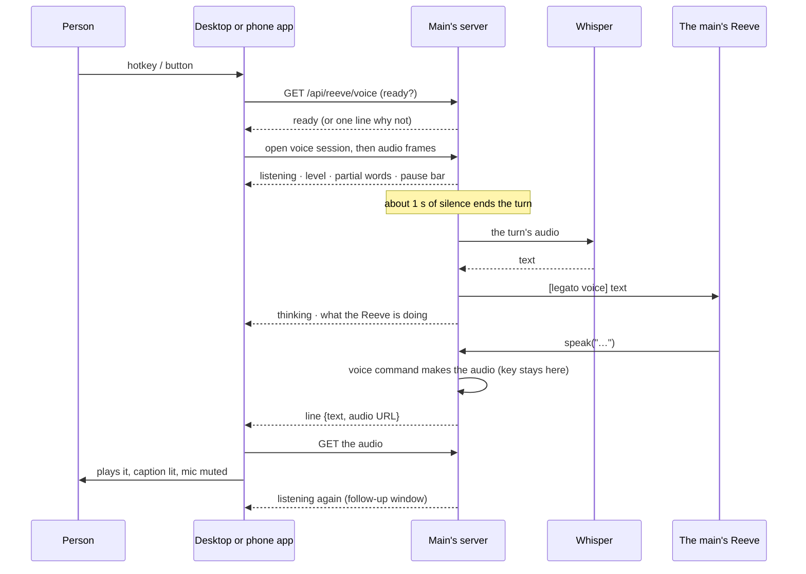

# Hands-free voice with the Reeve: design

The investigation of task `xocqcn7y` (2026-11-11). It answers the task's questions and the notes added to it (including Psi's advice), recommends a v1, and lists what is left for later. The follow-up tasks are in Personal › Backlog, named "Reeve voice (1)" to "(12)"; [§ Follow-up tasks](#follow-up-tasks) lists them in build order.

The visual reference is the approved Claude Design canvas *Reeve Voice Widget* (`https://claude.ai/artifact/QYBZHRdutKZefysQVLDqtB`, private): the 60-tick seal dial of the signed approval sheet becomes the voice ring, in five states.

## In short

The person presses a key (on the desktop) or a button (in the phone app). The widget checks that the cluster's main can take voice, then listens. A pause of about a second ends the turn. The main transcribes it and gives it to its Reeve as a spoken message. The Reeve answers with `speak`, and the main sends the audio back to the device that is listening, which plays it and shows the words as a caption. The conversation stays open for a reply until the person stops it.

The design has two parts:

- **One design on the server**, which both apps use: a voice status route, a voice session (a WebSocket that takes audio in and sends state, captions and lines out), messages marked as spoken, voice mode in the Reeve's prompt, the Reeve's lines sent to the listening device, and `speak` shown in the conversation as what was said.
- **Two thin clients.** The desktop app (Rust: hotkey, capture, playback, an always-on widget window) and the Android app (Kotlin capture, under a sheet in the web UI). One set of React components draws the widget in both.

The main decides when a turn ends, so the logic is written and tested once, in Go, and both clients behave the same. It measures the pause by counting audio samples, not by when they arrive, so a slow network cannot cut a sentence short.



## What exists, and the gaps

| Piece | What exists | Gap for this design |
| --- | --- | --- |
| Speaking | `speak` (uncommitted, task `bf3eakft`): `internal/cli/mcp_reeve.go`, queue in `internal/service/reeve_speech.go`. The command makes `<data>/reeve-voice/line-N.mp3`; `pw-play` plays it on the host. The credential is read by the host and given only to the command. | Plays only on the host. A failed line is only logged. The file is always named `.mp3`, whatever the command wrote. |
| Dictation | `internal/engine/whisper` (Wyoming over TCP, one batch per call), `service.VoiceService`, `POST /api/voice/transcribe` (one upload of 16 kHz PCM as JSON). | **`legato serve` never wires `VoiceService`**: only the TUI does (`cmd/legato/main.go`). No streaming and no silence detection anywhere. |
| Messages to the Reeve | `POST /api/reeve/message` (`ReeveService.Message`): the same as typing, and it starts or resumes the session. Peers frame messages as `[from the Reeve on …]`; Legato's own are `[legato] …`. | No way to mark a message as spoken. The prompt does not mention `speak`. |
| Main and workers | `InstanceRole` (`service/reeve.go`): main, worker, both, or standalone. Shown only in `GET /api/reeve` and the Reeve's snapshot. | `/api/meta` has no role or instance ID. The desktop app (`store.rs`) and the Android app (`ConnectionStore.kt`) record nothing about roles. |
| Readiness | `GET /api/reeve` (session state); `/api/settings` `voice_enabled` covers dictation only. | Nothing reports whether the voice works, without the credential. |
| Desktop app | Tauri 2.12, one window with N+1 webviews; plugins: deep-link, single-instance, dialog. Its own HTTP client with pinned TLS (`legato.rs`). Dictation records with `parecord` (`voice.rs`), all at once, then uploads. | No global shortcut, no second window, no streaming capture, no playback. |
| Android app | Compose shell, one WebView, native approval sheet. Dictation with `MediaRecorder` (AAC), handed to the page whole. | No streaming capture, no playback, no audio focus, no service. |
| Conversation | Web `NativeAgentPanel.tsx` folds tool calls into "steps"; Legato UI tools get their own cards (`agentUi.ts`). The TUI shows one line per tool. | `speak` is shown as a folded tool call with an empty summary (`claudebridge/tools.go` has no `text` key). |

**A note on "prime".** In the code, the *prime* is the Reeve that starts a conversation with a peer (`service/reeve_peers.go`). The person uses "Reeve prime" for the main's Reeve. To keep the two apart, the code and the UI should say *the main's Reeve*.

## 1. The hotkey

**Recommendation: the XDG desktop portal's GlobalShortcuts interface through the `ashpd` crate on Wayland, the `legato-desktop://voice` deep link as a fallback everywhere, and `tauri-plugin-global-shortcut` on X11 and macOS. Default key: Meta+Alt+Space on Linux.**

- **`tauri-plugin-global-shortcut` does not work for native Wayland apps.** It grabs keys through X11, so on Plasma Wayland it sees keys only while an XWayland window has focus. That is not acceptable for a key used from any app.
- **The portal** (`org.freedesktop.portal.GlobalShortcuts`, implemented by `xdg-desktop-portal-kde`):
  - The app creates a session, then binds its shortcuts once: `talk` ("Talk to the Reeve", preferred trigger `LOGO+ALT+space`) and `cancel` ("Stop talking to the Reeve", with no preferred trigger).
  - The first time, KDE shows its own dialog, where the person accepts the key or picks another. KDE shows conflicts there. On later starts, `ListShortcuts` returns what was bound.
  - `ConfigureShortcuts` (portal version 2) opens KDE's dialog again. The desktop app's settings offer it as "Change the key…".
  - `Activated` and `Deactivated` give key press and release, which a hold-to-talk mode needs (see [§ 4](#4-end-of-turn)).
  - `ashpd` is pure Rust over `zbus`, with a `tokio` feature to match Tauri's runtime. It needs no C library.
- **The person's desktop has what this needs** (checked 2026-11-11, outside the sandbox): Plasma and KWin 6.7.2, `xdg-desktop-portal` 1.22.1 with the KDE backend. GlobalShortcuts is version 2, and `org.freedesktop.host.portal.Registry` is present. KDE keeps portal shortcuts: Slack's (`com.slack.Slack`, "Electron shortcut Ctrl+Shift+Space") is listed in `~/.config/kglobalshortcutsrc` under its app ID.
- **What is left for the spike** (task 7):
  - A portal must know which app is asking. A sandboxed app (Slack, above) is known by its Flatpak ID. A host app like this one registers its desktop-file ID with `org.freedesktop.host.portal.Registry` (`ashpd` has a call for it), or is known by its systemd scope. Check that KDE lists the shortcut under "Legato" and keeps it across restarts.
  - Check that KDE sends `Deactivated` on release, which hold-to-talk needs.
  - KDE has had bugs with `BindShortcuts` after the first call (KDE bug 498575). Bind once per session, and do not bind again while a session is open.
- **The deep-link fallback** costs almost nothing. The app already registers `legato-desktop://` and runs as a single instance. `xdg-open legato-desktop://voice` (or `legato-desktop --voice`) is passed to the running app. The person can bind that in any desktop's custom shortcuts. It covers GNOME before version 48, wlroots compositors without the portal, and a portal that fails.
- **How the person's other Tauri app does it.** PSITTAC Desktop (`~/Projects/personal-ai-agent/packages/desktop`, Tauri 2) binds all its keys with `tauri-plugin-global-shortcut`: Alt+P (text), Alt+V (voice), Alt+Space (push to talk), Alt+M, Alt+S, Alt+X, Alt+W and Alt+Escape, configurable under `[hotkeys]` in `~/.config/psittac/config.toml` (`register_hotkey` in `src-tauri/src/main.rs`).
  - It runs as a native Wayland client (no `GDK_BACKEND` override), so its keys are grabbed on XWayland (`DISPLAY=:0`). It does not appear in KDE's shortcut list.
  - Whether those keys reach it while a Wayland app has focus depends on Plasma's "Legacy X11 App Support" setting. The person's `kwinrc` leaves it at the default, which, as I understand it, passes modifier keys alone but not Alt+letter combinations. **Ask the person whether Alt+V works while a native Wayland app has focus.** If it does not, that confirms the portal is needed.
  - It also talks to KWin over D-Bus (`kwin.rs`, a KWin script, with `zbus` and `ashpd`), and its own docs say a window cannot place itself on Wayland ("centre it with a KWin window rule"). That agrees with [§ 2](#2-the-desktop-widget).
  - Its voice code is prior art for [§ 4](#4-end-of-turn).
- **The default key: Meta+Alt+Space, which is free** on the person's Plasma. The `Meta+Alt` keys already taken there are K and L (keyboard layout) and S (screen reader). Rejected:
  - Ctrl+Space: KRunner here (`[services][org.kde.krunner.desktop]`), and many editors' completion key.
  - Alt+Space: PSITTAC's push to talk.
  - Ctrl+Shift+Space: Slack's portal shortcut, though it is unbound (`none`) at the moment.
  - Meta+Space: the input-method switch with IBus and fcitx.
  - Meta alone: opens the launcher.

  KDE's dialog also shows any conflict when the shortcut is first bound.
- **macOS:** `tauri-plugin-global-shortcut` works there. It uses Carbon hot keys and needs no Accessibility permission. Option+Cmd+Space opens Finder's search window, Cmd+Space opens Spotlight, and Ctrl+Option+Space switches the input source. Propose Ctrl+Shift+Space and check it on a Mac.

## 2. The desktop widget

The approved design shows:

- an **idle capsule** (318×64, always on screen): a breathing ring, the Reeve's name, "main · ready" and the key;
- a **not-ready capsule** (430×64): an amber ring, one line saying why, and Open settings;
- a **card** (412 wide) for listening, thinking and speaking.

**Recommendation: a second Tauri window, `voice`, made into a layer-shell surface on Wayland compositors that support it (KWin does), anchored to the bottom-right corner, with no keyboard focus. On other systems, use a normal undecorated window.**

- **Why not an ordinary always-on-top window.** On Wayland, `set_always_on_top` and `set_position` do nothing. A client may not place itself or keep itself above other windows, and KWin gives no client API for "keep above" (KDE bug 460873).
- **Layer shell** (`zwlr_layer_shell_v1`, which KWin supports) is how panels and docks do this:
  - Use the `gtk-layer-shell` crate (GTK 3, which matches Tauri's `gtk` 0.18).
  - **Layer `Top`**: above windows, below full-screen ones, so it does not cover a video.
  - **Anchors**: bottom and right, 16 px from the edges, the corner chosen in the desktop's settings.
  - **Exclusive zone 0**: windows are not pushed aside.
  - **Keyboard interactivity `None`**: the widget never takes focus from the app the person is in, which the task asks for. Clicks still work.
  - It shows on every virtual desktop, and leaves no taskbar entry.
  - It costs the `gtk-layer-shell` C library at build and run time. The desktop app already links GTK and WebKitGTK, so this is one more system package and one more library in the AppImage. The "no C" rule is the Go binary's, not the desktop app's.
  - **It is not installed on the person's machine** (Fedora 44 Atomic: no `libgtk-layer-shell` in `/usr/lib64`). Build it in a distrobox, as PSITTAC does (`install-with-distrobox.sh`), and bundle the library in the AppImage. Load it with `dlopen` at run time, so a build without it still runs and falls back to a normal window.
- **The catch: layer shell must be set before GTK realizes the window.** `tauri-plugin-widgets` works around this: it hides the Tauri window, moves the webview's container into a new `gtk::ApplicationWindow`, and makes that a layer surface. Task 8 starts with a spike to find the simplest way that holds. Either make the window invisible and initialise layer shell before tao realizes it, or move the container as that plugin does.
- **Size.** The surface resizes with the state (capsule ↔ card). A layer surface anchored to a corner grows up and to the left. A transparent window (`transparent(true)`) gives the rounded capsule and its shadow. Size the surface to the content, because a transparent margin would still take clicks.
- **Fallbacks:**
  - **Without layer shell** (GNOME's Mutter): a normal undecorated window. The person places it, and KWin window rules can pin it. Or show the widget only during a conversation.
  - **On X11:** `always_on_top`, `set_position`, `skip_taskbar` and `focusable(false)` all work.
  - **On macOS:** a non-activating `NSPanel` (the `tauri-nspanel` crate) at floating level, shown on all spaces.
  - **A KWin rule or script** (`kwinrulesrc`, or a KWin script loaded over D-Bus) could also keep a normal window above and in place. It is KDE-only and edits the person's configuration, so it stays a fallback.
- **No keyboard focus means no Esc.** The design's "esc to cancel" becomes "the key again to send, the `cancel` shortcut or the Cancel button to stop". A layer surface could take focus on click (`OnDemand`), but `Exclusive` would steal it from the person's app.
- **What it shows when idle:** the capsule from the design, showing the Reeve's name, "<main> · ready" and the bound key, which comes from the portal's `ListShortcuts`, not a fixed label. Clicking the capsule does what the key does. A context menu offers Hide, Corner and Settings. "Not ready" is checked every 30 s while idle and again on every key press ([§ Readiness](#readiness-check-before-listening)).
- **Where its page comes from:** the desktop app's own bundle (a second Vite entry, `voice.html`), not a server's page. It must draw "main unreachable" when no server answers, and it holds no token: Rust makes the network calls and sends the page events. It needs a capability file of its own scoped to the `voice` window. `on_new_window` keeps refusing pages' windows; this window is made by the app.

## 3. Microphone capture

**Desktop: Rust, streaming the system recorder (`parecord`, else `arecord`) that `voice.rs` already uses. Android: native `AudioRecord`. Both send 16 kHz mono 16-bit PCM to the main in frames of about 100 ms. The webview's `getUserMedia` is not used in the apps.**

- **Desktop:**
  - `voice.rs` already records 16 kHz mono s16le from `parecord --latency-msec=50` and computes a level every 150 ms. Streaming is a small change: send each chunk on as it arrives instead of keeping it. It links no audio library, as now.
  - The ring's ticks follow the local level at once, without a round trip.
  - Barge-in later needs a chosen PipeWire source and sink ([§ 8](#8-the-reeves-voice-and-the-microphone)), and that is a recorder argument (`--device`).
  - macOS has no `parecord`. Use `cpal` (CoreAudio) behind `cfg(target_os = "macos")`, or `AVAudioEngine` through the Swift package the app already links for Touch ID.
- **Why not `getUserMedia` in the desktop webview:**
  - WebKitGTK refuses it without the embedder setting `enable-media-stream` and answering each `UserMediaPermissionRequest`.
  - It needs GStreamer's WebRTC plugins, and the AppImage is built with `bundleMediaFramework: false`.
  - Pages served over plain HTTP have no microphone at all, which is why `voice.rs` exists.
  - The widget would also need TLS and token handling in the page. Rust already has both.
- **Android:**
  - `AudioRecord` with source `VOICE_RECOGNITION` (tuned for speech, without call processing), 16 kHz mono PCM16.
  - Frames go to the page through the existing bridge (`legato:shell-voice` events), base64, about 3 KB every 100 ms, which `evaluateJavascript` handles easily.
  - The page runs the session. `MediaRecorder` (AAC) stays for dictation.
- **The web UI in a browser** (over HTTPS) can use `getUserMedia` with an `AudioWorklet`. It gets the same voice sheet for free, which is also the test bench for the server work.

## 4. End of turn

**Recommendation: press once, the turn ends after a pause, then an open conversation. The pause is 1.0 s by default (`reeve.voice.pause`), measured on the main.**

- **The modes:**
  - **Press once, auto-stop, stay open (v1 default).** The key starts listening, and a pause ends the turn. After the Reeve has spoken, the widget listens again for a follow-up for `reeve.voice.follow_up` (6 s by default). The phone design says "tap Reply or just start talking". If nobody speaks, it goes back to idle. The key, Cancel, or closing the widget ends the conversation. This is the closest to a spoken back-and-forth, without leaving a microphone open indefinitely.
  - **Single turn** (`follow_up: 0`): one turn, then idle. Good for quick questions.
  - **Hold to talk:** the portal's `Activated` and `Deactivated`, with no pause detection. Reliable in noise, but not hands-free. Make it an option in the desktop's settings, never the default.
  - **Open until the key is pressed again** (no follow-up timeout): a microphone left open by mistake keeps sending turns. Rejected as a default.
- **Why the main decides, not each client:**
  - It is written once, in Go, tested with recorded audio fixtures, and tuned from one setting for both clients.
  - The server needs the stream anyway, for partial words and for the speculative transcription below.
  - The pause is counted in samples, so jitter cannot end a turn early.
  - The clients still draw the level themselves.
  - The cost is a round trip before the pause bar moves, which is a few milliseconds on the LAN.
- **The detector (v1):** energy, in pure Go, as Legato builds without C.
  - **Start from PSITTAC's detector** (`src/voice/vad.ts`), which already works in the person's room. It times by sample count, as here. It uses hysteresis, with two RMS thresholds: 650 to start speech, 300 to keep it going, so quiet syllables and breaths stay in the turn. Speech starts after 45 ms of loud frames and ends after 1800 ms of quiet. While the agent speaks, it raises both thresholds 2.5×, so the speakers' sound rarely counts as speech. That gives it a rough barge-in with no echo cancellation.
  - Port it to Go, with its cases as test fixtures, and add what it lacks:
    - a noise floor tracked slowly from the quiet frames, with the thresholds relative to it;
    - the 400 ms sentence boundary below;
    - `reeve.voice.pause` in place of the fixed 1800 ms;
    - at least 300 ms of speech per turn.
  - It ends after `pause` of non-speech.
  - No speech within 8 s of listening returns to idle ("I didn't hear anything").
  - A turn longer than 60 s is sent as it stands.
  - Silero VAD would be more robust, but it needs ONNX Runtime (C). Earshot is pure Rust, not Go. Neither suits the Go binary. Revisit with recordings if the energy detector proves weak in the person's room.
- **How long a pause.** Three figures disagree:
  - The person asked for about a second.
  - Psi (the person's household agent, which talks through Home Assistant Assist and Piper) finds that 300–500 ms works as a sentence boundary: shorter cuts people off, and longer leaves an awkward wait.
  - The person's other project uses about 1.8 s.

  Psi's figure comes from short spoken requests to a house. A request to the Reeve is often thought out while it is said, with pauses in the middle of a sentence, so a short pause cuts it off more often.
- **The design uses two thresholds, so the boundary can be short without cutting people off:**
  - **The sentence boundary** (Psi's 300–500 ms; fixed at 400 ms) starts transcription. If speech resumes, the result is dropped, at no cost.
  - **The end of the turn** (`reeve.voice.pause`) sends the turn. It ships at 1.0 s, the person's figure, and accepts 0.3–2.0 s. Tune it by feel during task 2, trying 0.5, 0.8 and 1.0 s.
  - The text is usually ready when the turn ends, so a longer end-of-turn pause costs only the wait itself.
  - Two things soften a cut-off at any setting:
    - **Send now** sends at once.
    - **Speech that resumes right after a send** (within 2 s, before the Reeve answers) is sent as a second message. It is queued for the Reeve like any message, so nothing is lost.
- **Speculative transcription:** at the sentence boundary (400 ms into a pause), the main starts transcribing the turn so far. If speech resumes, it drops the result. If the pause completes, the text is usually ready, which hides most of Whisper's time ([§ 9](#9-latency)).
- **Partial words** (the design's live transcript with a caret):
  - Whisper here is batch-only. Wyoming defines streaming transcript events, but `wyoming-faster-whisper` transcribes after the audio ends.
  - So partials come from transcribing the turn so far about once a second, whenever Whisper is idle, and only for the first 20 s of a turn.
  - `reeve.voice.partials` turns this off when Whisper is too slow, for example on CPU. The ring then shows listening without words.

## 5. Transcription path

**On the main, with its `VoiceService` and Whisper.** The audio is already streaming there. Whisper runs once, next to the Reeve, so the phone needs no model. The text arrives where it is delivered. Transcribing next to the desktop would only help if the main's Whisper were far away or slow, which is not the person's setup. Keeping raw audio on the server also leaves room for speaker-aware transcription (task `0kbqr321`).

What it takes:

- **Build `VoiceService` in `legato serve` as the TUI does.** It is a gap today, and a prerequisite.
- **Messages are marked as spoken:** the voice session delivers `[legato voice] <text>` through `ReeveService.Message`, the same path as `POST /api/reeve/message`. If the Reeve is suspended, the message resumes it. See [§ Voice mode](#voice-mode-the-reeve-knows-it-is-heard).

**Sharing the person's Wyoming services.** Home Assistant Assist reaches its speech services over Wyoming, the protocol Legato's Whisper client speaks (`internal/engine/whisper`). What can be shared:

- **Whisper.** `voice.whisper_url` can point at the `wyoming-faster-whisper` that Assist already uses (`tcp://<host>:10300`), so no second model is needed.
  - That server works through one request at a time, so Legato's requests and Assist's wait for each other.
  - Partial words send a request about once a second while the person speaks. On a shared Whisper that runs on a CPU, turn `reeve.voice.partials` off, so that Assist in the house is not kept waiting.
  - The status route's `describe` check works the same against a shared server.
- **Speech (`wyoming-piper`).** When the Reeve's Piper voice is ready (task `ybp1od4z`), the shared `wyoming-piper` can serve it.
  - `reeve.voice.command` can then be a short script that asks Wyoming for the audio and applies the radio filter, instead of running Piper on the main.
  - A built-in Wyoming speech client (a `wyoming://` voice) can come later.
- **Wake word (`wyoming-openwakeword`).** It could later listen to the same stream from the voice session. A wake word is out of scope here.

I could not see from the sandbox which services the person runs or where. Task 1 records the shared addresses in the settings' descriptions and the site's page.

## 6. Routing to the main's Reeve

**The apps ask each paired server's voice status route and take the one whose role is `main`.**

- **The new route** `GET /api/reeve/voice` (class read, web token; [§ Readiness](#readiness-check-before-listening)) returns the instance's ID, name and role from `InstanceRole`. The role stays off `/api/meta`, because `/api/meta` answers without a token.
- **How a client picks:**
  1. Exactly one server says `main`: it is the main.
  2. None says `main` and there is one server: use it (standalone).
  3. Otherwise (two mains, or `main and worker`), the person chooses once in the app's settings ("The Reeve to talk to"). The choice is kept by instance ID, so a new URL does not lose it.
  - The desktop asks again when its server list changes and every 10 minutes. It keeps the result in `state.json` (`voice.server`).
- **The route into the conversation** is `ReeveService.Message`. The voice session calls it directly in the server. That is the same as `POST /api/reeve/message` (the typed path), plus the voice marker.
- **The gaps:**
  - The role and instance ID appear only in `GET /api/reeve` and the Reeve's snapshot.
  - Neither app records roles.
  - `ws` and the voice session take the web token only. Both apps hold the web token for each server. A worker's page on the phone cannot open a session on the main, because it does not hold the main's token. See [§ Android](#android).

## Voice mode: the Reeve knows it is heard

**Each spoken message starts with `[legato voice]`. The Reeve's prompt says what that means.** Voice mode lasts for one message: the Reeve answers a `[legato voice]` message by voice, and a typed message (no marker) in writing. So voice mode starts with the first message from the widget and ends with the next typed one, as the note asks, with no state for the Reeve to track. When the widget closes, Legato sends the Reeve nothing. The next message decides.

The prompt (a "Voice" section in `ReeveRolePrompt`, present only while `reeve.voice.enabled`):

> A message that starts with `[legato voice]` was spoken, and the person is listening, probably not looking at the screen. Answer it with `speak`: one call for each reply, the outcome first, at most three short sentences. Keep the written reply to what cannot be said aloud (a path, a link, code); write nothing more. When the work will take more than a few seconds, first say in one short line what you are doing. A message without the marker was typed: answer in writing, and speak only if asked.

- **The `speak` description** changes from "on the speakers of the machine Legato runs on" to "to the person, on the device they are listening on". Today the tool is listed only when the Reeve's session starts with the voice on. That stays, and voice mode needs the voice on, so the status route refuses voice otherwise.
- **If a turn ends with no `speak`:** the widget says "Answered in writing" with Open conversation. Legato does not read the written reply aloud.

## A record of what was said

**Show each `speak` call in the conversation as a spoken message, not a folded tool call. The Reeve does not write the same words twice.**

| | Show `speak` as a message (recommended) | The Reeve also writes it |
| --- | --- | --- |
| The record | The exact words heard, in place, in order | Two versions that drift apart |
| Tokens and time | Once | Twice, in the slowest part of the turn |
| Reading later | A spoken bubble, then any written detail | The same thing said twice |
| Work | Bridges and two renderers | Prompt only |

- **Bridges:**
  - `claudebridge/tools.go` maps Legato's `speak` (`mcp__…legato__speak`) to the native tool name `speak` and adds `text` to `summaryKeys`.
  - `codexbridge` does the same for `legato.speak`.
  - Chimera's encoded name is matched as `agentUi.ts` already does.
- **Web** (`NativeAgentPanel.tsx`): exempt `speak` from the folded steps, as `spawn_agent` and the UI tools are. Draw it as a "said" bubble: the ◈ kicker "SAID", the text, and the line's state when known (spoken, not spoken). The desktop app's server pages are the web UI, so this covers the desktop too.
- **TUI** (`internal/tui/agents/conversation.go`): `toolLine` special-cases `speak` as `◈ said "…"`.
- **The widget** shows the line as a caption while it plays: the design's "caption lit as it is spoken". v1 lights the whole line that is playing and dims those queued. Lighting word by word needs word timings: ElevenLabs' "with timestamps" endpoint, or Piper's phoneme durations. That is later.
- **Making failures visible:** `ReeveSpeech` today only logs a failed line. Publish `EventReeveSpoke` (made, played, failed) so the bubble and the widget can say when a line was not spoken.

## 7. Audio back to the listening device

**A line made while a voice session is open goes to that session as `line {id, text, url}`. The device fetches `GET /api/reeve/voice/lines/{id}` with its token, plays it, and acknowledges. Only the audio file leaves the server, never the credential.**

- **`ReeveSpeech` gets an output.** After `make`, a line goes to the open voice session if there is one. Otherwise it plays on the host as today.
- **Lines that answer a voice message whose session has closed are dropped.** The person walked away, and the host's speakers may be in another room. The record still shows them. Legato knows a line is a voice line because a voice message was delivered and the Reeve's turn has not ended.
- **The clip:**
  - Kept under `<data>/reeve-voice/` with a random 128-bit ID, until the device sends `played` or after 10 minutes, and when the session ends.
  - The route is class read, and the ID cannot be guessed.
  - Its content type is detected from the file (MP3 frame or ID3 header, `RIFF`/WAVE, `OggS`). Piper writes WAV, and the file is not always `.mp3`.
- **Order:** lines are announced as soon as each is made. The device queues and plays them in order, so making line 2 overlaps playing line 1, as the host queue does today.
- **Stop:**
  - While speaking, Stop drops the queued lines on both sides and stops playback.
  - While thinking, Stop interrupts the Reeve's turn through the native endpoint's interrupt.
  - Reply stops playback and listens.
- **Playback:**
  - Desktop: Rust fetches over the pinned TLS client and plays with `pw-play` (or `paplay`), and `afplay` on macOS. It knows exactly when playback starts and ends.
  - Android (v1, in the app): the page plays with an `<audio>` element.
- **Quiet hours** (`reeve.voice.quiet_hours`, for example `22:00-07:00` in the main's local time; empty for none). Psi switches to text when the person is probably asleep, and the Reeve should too:
  - During quiet hours, no line plays on the host's speakers. `speak` answers "quiet hours: reply in writing", so the Reeve knows the line was not heard.
  - **A line that answers a voice message is not held back:** the person has just spoken to the widget and is listening on their own device.
  - The Reeve's snapshot says when quiet hours are on, so it does not try to speak.
- **Streaming later.** The command interface writes a whole file. A streaming voice (ElevenLabs' streaming endpoint, Piper writing raw audio as it goes) could be served as chunked audio from the same route, so the first word plays before the line is finished.

## Readiness: check before listening

On the key or button, the client calls `GET /api/reeve/voice` on the main, with a 2 s timeout. If anything fails, the widget shows the not-ready capsule with one line and does not record.

```json
{
  "instance": {"id": "…", "name": "tessitura", "role": "main"},
  "reeve": {"name": "…", "state": "suspended", "busy": false},
  "speech": {"enabled": true, "command": true, "last_error": ""},
  "transcription": {"enabled": true, "reachable": true},
  "session": {"open": false, "device": ""},
  "ready": true,
  "reason": "",
  "setting": ""
}
```

The reasons, in the order they are checked:

1. The client cannot reach the main: "Can't reach <main>".
2. `voice.enabled` is off or `voice.whisper_url` is empty: "Transcription is off on <main>" (`voice.enabled`).
3. Whisper does not answer a Wyoming `describe` within 1 s: "Whisper isn't answering on <main>".
4. `reeve.voice.enabled` is off: "The Reeve's voice is off on <main>" (`reeve.voice.enabled`).
5. `reeve.voice.command` is empty: "The Reeve has no voice command on <main>" (`reeve.voice.command`).
6. The Reeve cannot take a message (turned off or failing to start): "The Reeve can't start on <main>".
7. Checked locally: there is no microphone or recorder: "No microphone on this computer".

Rules:

- The route never returns the credential or the command line, only whether one is set.
- Open settings goes to the main's settings page at the setting's anchor.
- **Warming up:** if the Reeve is suspended, the status call starts resuming it while the person speaks. Resuming takes seconds, and the speech hides them.
- **One voice session at a time.** A new one takes over, and the old one gets `ended {reason: "taken over by <device>"}`. This decides where lines go.

## 8. The Reeve's voice and the microphone

**v1: the device does not send audio while it plays a line, or for 300 ms after. The main also ignores frames while it is in the speaking state.** The device knows exactly when it plays, so this needs no echo cancellation. Psi's experience agrees: muting the microphone (or hold-to-talk) is the practical first version, and echo cancellation is for later.

Later, so that the person can interrupt the Reeve mid-sentence:

- **A cheaper step first:** PSITTAC already lets the person interrupt without echo cancellation. While the agent speaks, it raises its speech thresholds 2.5×, so only speech louder than the speakers' sound counts ([§ 4](#4-end-of-turn)). The same can be tried here before echo cancellation, on a desk with speakers rather than a headset.

- **Desktop (PipeWire):** `libpipewire-module-echo-cancel` (WebRTC's echo canceller) adds a sink and a source. The app plays lines into the sink (`pw-play --target`) and records from the source (`parecord --device`). The module can be loaded by the person's PipeWire configuration, or at run time with `pactl load-module module-echo-cancel`. The app finds the nodes and uses them when present.
- **Android:** `AudioRecord` with `VOICE_COMMUNICATION` and `AcousticEchoCanceler`, with playback as `USAGE_VOICE_COMMUNICATION` in the same audio session.
- **A browser:** `getUserMedia({echoCancellation: true})` with playback in the same page.
- **The server:**
  - While speaking, a turn needs a higher threshold, to ignore what is left of the echo.
  - Speech then becomes a barge-in: the device stops playback and sends `stop`, and the queued lines are dropped.
  - The next message tells the Reeve what was cut: `[legato voice] (interrupted after "…") <text>`.

## 9. Latency

Estimated. The settings and the main cannot be reached from this sandbox, so nothing here was measured. Task 2 logs these times for every turn so they can be measured.

| Step | Estimate | Notes |
| --- | --- | --- |
| End of speech → turn sent | 1.0 s | The pause itself, by design |
| Sending the audio | ~0 | Streamed while the person speaks |
| Whisper | 0–1.5 s | 0.2–0.5 s on a GPU, 0.5–1.5 s on a CPU for a short turn. Speculative transcription hides most of it. |
| Delivery to the Reeve | < 0.2 s | `QueueMessage` to the native endpoint. A suspended Reeve adds 5–15 s, which warming up hides. |
| The Reeve's turn, to its first `speak` | 2–6 s | Model time plus any tool calls: **the largest step** |
| Making the line (ElevenLabs + radio filter) | 1–2 s | A request for about 150 characters, plus `ffmpeg` |
| Fetching and starting playback | ~0.1 s | LAN |
| **First sound after the person stops** | **4–10 s, about 6 s typical** | |

- **Piper** makes a short line locally in about 0.2–0.6 s on a CPU (estimate), with no network or cost per character. That saves about a second on each line. More lines overlap well, because making the next line takes less time than playing this one.
- **Larger wins** than Piper:
  - The prompt's "say first what you are doing", so the first sound comes before the tool calls.
  - Warming up a suspended Reeve on the key press.
  - Streaming speech, later.

## Android

The notes narrow v1 to **inside the app**: a sheet over the page, like the approval sheet, with the same ring at 176 px. It is not a system overlay.

- **The sheet is the web UI's** (the shared components, [§ The widget's look](#the-widgets-look-one-design-built-once)), opened by a ring button in the web UI.
  - The button shows when the shell offers streaming capture, or when the browser has `getUserMedia`.
  - It is enabled on the main's page.
  - On a worker's page, it says "Voice is on <main>" and opens the main's page with the sheet open. The page asks the shell to switch servers. That is a new bridge message beside `workers`.
- **Shell (Kotlin):**
  - `legatoShell.voice.stream` starts and stops `AudioRecord` frames to the page.
  - The page runs the session and plays lines with `<audio>`.
  - `ConnectionStore` learns which connection is the main from the status route, the same way as the desktop.
- **Audio focus:** request `AUDIOFOCUS_GAIN_TRANSIENT` for the conversation, so music pauses while listening and speaking, and abandon it when the sheet closes.
- **When the app leaves the foreground:** the conversation ends. `ServerPage` already cancels recording when the app is backgrounded.
- **Bluetooth:** v1 uses the default routing. A Bluetooth headset plays the lines. Its microphone needs `setCommunicationDevice` (API 31+) with a `VOICE_COMMUNICATION` source, which is later work.

**What starts listening, compared** (for later; v1 is the in-app button):

| Start | Can it start a microphone service from the background? (Android 14+) | Verdict |
| --- | --- | --- |
| Button in the app | Yes: an activity is visible | **v1** |
| Notification action | Yes: exempt as "interacting with a notification" | **Next**: a conversation started in the app starts a foreground service (`microphone\|mediaPlayback`) while the activity is visible. Its notification carries the state and Talk and Stop actions, so the conversation survives the screen going off. |
| Home-screen widget | Yes: exempt | Later |
| Quick Settings tile | Only by opening an activity (`startActivityAndCollapse` with a `PendingIntent`) | Later; it opens the sheet |
| Headset or Bluetooth button | No exemption: works only while the app or its service is in front | After the notification service exists |
| The app as the phone's assistant (`VoiceInteractionService`) | Yes: exempt | Heavy, and replaces the person's assistant; not planned |

Since Android 14, a foreground service of type `microphone` must be created while the app has a visible activity, unless one of those exemptions applies; otherwise it gets a `SecurityException`. Starting it in the app and continuing in the background is the way that always works.

## The widget's look: one design, built once

- **Shared components in `web/src/voice/`**, used by the web UI's sheet and imported into the desktop bundle with a Vite alias. Both use React 19, and the desktop's Vite reads the source with `server.fs.allow`.
  - `VoiceRing`: the 60-tick dial as SVG, like `SealView`, in the modes idle, listening, thinking, speaking and blocked. In listening, its ticks follow the real level, not only a CSS loop.
  - `VoiceCapsule`, `VoiceCard` (desktop) and `VoiceSheet` (phone).
- **The tokens** from `desktop/src/styles.css` (`--accent` #6D5EF6 to `--accent2` #8A6CFF, `--green` #3ECF8E, `--amber` #E8B53A, Geist Mono kickers, the ◈ glyph) become shared CSS variables.
- **The desktop bundle has no Geist font today** (no `@font-face`): bundle Geist Mono for the kickers.
- **Reduced motion:** `prefers-reduced-motion` stops the breathing, sweeping and tick animations, and keeps the state colours and text. `SealView` has none today.
- **Copy changes from the canvas:**
  - "esc to cancel" becomes "<key> to send" ([§ 2](#2-the-desktop-widget)).
  - The key is read from the portal, not fixed.
  - The thinking line is "what the Reeve is doing", from the newest tool call's summary in the conversation tail (`ConversationTail`).

## The voice session protocol

`GET /api/reeve/voice/session` upgrades to a WebSocket with the web token (`?token=`, as for `/ws`), class change. Only text frames are JSON. Binary frames are audio: PCM s16le, mono, 16 kHz, 20–100 ms each.

| From the device | Meaning |
| --- | --- |
| `hello {device, client, play}` | Who is listening ("Cameron's desktop", `desktop`/`android`/`web`), and whether it can play lines |
| (binary) | Audio, only while listening |
| `listen` | Start a turn (the key, Reply, or the follow-up window) |
| `send` | Send now |
| `cancel` | Drop this turn |
| `stop` | Stop speaking, drop queued lines; while thinking, interrupt the Reeve |
| `playing {line}` / `played {line}` | Playback started or ended (mutes the main's detector, frees the clip) |
| `bye` | End the conversation |

| From the main | Meaning |
| --- | --- |
| `state {state}` | `idle`, `listening`, `thinking`, `speaking` |
| `pause {ms, of}` | The pause bar while the person is silent |
| `partial {text}` | Words so far |
| `heard {text}` | The turn as sent to the Reeve |
| `activity {text}` | What the Reeve is doing, one line |
| `line {id, text, url}` | A line ready to play |
| `written` | The turn ended with no `speak` |
| `ended {reason}` | Taken over, voice turned off, the Reeve stopped |

The desktop speaks this protocol from Rust, and the web UI from TypeScript. JSON fixtures under `internal/server/testdata/voice-session/` pin it for both test suites, as `internal/engine/pairing/testdata/exchange.json` does for pairing.

New settings, all live:

- `reeve.voice.pause` (duration, 1s, 0.3–2s)
- `reeve.voice.quiet_hours` (a time range in the main's local time, empty for none)
- `reeve.voice.follow_up` (duration, 6s; 0 for a single turn)
- `reeve.voice.partials` (bool, on)

Each needs `docs/ai/config.md`, `docs/ai/settings.md` and the site's configuration page.

## v1, and what is left for later

**v1:**

- On the server:
  - transcription in `legato serve`, which can use the Wyoming Whisper that Home Assistant already shares;
  - the voice status route;
  - the voice session, with the energy detector, a 400 ms sentence boundary and a 1.0 s end of turn, speculative transcription and partials;
  - `[legato voice]` messages and the prompt;
  - lines sent to the listening device, with host fallback and quiet hours;
  - `speak` shown as said.
- **Desktop (Linux):**
  - the portal key and deep link;
  - the layer-shell widget in all five states;
  - streaming `parecord`;
  - `pw-play`;
  - muting while speaking;
  - choosing the main.
- **Android:** the in-app sheet with `AudioRecord`, audio focus, and `<audio>` playback.

**Later:**

- Interrupting the Reeve, with echo cancellation.
- The phone outside the app: the foreground-service notification first, then the widget and tile.
- Bluetooth headset microphones.
- Streaming speech, and word-by-word captions.
- A model-based voice activity detector, if the energy detector proves weak.
- macOS capture and panel.
- Speaker-aware transcription (task `0kbqr321`).

**Not planned:** a wake word, speech from worker agents, a voice for each agent.

## Open questions

1. **Do PSITTAC's Alt+letter keys work while a native Wayland app has focus?** If not, that confirms the Tauri plugin is not enough on this desktop. Ask the person.
2. **Does KDE list a host app's portal shortcut under its name, keep it across restarts, and send `Deactivated`?** Task 7's spike. KDE does keep a Flatpak app's (Slack's).
3. **What is the simplest way to make a Tauri window a layer surface before it is realized, and to bundle `gtk-layer-shell`?** Task 8's spike.
4. **How fast is the main's Whisper, and is it the one Home Assistant shares?** This decides whether partials are on by default. Task 2 measures it.
5. **Which end-of-turn pause feels right:** the person's second, Psi's 300–500 ms, or PSITTAC's 1.8 s? Task 2 tunes it by feel.

Answered on 2026-11-11, outside the sandbox: how PSITTAC binds its keys (§ 1), and whether Meta+Alt+Space is free (it is).

## Follow-up tasks

In Personal › Backlog, in build order. The server tasks come first; the Android task comes after them, as the notes ask.

They are also in Burnlite, as the milestone [Hands-free voice with the Reeve](/LEG-118) (LEG-118), with native blockers. Task (2) is split there into the voice session (LEG-120) and the end-of-turn detector (LEG-121), so the tasks are LEG-119 to LEG-131 in this order.

1. `pin6xnzw` **Reeve voice (1): transcription in `legato serve`, and the voice status route.**
2. `u0sxafww` **Reeve voice (2): the voice session.** Streaming audio, the end-of-turn detector, transcription and delivery, plus timing logs.
3. `knk1augt` **Reeve voice (3): voice mode.** `[legato voice]` messages, the prompt, and the `speak` description.
4. `5n3ayu68` **Reeve voice (4): the Reeve's lines to the listening device**, with host fallback, Stop and quiet hours.
5. `a821qlvx` **Reeve voice (5): show what the Reeve said in the conversation** (web and TUI), and line failures.
6. `4n92j5ed` **Reeve voice (6): the shared widget components and the web UI's voice sheet.**
7. `8p4ztwoe` **Reeve voice (7): desktop spike and global key.** Portal, deep link, X11 and macOS.
8. `m0o3ahua` **Reeve voice (8): desktop, the always-on widget window** (layer shell).
9. `lcqm1no6` **Reeve voice (9): desktop, the voice session client.** Streaming capture, playback, choosing the main.
10. `zbch1n86` **Reeve voice (10): Android, the voice sheet in the app.**
11. `4k6poagh` **Reeve voice (11), later: interrupting the Reeve** (echo cancellation).
12. `t3r7ayhn` **Reeve voice (12), later: the phone outside the app** (foreground service, notification, tile).

## Sources

- XDG portal GlobalShortcuts: <https://flatpak.github.io/xdg-desktop-portal/docs/doc-org.freedesktop.portal.GlobalShortcuts.html>; `ashpd`: <https://docs.rs/crate/ashpd/latest/source/src/desktop/global_shortcuts.rs>; KDE bug 498575 (BindShortcuts): <https://bugs.kde.org/show_bug.cgi?id=498575>
- Wayland and keeping a window above: KDE bug 460873 <https://bugs.kde.org/show_bug.cgi?id=460873>; Wayland issue 305 <https://gitlab.freedesktop.org/wayland/wayland/-/issues/305>; `tauri-plugin-widgets` (layer shell in Tauri): <https://docs.rs/crate/tauri-plugin-widgets/0.5.0/source/src/linux/mod.rs>
- WebKitGTK media permission: <https://github.com/block/buzz/pull/3557>
- KRunner's keys: <https://bugs.kde.org/show_bug.cgi?id=488913>, <https://invent.kde.org/plasma/plasma-desktop/-/issues/87>
- Android foreground services and while-in-use permissions: <https://developer.android.com/develop/background-work/services/fgs/restrictions-bg-start>, <https://developer.android.com/guide/components/fg-service-types>
- Voice activity detection in Rust (earshot, Silero): <https://docs.rs/crate/earshot/1.2.2>, <https://docs.rs/crate/wavekat-vad/0.1.9/source/README.md>
- Wyoming streaming transcripts: <https://github.com/rhasspy/wyoming/>
