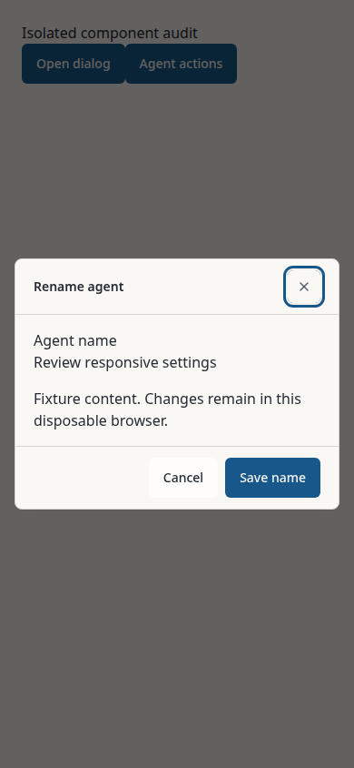
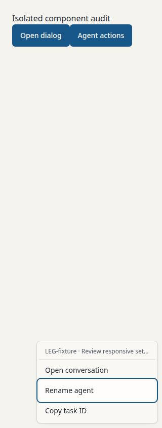

# Legato web UI audit — 15 November 2026

## Summary

Legato has a coherent visual direction: a dense, state-led Control Room with clear material roles. The largest opportunity is consistent information structure and interaction behavior, not a replacement palette.

The requested priorities are Settings, dialogs, context menus, and skill discovery. Improve those first, then apply the same contracts across operational pages.

Two safety/access fixes come first: terminal prompt Enter handling can activate the wrong choice, and phone plan layouts hide rejection and cleanup controls. These are not cosmetic issues.

This is an audit and proposal. No production UI, live preference, agent, approval, credential, or running Legato process was changed.

## Method and evidence

- Map every SPA route, Settings group, overlay family, and menu entry point.
- Delegate independent source audits using Impeccable's technical audit and Operate-mode guidance.
- Review DESIGN.md, the shared theme implementation, and relevant feature documentation.
- Verify the strongest findings against current production callsites before accepting them.
- Keep source-confirmed defects, design recommendations, rendered evidence, and unverified hypotheses separate.
- Use isolated browser fixtures only; never test against the operator's running instance.

One Settings worker hit a model rate limit. A replacement specialist completed that review. The Impeccable context launcher initially failed because its engine cache was unavailable. Existing project context was read directly, as the skill requires.

Five source specialists completed focused reviews, supported by a separate inventory worker and a rendered-evidence worker. Slower duplicate workers were stopped after replacement reviews completed. The inventory covers every route/family; individual state coverage is sampled, not exhaustive.

The consolidated register contains **25 findings: 9 P1 and 16 P2**. These counts describe this register, not every possible defect in Legato.

No full WCAG conformance, native-device behavior, or performance benchmark is implied by this audit. A numeric whole-product score would imply coverage that a bounded source/fixture audit does not establish.

### Rendered checks

The Playwright container was unavailable. A separate worker used the project's raw-CDP approach with disposable Chromium and a proxy-free Vite fixture. The fixture imported the production shared Dialog, Button, AgentContextMenu, and theme implementation. No Legato API or running instance was used.

- Checked 1440px, 390px, and 320px viewports, all 844px high, in Ocular Light.
- Both sampled overlays fitted those viewports without page overflow. This does not establish long-list or long-form coverage.
- The shared dialog wrapped Tab/Shift+Tab, closed with Escape, and restored its opener. Phone gutters measured 16px and footer buttons 44px high.
- The sampled context menu supported ArrowDown and Escape, but focus returned to BODY rather than the trigger at all three sizes. This validates the missing restoration contract in O2.
- No browser exceptions were recorded. No contrast ratio, physical touch gesture, virtual keyboard, full Settings page, or native-device test was performed.
- The worker stopped its own browser/server and removed its runtime directory. Results and cleanup are in `docs/analysis/web-ui-audit-evidence/`.

## Surface inventory

The SPA has 15 explicit route patterns across 11 top-level destinations, plus the Agents Ensemble view. Route registration: `web/src/App.tsx:63`. Navigation metadata: `web/src/lib/navSections.ts:40`.

| Area | Surfaces and production entry points |
| --- | --- |
| Shell | Layout, rail, phone bottom bar/More, server identity/switching, updates, connection/auth, approval tray, voice launcher |
| Agents | Solo native chat, terminal, sidebar/select/groups, Ensemble, swarm command center, prompts/composers, model/mode/resources/macros, requests, tool output |
| Agent content | Artifacts, related work, HTML sandbox, Markdown/diagrams, image viewer, revisions/download/removal, video and recording studio |
| Board | Desktop grid/columns/cards, mobile lists/column chips, search/filter/workspaces, task panel/details/editing, worktrees/PRs, away workers and returns |
| Settings | Agents, Reeve, Security, Integrations, Handoff, Connection, Appearance, Lists, Updates, conditional Development |
| Dialog families | Task create/edit/move/delete/import/search/archive/worktree/PR; Spawn/Start swarm/rename/group; workflow run/input; pairing/QR; confirmation/approval; offline; media |
| Menu families | Agent context/overflow/header actions; card actions/workflow submenu; group actions; model/effort/session settings; slash commands/skills; resources/macros; shell disclosure |
| Attention | Intervention, ready-for-review, and merge-blocker sections; source-owned actions/dismissal |
| Plans | Queue, document, questions/comments, revisions and decisions |
| Reviews | Queue, tour, chapters, diff/selection, handoff/briefing/evidence |
| Workflows | Runs/definitions, launch forms, run detail/steps, manual input/retry/cancel |
| Learning | List/search/filter, learning detail, evidence, curation/actions |
| Reports | Time ranges, summaries, tables/drilldown and export |
| Remote | Managed clones and associated actions |
| Audit | Filtering, event list, details, load-more |
| Foundations | Buttons, fields, state pills, notices/toasts, loading/empty/error patterns, focus/keyboard, motion, theme roles and generated legacy mappings |

### Important theme caveat

Legacy classes such as `bg-zinc-900` do not by themselves prove a broken light theme. `web/src/theme-utilities.css:1` and `scripts/theme-utilities.mjs:1` map legacy classes to shared theme roles. A valid contrast finding needs resolved colors and actual states. Theme evidence and its limits are recorded in `themes/VERIFICATION.md`.

## What should stay

- The approved Control Room identity, shared canonical palettes, and rail/canvas/panel/raised hierarchy.
- All six themes, additive Vivid variants, explicit terminal overrides, server tints, and motion preferences.
- The rounded inset composer focus treatment.
- Dense operational information where it supports a task; density is not itself a defect.
- Source/pin/reset/restart/signature semantics in Settings.
- Slash fuzzy matching, keyboard completion, and insertion without automatic send.
- Shared action definitions where context and overflow menus already reuse them.
- The good responsive layout patterns in Spawn and Hand off: bounded bodies, clear context, and reachable actions.

## Verified findings

Severity: **P1** causes significant difficulty, lost work, misleading state, or a substantial access barrier. **P2** adds friction but has a workaround. No P0 is established by the evidence below.

### Settings

**S1 · P1 · Registered settings have no visible destination.**

`web/src/pages/Settings.tsx:239`, `:274`, `:279`, `:416` and `web/src/components/settings/RegistrySettings.tsx:146` mount only selected registry prefixes. The registry includes other editable keys, such as `default_workspace`, `web.discovery`, `jira.base_url`, and `swarm.enabled` (`config/settings.go:110`). Users cannot find an editor by searching harder.

Give every registry key/list exactly one task-based destination. Search titles, descriptions, task terms, and dotted keys. Keep file-only keys explicitly read-only. Add a coverage test against the actual registry rather than a second disconnected list.

**S2 · P1 · Failed loads can look like missing functionality.**

`web/src/pages/Settings.tsx:46` converts absent registry data to an empty array. `web/src/components/settings/ListSettings.tsx:105` and `MoveSettings.tsx:12` disable retry and render nothing without data. Registry error feedback exists inside MQTT, but does not cover the other affected sections.

Keep each section visible during loading and failure. Provide local Retry and distinguish unavailable data from a genuinely empty list.

**S3 · P1 · Live refresh can replace an unfinished edit.**

`web/src/components/settings/RegistrySettings.tsx:74` stores a text draft; `:75` replaces it whenever the server value changes. `web/src/hooks/useConfigSettings.ts:5` explicitly supports refresh after another client changes settings.

Preserve dirty drafts and their baseline. Show an external-change conflict, then let the user reload the value or keep the edit. A failed save needs a direct retry path; focus/blur alone is not a clear save contract.

**S4 · P2 · Storage format determines navigation.**

Credentials are described in Security (`web/src/components/CredentialsSettings.tsx:41`), but edited through Lists (`web/src/components/settings/ListSettings.tsx:97`, `config/entries.go:42`). The credential empty state still directs users to file editing (`CredentialsSettings.tsx:45`). Lists also mixes workspaces, tools, sandbox mounts, macros, credentials, and Reeve rules.

Move lists to their task owners. Give Credentials one editor and link to it from the overview and MQTT setup. Use typed common fields before advanced JSON.

**S5 · P2 · Settings navigation requires users to know the grouping.**

`web/src/pages/Settings.tsx:143` exposes broad groups without search. `:178` only explicitly resolves delayed `#setting-` links. `:183` scrolls and replaces history. Some card destinations, including `#move`, appear only after a separate query completes.

Use searchable selected sections with stable destinations, browser Back, and one legacy-link resolver. If retaining the long page, still fix search, delayed anchors, and focus/scroll behavior.

**S6 · P2 · A pin offers a migration before checking eligibility.**

`web/src/components/settings/RegistrySettings.tsx:125` offers Move for every pinned non-secret row. The server excludes additional values, including environment-backed values and values needed to load the file independently (`docs/ai/settings.md`, “What can move”).

Use the authoritative eligibility result. Explain ineligible pins. Confirm file-write/restart consequences for eligible moves; preserve signed-approval and pending-restart semantics.

**S7 · P2 · Sticky navigation and target offsets disagree.**

Phone navigation is sticky (`web/src/pages/Settings.tsx:194`), but generic targets reserve only `scroll-mt-6` (`web/src/components/settings/SettingsUI.tsx:9`, `:42`). MQTT already uses a larger responsive offset. Existing retained phone captures also show the active chip outside the visible chip strip while Appearance content is in view.

Measure the sticky height and keep target headings/focus visible. This is a source-supported geometry risk, not a new physical-device result.

### Shared dialogs and menus

**O1 · P1 · Modal semantics are not a shared behavior contract.**

The shared `web/src/components/ui/Dialog.tsx:55` contains a focus loop and restoration, but bespoke `web/src/components/SpawnAgentDialog.tsx:498` declares `aria-modal` and handles Escape without that shared loop/restoration. `web/src/components/MobileNav.tsx:139` has another separate dialog implementation. `web/src/components/PlanApprovalModal.tsx:159` has neither dialog semantics nor that focus lifecycle. Similar-looking overlays can therefore have different keyboard and background behavior.

Use one overlay foundation with intentional confirmation/form/reader compositions. Test containment, initial focus, restoration, background isolation, nested-overlay precedence, and busy states through real entry points.

**O2 · P2 · Menu height and position depend on estimates.**

`web/src/components/AgentContextMenu.tsx:31` estimates height from a constant row size and entry count. The rendered menu has no viewport-limited scrolling. Long action lists, wrapped names, and short-height windows can invalidate the estimate. Card workflows use a separate placement system (`web/src/components/board/CardContextMenu.tsx:64`).

The bounded rendered check did fit a three-item menu, so current overflow is not claimed for that fixture. It did confirm missing trigger-focus restoration after Escape.

Use shared measured collision handling, a constrained scroll area, and phone submenu navigation. Restore focus after dismissal.

**O3 · P2 · A menu label does not provide menu keyboard behavior.**

`web/src/components/ComposerModelMenu.tsx:84` renders a menu with radio items, but opening it does not move focus into the choices or provide Arrow/Home/End movement. Extended session settings render in another anchored layer (`:138`) with a separate interaction model. `web/src/components/ui/Dropdown.tsx:19` handles outside clicks but supplies no common Escape/focus contract.

Choose a complete action-menu/choice pattern, and place multi-field settings in a labelled popover/dialog form. Keep the host styles and current selection semantics.

### Commands and skills

**K1 · P2 · Catalog failure is indistinguishable from absence.**

`web/src/components/NativeAgentPanel.tsx:428` converts failed command/skill requests to empty lists. `:450` only opens the picker when entries exist. The same effect has no cleanup/generation guard, so a late response can replace a subsequent agent's catalog if the mounted panel changes agent.

Show loading, partial failure, unavailable, and no matches separately. Preserve the draft, provide Retry, and scope responses to the current agent/session.

**K2 · P2 · The picker is difficult to discover and inspect.**

`web/src/components/NativeAgentPanel.tsx:445` opens completion only for a slash-prefixed draft with no spaces. `web/src/components/NativeSlashMenu.tsx:83` truncates descriptions to a single small line. Empty-query ranking sorts the combined catalog by name length/name (`web/src/lib/slashMenu.ts:93`), not by a browsing structure.

Add a visible Commands and skills entry. Preserve typed-slash ranking; add catalog grouping/filtering and a readable selected description/source. Selection must keep the existing insert/expand-only contract (`NativeAgentPanel.tsx:850`).

### Board and shell

**B1 · P1 · Task cards do not participate in semantic keyboard navigation.**

`web/src/components/board/BoardCard.tsx:87` renders a clickable, draggable div without a focusable card action or role. The overflow button is focusable, and Board has global cursor shortcuts, so this is not a claim that every keyboard path is absent. The card itself does not expose its primary operation to standard focus/assistive navigation.

Provide a semantic primary card action, avoiding nested interactive controls. Preserve the existing cursor shortcuts and announce the selected task/column. Test both standard keyboard navigation and the expert path.

**B2 · P2 · Initial load errors lack local recovery.**

`web/src/pages/Board.tsx:1004` and `web/src/pages/AttentionPage.tsx:237` display an error without a Retry action, although their hooks expose refresh. Add a common error-state recipe with local Retry and retained context. Do not use an empty-state design for a failed query.

**B3 · P2 · Connection status is attached to a work destination.**

`web/src/components/MobileNav.tsx:47` puts the disconnected dot on Attention. The More server card does show explicit connection text, and OfflineDialog handles sustained loss. Make the shell's server/connection status distinct from Attention work counts without adding a duplicate blocking dialog.

### Agent workspace, artifacts, and approvals

**A1 · P1 · Enter can activate a different terminal prompt choice.**

`web/src/components/PromptBar.tsx:49` intercepts bubbled Enter and calls `onSelect(actions[selected].keys)`. Tabbing to another native button does not update that separate selection index (`:74`). Enter on Dismiss also reaches the parent handler (`:92`). The public PromptBar wires selection to `onSendKeys` (`:325`). The focused action and the operation sent can disagree.

Use one focus model. Let native buttons handle Enter, or use a complete roving-focus choice pattern. Verify Reject sends only rejection keys and Dismiss sends none. This is a source-confirmed activation defect; no real approval was exercised in this audit.

**A2 · P2 · Artifact tabs and modal sheets lack complete navigation.**

`web/src/components/AgentArtifactPanel.tsx:224` exposes tabs without roving focus, arrow navigation, or tab/tabpanel links. The phone panel declares a modal (`:340`) but only moves initial focus (`:112`). Apply standard tab behavior and the shared phone-overlay lifecycle while leaving the desktop column nonmodal.

**A3 · P2 · Interrupted resizing lacks teardown.**

`web/src/components/AgentArtifactPanel.tsx:117` adds global pointer listeners and removes them only on pointerup. Add pointercancel, blur, and unmount cleanup. Retain the existing keyboard resize path and touch-action handling.

**A4 · P2 · Shell disclosure omits accessible state already available elsewhere.**

More-sheet links omit the count-bearing `sectionName` while badges are hidden from assistive technology (`web/src/components/MobileNav.tsx:74`, `:11`). Server disclosure and options lack explicit expanded/current state (`web/src/components/NavRail.tsx:112`, `:137`). Reuse the existing navigation naming contract and expose the current server independently of color.

### Operational pages

**R1 · P1 · Phone plan decisions are hidden without an equivalent control.**

`web/src/pages/PlanPage.tsx:339` hides Reject below `sm` and cleanup below `md`. The phone feedback panel does not repeat either. Keep both reachable in a wrapping action region or accessible overflow menu. Preserve required-answer approval gating.

**R2 · P1 · Destructive review confirmation has no managed modal lifecycle.**

`web/src/pages/ReviewQueuePage.tsx:181` renders an `aria-modal` confirmation without initial focus, containment, Escape, or restoration. Apply the confirmation composition with safe initial focus. Plan feedback (`PlanPage.tsx:345`) and review phone panels also need the shared overlay contract.

**R3 · P1 · Late requests can replace the selected data context.**

`web/src/pages/LearningsPage.tsx:27`, `LearningDetailPage.tsx:25`, and `AuditPage.tsx:35` unconditionally commit asynchronous results after their filter/server/ID context changes. Audit pagination also appends captured rows (`AuditPage.tsx:59`). Use context-keyed queries or request-generation guards. Test by resolving old requests last; only the current context should appear.

**R4 · P2 · Refresh failure discards useful cached content.**

`web/src/pages/AttentionPage.tsx:236` and `WorkflowRunPage.tsx:216` replace useful content with an error even when their hooks retain data. Keep last-known content, mark freshness, and offer Retry. Remote's freshness/retry pattern (`RemotePage.tsx:73`) is a useful reference.

**R5 · P2 · Report comparisons lose direction for assistive reading.**

`web/src/pages/ReportsPage.tsx:52`, `:58` use absolute values and hide the directional arrow from assistive technology. Include increased/decreased or a signed accessible value; positive and negative changes must not announce identically.

**R6 · P2 · Workflow preview cannot visibly recover after success.**

`web/src/pages/WorkflowRunPage.tsx:193` sets preview text without clearing an earlier error; `:204` keeps showing that error. Preview and download share error state. Separate their states, show loading/Retry, and clear the preview failure after success.

### Detector review

The source detector ran successfully using a temporary `IMPECCABLE_HOME`. Exit 2 indicates findings, not a failed scan. It reported **13 warnings: 11 `side-tab` and 2 `ai-color-palette`**.

- Four side-border warnings refer to peer-approval/message provenance, spoken messages, and selectable/commented plan blocks (`ApprovalTray.tsx:180`, `NativeAgentPanel.tsx:1057`, `SaidBubble.tsx:21`, `PlanPage.tsx:114`). These have semantic uses. Do not remove them merely to clear an aesthetic detector.
- Seven side-tab warnings refer to keyframes of the existing optional glitch effect (`index.css:275–282`). These are not seven independent component defects. Motion and reduced-motion behavior deserve checking; a stripe rule does not prove failure.
- Two palette warnings refer to the BookOpen icon in Learning headers (`LearningsPage.tsx:43`, `LearningDetailPage.tsx:63`), not a measured contrast failure or a new page palette.

The scan helps locate repeated implementation choices. None of these warnings independently establishes a technical accessibility or usability violation. The approved state-led design and the actual task take priority over the detector's generic aesthetic rules.

## Recommended implementation order

1. `/impeccable harden`: complete shared overlay/menu/control behavior, with regression tests.
2. `/impeccable shape` and `/impeccable layout`: task-based Settings ownership, searchable selected sections, explicit scope/save/recovery, and complete registry/list coverage.
3. `/impeccable harden` and `/impeccable adapt`: migrate context/overflow/model menus, focus and viewport placement, including phone submenus.
4. `/impeccable clarify` and `/impeccable layout`: visible command/skill discovery, readable descriptions, catalog states, and agent-scoped responses.
5. `/impeccable harden` and `/impeccable adapt`: apply the contracts across agents, board, approvals, voice, and operational pages, if the full scope is approved.
6. `/impeccable polish`: verify spacing, hierarchy, labels, focus, themes, motion, and small screens; repeat the audit.

The editable proposal is `.legato/plans/web-ui-excellence/plan.md`, with scope/navigation questions in `plan.json`. Implementation must wait for approval.
