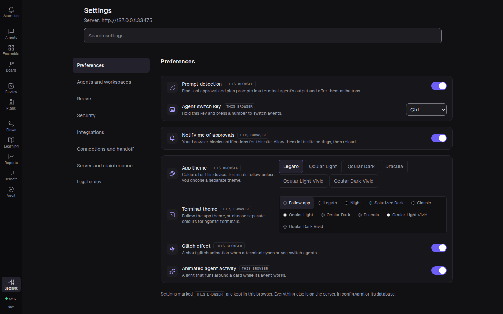
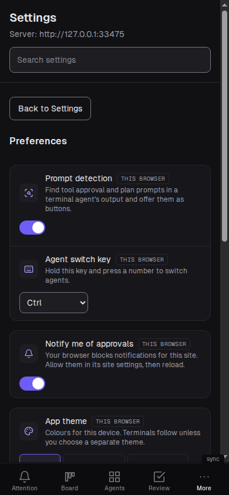
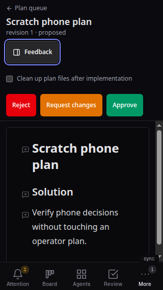
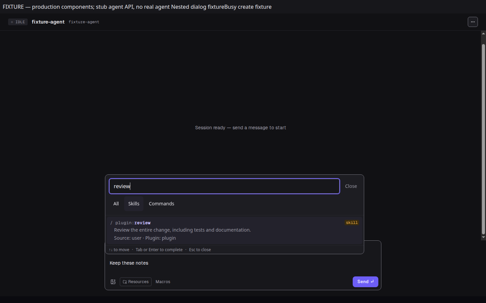

# Web UI excellence — implementation verification

15 November 2026. Approved plan `pl-xpgbjnrx-web-ui-excellence`, revision 1. Implementation branch: `legato/xpgbjnrx-web-ui-build`; isolated worktree `.legato/worktrees/web-ui-excellence`. Nothing was pushed, deployed, or restarted in the operator's instance.

## Delivered

- Seven selected Settings categories, task/key search, scope/source/pin/restart information, legacy fragment resolution and complete registry/list ownership. Typed common list fields preserve unknown JSON; text saves explicitly and detects live-update conflicts. Directory presets are editable. Credentials have one editor under Security.
- Shared modal stack and anchored menu lifecycle, nested Escape, isolation, busy handling, focus restoration and viewport-aware placement. Board actions have visible keyboard/touch entry points. Session settings use a labelled dialog rather than a menu role.
- Explicit Commands and skills discovery, ranked search and filters, readable metadata, partial-failure retry and draft-preserving insertion without sending.
- Phone plan Reject/cleanup parity, modal phone feedback, nonmodal desktop columns, artifact tabs/resize cleanup, navigation state, approval/voice focus, cached operational recovery and stale-response isolation.
- A Go settings-boundary correction: tmux options are strings, not objects. Their typed editor now saves through the real API and effective configuration.
- Shared legacy-default text/control/focus contrast and a 320px file-only key wrap correction. Named canonical themes, saved terminal overrides and composer inset focus remain intact.

## Checks

- **1,840 web tests in 239 files pass.** `pnpm -C web test`.
- **104/104 isolated browser assertions pass**, using a newly compiled Go binary, real scratch database/backend and current Vite frontend. Zero browser JavaScript exceptions.
- `pnpm -C web build` and `pnpm -C web lint` pass; the build includes TypeScript and generated-theme checks. Output is in this isolated worktree, not the operator checkout. Existing bundle-size and Browserslist-age warnings remain.
- `CGO_ENABLED=0 GOCACHE=/tmp/legato-ui-go-cache go test ./config ./internal/service ./internal/server` passes. Disabling CGO avoids the host ccache sandbox write failure; SQLite remains pure Go.
- `ASTRO_TELEMETRY_DISABLED=1 pnpm -C site build` passes: 57 pages, all internal links valid. Site dependencies were borrowed by a temporary local symlink; no dependency manifests changed.

The browser proves all 167 scalar/file-only/list catalog entries have exactly one rendered owner. It follows search/deep links (including delayed data), blur without save, Apply persistence, pin protection, external-edit conflict/reload, failed-load retry, and typed tmux string persistence. It exercises populated Board keyboard menus and Move, nested dismissal, create cancellation/restoration, and phone plan rejection through the real scratch API. Every Settings category fits 1440×900, 390×844, 320×568 and 720×450. All six themes pass sampled resolved text, required-control and keyboard-focus contrast across default, actual hover, selection, error and focus states. A deliberately 1:1 OKLCH probe checks the sampler itself.

Reproduce from this branch:

```sh
CGO_ENABLED=0 go build -o /tmp/legato-ui-verification ./cmd/legato
LEGATO_VERIFY_BIN=/tmp/legato-ui-verification node scripts/verify-web-ui.mjs
```

Results and individual measurements: `/tmp/web-ui-excellence-evidence/results.json` and `*-contrast.json`. The harness owns ephemeral ports, config, database, browser profile, Vite cache and tmux runtime; its final cleanup reports all three owned processes stopped and its runtime removed. It never falls back to a live backend.

## Test audit and repeat Impeccable pass

A fresh read-only test audit examined approximately 44 changed suites and the test-first logs. Primary contracts remain covered through public components/page entry points: terminal approval activation, modal/menu lifecycle, registry ownership, rejected/conflicting drafts, skill insertion, stale responses and refresh recovery. The phone approval regression now submits both unchecked and checked cleanup payloads; the changed keyboard-hint theme assertion no longer pins a literal fallback color. Existing unrelated class-literal tests were not rewritten or deleted. No tests were skipped or loosened to hide a product failure.

Repeat deterministic detection was partitioned below the 500-file limit: components produced 3 advisories/findings; pages/hooks/lib/index produced 10. All 13 are incumbent styling flags: functional quotation/selection/state side markers, optional glitch stripes, or themed Learning headings. They are not accepted as proof of defects or a reason to remove operational state distinctions. No detector-only visual redesign was made. The rendered pass instead found and fixed the real overflow and legacy-default contrast failures.

## Limits and integration

Skills and nested/busy dialogs use production-component fixtures with stub external agent API/WebSocket transport: real external agent execution is not verified. Phone fixture clipping is not evidence about the native agent integration. 720×450 is a CSS viewport equivalent of 200% zoom, not browser-chrome zoom. Physical touch/virtual keyboards, native desktop/Android, WebKit and full screen-reader conformance remain unverified. Contrast sampling covers solid resolved colors, not gradients, glyph antialiasing or arbitrary authored HTML.

Peer `bbjm32rw` owns server theme preference support. That component does not exist on this branch and is deliberately not imported. Once its branch lands, import named `ServerThemeSettings` from `components/settings/ServerThemeSettings` and mount **`<ServerThemeSettings />` (no props)** in `Settings.tsx`'s `current === "server"` group, after its Tint/Appearance card. Register its actual card ID as a server-owned search destination. Do not put the server preference in browser-tagged Preferences. Preserve the peer's ServerThemeProvider ordering and native bridge version check `>= 1`. No canonical palette or peer branch was changed here.

## Rendered evidence

These are current production UI paths on the disposable instance. The skill picker is explicitly a production-component fixture.








