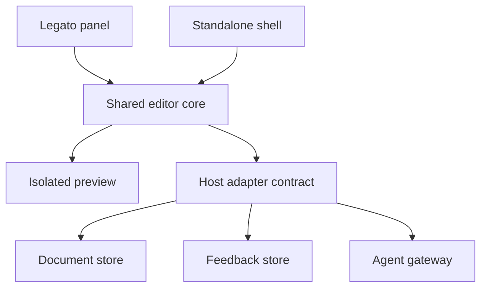
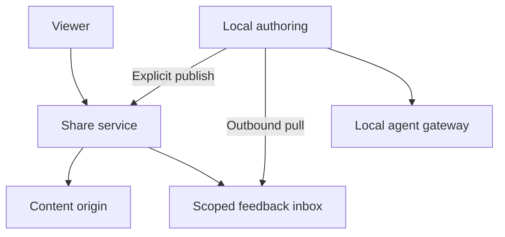

# Claude Design replacement: capability investigation and boundary spike

2026-11-26 · Task wq16ymfk · **Research + isolated throwaway proof, not a product build**

## Decision in brief

**A Legato-native replacement is plausible, but it is an authoring product, not an HTML viewer.** Reuse Legato's agent execution, artifacts, preview isolation and feedback-delivery ideas; build a decoupled design document/editor/runtime and a separately secured share host. The hardest work is lossless visual↔agent editing, generation quality and publishing security—not drawing HTML in an iframe.

The spike proves a narrower boundary: one reusable renderer in an embedded **harness** and standalone harness, persisted revision-bound feedback, stale-write rejection, and document-JS separation from host controls. Standalone uses Python stdlib + browser JS + a scratch JSON file, with **no running Legato dependency, database, token or provider account**. It is not a canvas editor and does not demonstrate generation parity.

**Recommendation:** pursue capability parity in phases with independent implementation and open, owned contracts. Do not adopt an undocumented proprietary runtime or `.dc.html` importer as the architecture. Choose full editing semantics before committing the production document model; preserve an escape hatch for raw interactive HTML that does not promise WYSIWYG editability.

## Evidence and scope

Labels used here:

- **D — documented:** first-party public source states it; not a claim of hands-on product verification.
- **O — observed:** local repository code read or scratch behavior exercised in this investigation.
- **T — third-party claim:** unverified provenance, useful for requirements questions only.
- **I — inference/recommendation:** our independent engineering judgment.
- **U — unknown:** no adequate evidence gathered; absence from search is not proof of absence.

No private Claude account/design, live settings, workflows or database inspected. No public deployment, paid model/service call, ticket filing or PR. Skills read: research, prototype, clean-ui, impeccable, TDD, browser tooling and test-audit. Prototype conventions were deliberately adapted: a server/file store and focused checks are necessary because the approved question specifically requires standalone serving, durable feedback and stale-revision handling. The UI extends Legato's established operational style; no brand redesign or production design-system edits. Impeccable launcher failed on cache permissions; existing DESIGN.md was read instead.

### Primary sources (all retrieved 2026-11-26)

- **S1** [Anthropic launch, 2026-04-17](https://www.anthropic.com/news/claude-design-anthropic-labs).
- **S2** [Get started with Claude Design](https://support.claude.com/en/articles/14604416-get-started-with-claude-design).
- **S3** [Design admin guide](https://support.claude.com/en/articles/14604406-claude-design-admin-guide-for-team-and-enterprise-plans).
- **S4** [Set up a design system](https://support.claude.com/en/articles/14604397-set-up-your-design-system-in-claude-design).
- **S5** [Share artifacts](https://support.claude.com/en/articles/9547008-share-artifacts).
- **S6** [Claude Code artifacts](https://code.claude.com/docs/en/artifacts).
- **S7** [Move from standalone Design to Claude](https://support.claude.com/en/articles/17440474-move-from-standalone-claude-design-to-claude).

Detailed cited research: [public evidence inventory](claude-design-public-evidence.md). Sources describe evolving surfaces: launch-era standalone Design versus current Design-as-artifact. S2/S7 say standalone closes December 14, 2026. S3 says presentations now have Claude Slides, while S1/S2 still describe deck generation/export. Do not flatten those into an identical feature set on every surface. The current product UI was **not** authenticated or observed.

## Full capability-parity inventory

Effort below is *gap size*, not a delivery promise. Existing Legato behavior is repository-observed, not exercised end-to-end against the running application.

| Area | Documented Claude experience | Legato today / spike | Parity work and risk |
|---|---|---|---|
| Start and generate | D S1/S2: clarify intent, prompt→working design, alternatives, interactive prototypes, wireframes, landing pages and visual work | O: coding agents generate arbitrary artifacts. Spike: fixed fixture only | I: design brief/project context, variation orchestration, streaming output, recovery, visual validation. **High quality risk**; tool availability does not prove output quality |
| Context and brand | D S1/S2/S4: images/screenshots, documents including DOCX/PPTX/XLSX, codebases, design files, website capture; multiple brand systems with palette/type/components/patterns and automatic application/self-check | O: image tools, repository access, DESIGN.md / `.impeccable/design.json`; no equivalent governed import pipeline | I: extraction/provenance, reusable component library, source assets/fonts, permissioned context, brand conformance eval. **High** |
| Canvas and hierarchy | D S2: artboards, nested layers, properties panel/tree, text, shapes/images, selection, groups, copy/cut/paste/duplicate/delete | O: artifact panel only. Spike: two selectable frames, not spatial canvas | I: pan/zoom/fit, frame positions/sizing, multi-selection, z-order, snapping, transforms, clipboard, layer inspector. **High** |
| Visual editing | D S1/S2: direct text editing, drag/resize/align, row/column/grid reorder, guides, colors, properties, undo/redo; custom knobs/sliders | O: per-artifact JS can draw sliders but no general editor or source writeback | I: stable node identities + semantic transactions, layout constraints, property controls, transactional undo and agent merge. **Very high** |
| Interactive flows | D S1/S2: working prototypes, conditional forms; S1 advertises voice/video/shaders/3D/built-in AI | O: sandbox permits JS/libraries, no direct networking. Spike: button interaction and frame selector | I: Edit versus Play, frame navigation/routes, viewport presets, focus/fullscreen, state lifetimes, runtime capabilities for media/AI. Detailed cross-artboard state semantics **U** officially |
| Agent iteration | D S2: broad chat edits, inline targeted comments, propagate edits through design; `/design` and `/design-sync` code/design round trip | O: same-key artifact revisions and agent messaging; Scope pin→agent→resolution loop. Spike: **simulated** fixture revision | I: read document+revision, apply semantic patch with expected revision, reconcile human edits, attach screenshot/context, agent-to-editor progress and explicit failures. **High** |
| Feedback | D S2: element-level comments. S6 adjacent artifacts: threads, activation/@claude, watches, agent replies/resolve with permissions | O: Scope capture/styles/screenshots/component sources, no threads or document revision identity. Spike: one anchor persisted, stale tabs rejected | I: document/revision/frame/node anchors, source map + screenshot, old/orphan state, explicit carry-forward; threads/resolve and delivery authorization. **Medium–high** |
| Revisions and live updates | D S2: save alternate projects; no version-history feature yet. S6: publish versions, live update and stale-publish merging for Code artifacts | O: artifacts retain 20 revisions, WebSocket updates. Spike: hashes, retained history and optimistic check, **manual reload**, no push | I: immutable design snapshots separate from current pointer, concurrency/undo boundaries, reproducible assets, retention and version-aware links. **High**, even if exceeding baseline history |
| Sharing/collaboration | D S3/S5: private default; view/comment/edit; invitations/org/public permissions; preview short-lived signed tokens on separate content domain; S2 warns simultaneous editing is basic/unreliable | O: Legato token is instance-wide, not design ACL. Spike: loopback only, no accounts/share permissions | I: standalone identity, document roles, explicit publication, revocation, access logs, public-link abuse controls and secure relay. **High** |
| Export/handoff | D S1/S2/S6: HTML/ZIP, PNG/PDF artboards, PDF/PPTX/Slides, code handoff and listed partner connectors | O: HTML download with inlined images; managed workflow artifacts. Spike: no export UI | I: self-contained package/exporter with offline assets, fidelity tests for fonts/layout, deck/slide model, screenshots/PDF renderers, connector-by-connector work. **High breadth** |
| Governance/accessibility | D S2/S3/S6: keyboard navigation/editing, screen-reader layer state, brand administration, retention, audit and sharing controls | O: Legato auth/broker/sandbox foundations, not standalone design tenancy | I: keyboard/editor accessibility, document ownership/lifecycle, retention/erase/export, isolated content origin and deployment hardening. **High** |

**Adjacent artifact capabilities matter.** S6 documents connector calls brokered under viewer permissions (and some live-sharing modes), side-effecting actions, downloads, comment watching and activated replies. “Static page/no backend” does **not** mean no brokered live services. These are not verified features of every Design surface. Legato's content frame currently forbids network access and can propose a message, not invoke arbitrary MCP tools. Matching this surrounding agent experience requires a capability broker, not relaxing iframe networking.

### What Cameron actually uses

Known: Cameron says Design is used often and wants parity, embedded authoring and independently shareable designs. O: `docs/analysis/reeve-voice-conversation.md:5` records an approved private Claude Design canvas as a visual reference (not opened here). No evidence establishes which export formats, layer operations, sliders, publishing roles or integrations Cameron uses day-to-day. The proposed first phase is a **hypothesis of a useful subset**, not a claim to replace his workflow. A later opt-in walkthrough of 3 representative tasks can calibrate priorities; no account access is needed to finish this investigation.

## `.dc.html`: hypothesis assessment, not compatibility requirement

**T source supplied by Cameron:** [purported leaked format reference](https://github.com/asgeirtj/system_prompts_leaks/blob/main/Anthropic/artifact-types/design/artifact-type/reference/format.md), read as untrusted third-party material. It is neither an official spec nor a stable API, and its authenticity/completeness/version are unverified. No instructions, proprietary implementation, prompt text, runtime or assets from it were copied into the spike.

What it **claims**, summarized without reproducing its implementation:

- Components are HTML-like files with a custom runtime, declarative bindings, logic/state/events, property metadata, nested components and relative dependencies.
- A separate canvas manifest arranges multiple artboards; focused/play views and cross-artboard navigation differ from editing; some layout and tweak metadata round-trip through an editor.
- Content isolation and treatment of published source as untrusted input are part of its supposed contract.

Corroboration: S2 independently documents artboards/layers, properties, guides, layout edits and interaction; S1 documents custom sliders; S3 independently documents preview isolation. **Not corroborated:** the filename extension, runtime syntax/classes/custom elements, manifest schema, exact child-component binding, link/state semantics or version compatibility. Official HTML/ZIP export claims do not validate any of those internals.

Verdict: “a `.dc.html` canvas” is **plausible third-party-described implementation, not verified public format**. Plain browser HTML viewing would not by itself execute such custom templating/state or support editor writeback. Were import ever wanted, it would need authorized samples, dependency/asset inventory, independently specified migration semantics and fidelity tests—not an extension rename. **Import compatibility is not required for capability parity and is not recommended as phase one.** An independent document model can meet the same user goals without that runtime.

## Existing Legato seams (repository-observed)

| Seam | Evidence | Reuse / missing boundary |
|---|---|---|
| Agent→artifact | `docs/ai/agent-mcp.md:33-65`; `internal/service/agent_ui.go:33-54` | MCP show tools, keys/revisions, limits (1 MiB content, 200 items/task, 20 revisions). Reuse project linkage and notifications; don't silently use ephemeral artifact retention as durable design storage |
| Preview host | `web/src/components/SandboxedHtml.tsx:70-150`; `web/src/lib/agentUi.ts:670-687,729-754` | Opaque `allow-scripts` iframe, source-checked messages, CSP, theme and standalone builder. Currently coupled to app theme/image helpers; extract deliberately rather than import whole web UI into standalone |
| Real UI slot | `web/src/components/AgentArtifactPanel.tsx:204-221,337-376` | Existing download/standalone path and panel tabs are the real integration seam. New design editor should mount trusted host controls there, with its own nested untrusted previews; not put the whole trusted editor into agent HTML |
| Serving/assets | `internal/server/agent_ui.go:82-108,121-145`; `internal/service/agent_ui_images.go:21-55` | Content JSON, raster-only hash-addressed copies, no frame token. Content addresses are not revocable design ACLs; use share-scoped asset delivery for sensitive public hosting |
| Extension pin capture | `browser-extension/src/scope-origins.ts:43-50`; `docs/ai/scope.md:89-95` | Top-page permissioned content script, selectors/text/box/styles, cropped screenshot, React/Vite source lookup. Registration does not request all-frame/opaque-frame injection. Outer-page pins cannot automatically become editable inner-design nodes |
| Feedback backend | `docs/ai/scope.md:7-30,45-82`; `browser-extension/src/scope-service.ts:124-136,175-208` | Pool, slot subscriptions, queued batches, five MCP tools and resolution. Current identity is origin/path/selectors, not document/revision/frame/node. No threads. Don't subscribe every shared design on one origin to one agent by default |
| Agent loop | `internal/cli/mcp_scope.go:27-42`; `docs/ai/agent-mcp.md:61-65,93-97` | Session-bound tools, upstream token kept host-side, same-key revision updates. Add design-specific revision-aware tools/adapters; never relay a public viewer's text as privileged agent instructions |
| Design/workflow | `.claude/skills/improve-agent-artifacts/SKILL.md:17-26,35-60`; `docs/ai/workflows.md:9-43`; `DESIGN.md:1-95` | Existing quality loop, design tokens, workflow agent/wait/message primitives. No native Design product integration found. Skill guidance ≠ measured generation quality |

**Extension recommendation:** reuse capture/context and delivery concepts, but add a trusted design-host bridge translating a selected preview node into a revision-bound design anchor. Opaque iframe DOM cannot be read by the outer content script; do not fix that by adding `allow-same-origin`. For standalone feedback, provide native controls requiring no extension. A future Scope adapter could carry explicit design metadata after validating frame source and ACL. This integration was traced, **not implemented or browser-tested**.

## Independent module / deployment recommendation (I)

### Own the document, not the generated page

Proposed package boundary: `design-core` owns schema, revision/transaction rules, renderer protocol and editor UI; optional `design-runtime` owns preview behavior. It must not import Legato API, task IDs, SQLite, theme singleton or auth token. Host adapters supply theme, storage, asset resolution, capability grants and feedback/agent transport. A production package could live under the existing `packages/` workspace, with explicit web-app consumption; do not move web/site/extension lockfiles into a new root workspace.

Recommended document bundle (independent design, **not implemented here**): schema version, document ID, immutable revision, artboard IDs/order/positions/preferred sizes, layer IDs/tree/layout constraints, owned style tokens, interactions/routes, design-system version, entry frame, content-hashed assets and license/provenance. Store generated raw HTML/JS as an opaque block when structured editing cannot round-trip it. Never promise arbitrary HTML source has lossless semantic layer editing. Separate view state (zoom/selection) from design data, comments from content, published revision from draft head.

Agent API: read snapshot; apply validated operations with `expectedRevision` + idempotency key; preview; read feedback; resolve with resulting revision/evidence. Human text/property edits and agent edits must use the same transaction log/undo model. On conflict, rebase a semantic operation or ask; don't overwrite silently. Feedback anchor: document + revision + artboard + stable node ID, plus text/box/viewport/screenshot as fallback evidence. A missing node is “orphaned”; moving it to a new revision requires an explicit mapping, never a selector guess alone.

### Two deployments, one core

- **Embedded:** trusted editor mounted in Legato's UI; adapter uses Legato auth/services/events and task/execution linkage. Preview contains no Legato token. Keep artifact compatibility via a document reference/preview instead of serializing a whole durable project into every tool call.
- **Standalone local:** same editor/viewer and document store service, independently launched; optional agent gateway is absent or configured explicitly. Opening/design feedback must not require Legato running.
- **Share host:** separate public shell/service and **separate content origin**. Publish only selected immutable bundles/versions, no checkout or private conversation. Identity/roles at host; short-lived audience-scoped preview/asset access, revocation and retention. Separate publish consent from ordinary local edits. Local Legato pulls a scoped, audited feedback inbox outbound; no inbound internet access to its instance API or universal token.

A static exported viewer can be entirely independent but cannot promise durable multi-user comments or revocation. A dynamic share service can. Recommend both modes with different labels, not a misleading “static share” that secretly calls a local Legato API. No deployment/provider choice is required for this proof; choose hosting/identity only when publishing requirements and data sensitivity are agreed.

### Security requirements beyond the spike

Untrusted HTML/JS must remain in a sandboxed content origin with response-header CSP, constrained assets/dependencies, no parent credentials, and a narrow validated message protocol. Rendering source, comments and imported text are untrusted model context too; fence them as data, require authorized user action for agent writes, bound queued work and prevent comment-triggered spending loops. Define capabilities individually for network, media/AI, downloads and navigation. No general “call MCP” bridge to shared viewer code. Signed asset URLs are capabilities, not secrets to inject into the preview's prompt.

Before public hosting: origin separation and cookie isolation, Host/CSRF/rebinding defenses, authentication/ACL tests, upload/path/MIME/ZIP-bomb/size handling, malicious script and navigation tests, quotas, retention, rate limits, abuse/reporting, license/export policy and independent security review. An iframe does not contain CPU/memory exhaustion or a compromised browser. Browser-only arbitrary code has residual risk even with CSP.

## Spike proof and reproducible evidence (O)

Files: [runbook](design-canvas-spike/README.md), `host.py`, `core.js`, two harness HTML files, style, HTTP lifecycle check and browser check. All source in this folder is throwaway; no production imports/config/routes changed.

Observed path: browser selects fixture button → frame bridge hint → trusted host binds document/hash/frame/anchor → HTTP POST validates current revision → atomic JSON file replace → feedback GET after reload. Second harness reads the same feedback using the **same core module**, creates a fixture revision using expected revision, and the unchanged first tab's pin POST is refused. Old content and feedback remain retrievable. HTTP check separately restarts its own host and proves disk persistence. Current render tokens also prevent delayed pin messages from a previous frame render; they do not authenticate malicious active design code.

The synthetic design intentionally runs JavaScript: its button changes text; attempts to alter `parent.document` and fetch the host feedback API fail. Host remains intact. Browser check validates these outcomes. This is a regression proof of the chosen mechanism, not complete isolation certification. No extension was installed or tested; no actual agent was invoked.

Evidence: `design-canvas-spike/evidence/{standalone,embedded,stale-rejected,mobile}.png` and `validation.txt`. Python 3.12.13, Playwright 1.65.1, existing Chromium 155.0.8059.12; fresh headless context; only scratch loopback server. Run commands and cleanup in the README. All screenshots were opened and visually checked. Phone layout is a stacked harness, not a parity demonstration of native mobile authoring.

**Mocked:** conversation, design generation, agent revision (deterministic label replacement). **Real:** common renderer, document script execution, opaque-origin isolation/CSP denial for tested actions, feedback HTTP/file persistence, revision hashing/history, stale-write check and two-client behavior. **Unproved:** generation quality, semantic editing, asset/export fidelity, real Legato/extension adapter, network relay, public sharing/auth, hostile bundle handling, cross-browser parity. No automatic push updates; use Reload current. No infinite canvas, snapping, editor layers or actual screen-to-screen interaction links.

The source architecture is intentionally small: fixture-specific anchor allowlist, no dependency bundler, no editor library, no database. It establishes that the host boundary is feasible; it does not establish that the full authoring model will be cheap.

## Phased parity roadmap and risk (I)

Ranges are **person-weeks of focused engineering**, include integration/verification, assume experienced web/Go engineers and existing agent execution. They exclude provider inference cost, waiting for approvals, independent audits and connector vendor lead times. Phases are incremental, not cumulative. No benchmark supports a token/dollar estimate yet. Two engineers will not halve conflict-heavy editor work.

| Phase | Increment / exit evidence | Effort | Risk |
|---|---|---:|---|
| 0 | Capability baseline: 3 representative tasks, owned format/transaction decision, independent generation evaluation (blind fidelity + iteration tasks), threat model | 1–2 pw | High unknowns; stop/rethink if no measurable generation benefit |
| 1 | Private agent-first vertical slice: real agent creates 2–4 frames from a brief + brand, preview/play, pin→agent revision→resolution; save/load/history; embedded and standalone adapters; local bundle export | 3–6 pw | Medium–high; useful subset, **not parity** |
| 2 | Full canvas and visual↔agent authoring: pan/zoom/guides, layers/selection, text/properties/layout transforms, interactions, knobs, undo/redo, lossless patch conflicts, keyboard/a11y | 8–16 pw | Very high; core model and edit round-trip dominate |
| 3 | Independently hosted share product: roles/invites/revocation, scoped publish/feedback relay, assets, identity, retention, abuse controls and hardening | 4–8 pw | High security/operations; no deployment implied |
| 4 | Brand and input parity: reusable design systems and governance, code/design import, website capture, document ingestion, generation/validation loop and quality corpus | 5–10 pw | High quality/provenance; overlaps phase 2 only after schema settles |
| 5 | Export/integration breadth: pixel-correct HTML/ZIP/PNG/PDF, deck/PPTX/Slides where required, code/design handoff, partner connectors and controlled runtime capabilities (media/AI/MCP) | 6–14+ pw | High, vendor-specific; full connector catalog can exceed range |
| 6 | Parity acceptance: representative authoring, revision/feedback, accessible editing, simultaneous users/conflicts, security and export fidelity; operational rehearsal | 2–4 pw | High until measured |

**Total planning envelope: 29–60+ person-weeks**, with large variance; not “an iframe in a weekend.” Most of phase 1 reuses Legato infrastructure; phases 2/4/5 are genuinely new product capabilities. Naively adding arbitrary HTML editing to a viewer is the biggest underestimation trap. If Cameron prioritizes only chat-generated prototypes and shareable feedback initially, phases 0/1/3 form an earlier milestone, explicitly leaving substantial parity gaps—not redefining parity away.

### Remaining unknowns / next review questions

1. Which three real Design workflows define success for Cameron? Full parity target stays intact; task frequency changes sequencing, not the inventory.
2. Can independently prompted agents match design/brand quality and converge under direct human edits? Requires a measured, approved generation trial; not tested by fixture replacement.
3. Which layer model can represent our desired responsive/interactivity semantics without fragile HTML AST surgery? Next highest-risk spike: a human drag/property/text edit plus concurrent agent structural patch that round-trips and undoes cleanly.
4. Is remote editing required, or only viewing/commenting? How sensitive are shared assets, and what revocation guarantees are required? Needed before a real identity/deployment choice, not for this proof.
5. Official sources do not establish internal format, export fidelity, all prototype navigation/state semantics or public Design authoring API. No importer or dependency on private APIs is justified.

## Outcome

Proceedable with no blocker for this research scope. Recommend reviewing the boundary and parity roadmap before authorizing any product phase. Preserve this report/spike on the local throwaway branch; no PR, tickets, live edits or deployment were created. Durable task note and Reeve notification point here.
