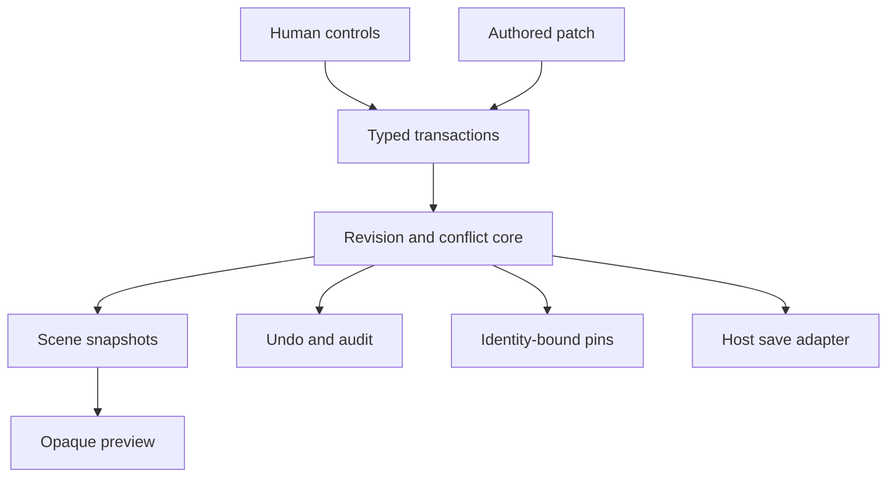

# LEG-665: human + agent edit reconciliation — findings

2026-11-26 · isolated throwaway proof · predecessor [LEG-664](/LEG-664)

## Verdict

**Feasible for an owned, constrained scene graph; not proved for arbitrary HTML/JS.** An independent TypeScript core can accept the same semantic transactions from direct human-facing controls and revision-aware structural patches. In this proof it preserves node identity, unchanged text/styles and world positions, rejects true conflicts, supports global undo/redo, and persists history and revision-bound feedback.

Evidence is **automated UI-driven**, not a Cameron usability sign-off. Playwright uses actual contenteditable text, property inputs and pointer movement in the opaque preview. The **agent portions are authored/simulated JSON patches**, not model generation, an agent session, MCP or a real Legato integration. No provider/login/paid service was used.

All code is under `docs/research/design-editor-spike/`; no production code/config/workflow, dependency lockfile or CI changed. The preceding proof/report/source/images remain untouched. LEG-664 is completed with exact-file archive inventory Note `c701e4f1-cb17-4cbe-863b-321bf4d0f5bb`; 12/12 stored-body receipt reconstructions byte/SHA-256 matched. Its PNGs are Legato-held (`ui-318f587b0b:1`), not Burnlite attachments.

## What was actually exercised

| Phase | Actual operation/outcome | Evidence |
|---|---|---|
| r0 | Capture authored patch base; pin `workspace-study / r0 / board / cta`, quote “Continue” | before snapshot; retained pin in subsequent phases |
| r1 | Type “Workspace for the launch team” into the canvas heading and Tab out | real contenteditable focusout → semantic text transaction |
| r2 | Inspector Fill change to `#245e9b` | real input change → property transaction |
| r3 | Drag `Move cta` by +90,+35 | actual pointer capture/movement/up → x/y transaction; canvas position (130,315) |
| stale attempt | Apply original r0 structural patch against r3 | refused; no document revision/change |
| r4 | Explicit Rebase nonconflicting | insert `details-group`, reparent existing body/cta; human text/fill preserved; cta local position becomes (114,299) under group origin (16,16), still world (130,315) |
| r5/r6 | Undo latest transaction, Redo next transaction | grouping removed/restored while prior human edits remain; new monotonic revision IDs |
| saved v1 | Save → full page reload | document, snapshots, history, pins and audit equal saved serialized state |
| r7 + conflict | Capture rename base r6, directly edit cta to “Open launch workspace”, try authored “Start now” patch | refused with base/current/proposed values; user text remains; revision stays r7 |
| r8 | Fresh remove-cta patch | old r0 pin explicitly Orphaned, original identity/revision/quote retained |
| r9 | Undo removal → Save v2 → reload | same node restored with human text; pin becomes historical-target-present, not silently rebound to a new revision |
| second shell | Open embedded harness | same compiled UI/core loads identical saved session; harness explicitly not real Legato UI |

`evidence/trace.json` preserves the before/after document snapshots, feedback states, final state, accepted/rejected patch audit and accepted patch list. The larger per-phase JSON files also preserve complete serialized sessions locally, including repeated snapshots/history; they are diagnostic expansions of the compact substantive evidence and reproducible by the check script. The compact trace is not labeled a complete serialized session.

Four PNGs show direct edits, structural rebase, conflict, and orphaning. They were opened and visually inspected at 1440px. The editor is a desktop feasibility harness; no mobile-editor or full accessibility claim.

## Mechanism and independent boundary

- `core.ts`: stable document ID `workspace-study`, frame/root ID `board`, node IDs, owned scene schema, transactions, revision snapshots, serialization, global undo/redo, pin lifecycle. No DOM, Legato imports/token, network, filesystem or database.
- `ui.ts`: browser projection and human-facing controls. It sends semantic operations, not raw source replacement or extracted DOM dumps. Both `/` and `/embedded.html` import the SAME compiled module/core.
- `serve.mjs`: disposable Node stdlib host with file-backed state, serialized compare-and-swap and atomic rename. It does not depend on running Legato, its token/database or a provider account. TypeScript compiler is a build-time dependency; `TSC_PATH` supports an external standalone copy. Node is a harness choice, not production host advice; TypeScript core + Go services remains the recommendation.

### Transaction semantics tested

1. **Immutable snapshots with session-scoped revisions.** `Editor.apply` takes a known base revision and operation list. Default policy refuses any stale revision. Only the explicit rebase action attempts reconciliation.
2. **Field-scoped rebase.** A scalar set requires that field's current value equal its base value. This preserves changes to other fields. Same-field changes are refused, not last-writer-wins.
3. **Structural preconditions.** Insert/reparent check relevant parent child lists/topology. Reparent is a semantic “keep current world position” operation: live human drag coordinates are transformed into the new parent's local coordinates. Remove compares the whole subtree and parent child list; it refuses to erase changed descendant content/styles.
4. **Atomic application.** Base and head are cloned. Any operation failing leaves document/revision/history untouched; only the rejection audit changes. A compound insert+conflicting-text test proves no partial inserted node leaks through.
5. **Global linear history.** Each accepted transaction retains before/after data, actor and operations. Undo/redo restore snapshots as NEW revisions. New edits after undo discard the redo branch. This is not selective actor undo, CRDT/OT or concurrent replica merging.
6. **Identity-reserving feedback.** Pins keep original document/revision/frame/node/quote. Reparent does not change node IDs. Deletion marks a pin orphaned; no selector guessing. IDs present in ANY retained snapshot cannot be recycled. Undo restores the original node and feedback target; it does not rewrite the pin's revision.
7. **Host persistence CAS.** Save includes expected storage version. Two concurrent saves at version 0 produce one success and one 409; a host restart reads the winner and keeps editable state, pins and undo/redo. No hidden browser-local-storage dependency.

## Verification and discoveries

Commands and full runnable steps are in `README.md`. Actual final log: `evidence/validation.txt`.

- Node v24.22.3; TypeScript 5.9.3; Playwright 1.65.1; reused Chromium 155.0.8059.12 in a fresh headless profile.
- Six focused core/storage tests PASS; the automated UI scenario PASS on **two fresh-state runs** after the readiness fix. One browser suite at a time; no running Legato or user Chrome tested.
- Tests first: missing core module, then missing serialize/undo/pin/remove and storage support failed before implementation. Core entrypoints are those the real UI and host call.
- A final UI run found a real **preview navigation race**: direct input could reach an obsolete iframe document between srcdoc assignment and new preview readiness. Fixed by hiding interaction until the current render token AND requested edit/pin mode are acknowledged by the preview. Editability follows mode. No sleeps, retries or increased test timeout were added. The two fresh-state reruns passed.
- Parent DOM access and `/state` fetch attempted from inside the opaque preview were denied while its normal edit script ran. This remains a bounded isolation check, not a sandbox/security audit.
- Test audit: **7 checks retained** (5 core, 1 HTTP storage, 1 browser scenario), no redundant constant/source assertions, no production tests changed. Distinct risks are semantic rebase, atomic conflict refusal, undo/history serialization, pin identity/tombstones, changed-subtree deletion, HTTP/disk CAS lifecycle, and real UI/iframe wiring.

## What this does NOT prove

- **No arbitrary HTML/JS losslessness.** The format has frame/group/text/button nodes and explicit position/size/color fields. There is no HTML importer, DOM-to-source mapping, rich text, CSS cascade/flex/grid/rotation constraints, component logic/state, images/assets, fonts, responsive behavior or linked screen flow.
- **No generation/brand-quality claim.** Authored fixture patches are not a model successfully understanding a human edit. No real agent, MCP, Scope extension or Legato service integration ran.
- **No production collaboration.** Revisions `rN` are unique only in one saved session. Two divergent replicas could reuse revision labels; production must use globally unique/context-bound revisions and enforce document identity. Coarse parent-list checks can reject changes that a richer semantic merge could safely reconcile. No text merge or convergence proof.
- **No selective/remote undo.** Undo is global linear history in one authoritative local session. Saving stale remote state fails; user must load/reconcile rather than silently overwrite.
- **No production identity/retention design.** All snapshots are retained in memory/JSON and double as deleted-ID reservations. Real pruning requires durable tombstones and a history/asset retention policy; session size is limited by the scratch host to 1 MB.
- **No general trusted-gesture bridge.** Preview text is escaped structured data and only our editor script runs. A malicious active preview script could read its own token and spoof edit messages; source-window/token checks prevent cross-frame/stale-render confusion, NOT malicious same-frame privilege escalation. Do not expose this as a write bridge to arbitrary generated JS. Production should separate trusted edit overlays/intents from untrusted Play code and scope capabilities explicitly.
- **No public service.** Loopback host has no accounts, ACL, public link permissions, multi-process lock, fsync/power-loss guarantee, CSRF/Host/rebinding defense, audit policy or abuse limits. No deployment, provider choice or public-share security certification.
- **No human usability sign-off.** Cameron can try the retained runnable demo, but the evidence here is automated UI interaction. Keyboard/property accessibility is partial; canvas/selection/multiframe UX parity is not claimed.

## Recommended decision

Use an **owned structured document/transaction boundary** for editable design nodes; render HTML as a projection. Let human tools and agents emit the same validated semantic operations against explicit document/revision context. Keep host auth/storage/agent transport out of that core.

Do NOT promise lossless visual editing of arbitrary generated application source. Plan two explicit modes when necessary: structured editable scene nodes, and opaque HTML/JS components that can run/play but require agent/code edits unless their editable properties are declared. Neither mode requires copying Claude internals or adopting `.dc.html`.

Preserve world/layout intent as a named operation, not a blind parent-ID change. Define conflict granularity and undo ownership before productizing. Pins need stable node IDs + original revision evidence, plus explicit orphan/historical states; they should not automatically jump to a selector match on a newer revision.

## Updated effort / risk

The proof reduces uncertainty about a **small typed transaction kernel**, not the full editor. It does not justify shrinking LEG-664's **29–60+ person-week** full-parity envelope or its **8–16 person-week** canvas/editing phase. Those remain high-uncertainty planning ranges, not calendar commitments.

A possible production sub-slice within that canvas phase—versioned schema/operations, server authority, identity tombstones, conflict protocol, durable history and a few direct controls—looks like **2–4 person-weeks** under constrained semantics, with high variance and validation/security work still needed. It is not additive to the old estimate and is not authorization to build it. Responsive layouts, rich content/logic editing, arbitrary-code boundaries, accessible canvas UX and multi-user/history semantics remain the major risks.

Next decisions (not implemented/authorized by this result): supported editable grammar versus opaque blocks; real agent operation protocol/quality evaluation; central authority versus concurrent replicas; semantic layout policies; trusted edit gesture boundary; production snapshot/tombstone GC. Full capability parity and independent sharing remain the product investigation target, not this small subset.

## Preservation and status

Runnable source, runbook, this report, actual validation log and compact substantive trace are preserved as LEG-665 Notes with receipt/hash inventory. Screenshots are copied into a Legato artifact, **not Burnlite binary attachments**. Expanded full-session diagnostic JSON and local binaries remain available in the clone and are reproducible; they are not silently claimed to be separate Burnlite backups.

No product PR, push, deployment, live settings/workflow edits or cleanup of the original deliverables. The result is ready for review as a bounded feasibility answer; it is not full product implementation approval.
