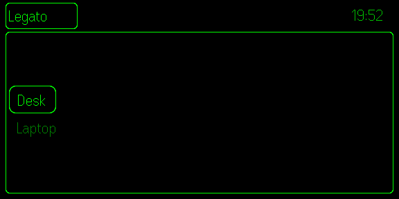
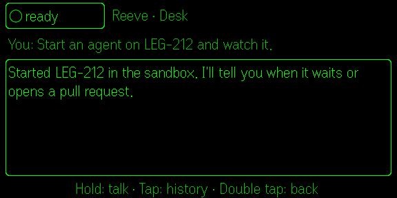
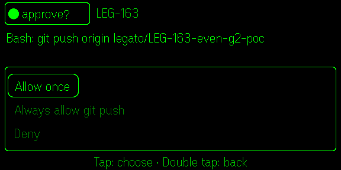

:::caution
This is a proof of concept. It runs in the Even Hub simulator; it has not yet run on real glasses. You build it from source.
:::

The glasses app puts your agents on the display of Even Realities G2 glasses. The ones that need you come first, so a glance tells you whether to go back to your desk. Talk to your Legato's [Reeve](/legato/using/reeve/) to give it instructions from wherever you are. Tap an agent to see what it has been doing, and hold to dictate a message to it.

The glasses app works with the Legato Android app on the same phone. It reads your Legato through that app, so every Legato you paired the phone with works on the glasses. The glasses hold no Legato address or token.


## What it shows

The app opens on the Legatos you paired the Legato app with. Tap one to see its agents. If the Legato app has only one, the glasses open it straight away. If you remove the Legato you have open from the Legato app, the glasses come back to this list and say so.



A Legato's list of agents has two tabs. **Active**, where the app opens, starts with the **Reeve** (`◆`) and, while approvals wait, **To approve**, then holds every agent that is not idle, the ones that need you first. It ends with **Idle agents**, which opens the **Idle** tab. Each line shows an agent's state, task ID and as much of its title as fits. The Reeve is counted on neither tab.

| Mark | State |
| --- | --- |
| `●` | needs you: it is waiting on a permission or a question |
| `▲` | error |
| `▶` | running |
| `▷` | background: its turn ended, and something it started still runs |
| `○` | idle |

The time at the top right is when the list was last read; the app reads it every 5 seconds while it is open, and every 30 seconds while the glasses' screen is off. Once the list is a minute old or more, how old shows before the time, such as `3m · 10:49`. Switching to background mode and back reads it at once. When the Legato app or Legato can't be reached, a note beside the tabs says so, and the last list stays on screen.

Open an agent to see its state in a badge at the top, then its feed: what it asks you for, then what it said and did, newest first, one line each. Tap a line to read it in full. A message that Legato or another agent sent it is shown as theirs, not as yours.


This works for agents that Legato drives natively, such as Claude Code and Codex. For an agent driven through its terminal, the page says there is no conversation to read.

## Talk to the Reeve

The Reeve is your Legato's own agent: you tell it what to do with the instance, such as start an agent on a ticket, check what needs you, or stop something. On the glasses it is a chat. Tap **Reeve** at the top of the Active tab.



The page shows the Reeve's state in the badge (`○ ready`, `▶ working`, `● needs you`, or `○ asleep` when no session runs), what you said last on a dim line, and the Reeve's reply in the frame under it. Swipe to scroll a long reply. While the Reeve works, the frame says **Thinking…** and what it is doing.

Hold the touchpad to talk to it, as for an agent: let go, check the transcript, and tap to send. A message wakes a Reeve that is asleep, or starts one. The Reeve knows the message came from the glasses, so it answers in a sentence or two of plain text, the outcome first. When something it does needs your approval, it says so; approve it on your phone or in the web UI, as usual.

Tap the chat to see the Reeve's whole conversation, one line an entry, as for an agent. Double tap goes back to the chat.

## Approve from the glasses

While requests wait for you, **To approve (N)** sits under the Reeve on the Active tab. Open it for the list, a line each:

| Mark | |
| --- | --- |
| `●` | you can decide it here |
| `◇` | signed: it needs your signature, so approve it on your phone |
| `○` | a question, or a request with nothing to choose: answer it on your phone or in the web UI |

Open one you can decide: its options are listed under it, such as **Allow once**, **Always allow** and **Deny**. Tap an option, and the next page shows the whole request with what you chose; tap again to send it, or double tap to go back. Nothing is decided on one tap. On an agent's page, the line of what it asks for (`● Asks: …`) opens its approval too.



If it was decided somewhere else first, the glasses say so. The decision is recorded as made on the glasses.

## Background mode

Hold the touchpad on the list to fold it into one row across the top of the display, so you can keep an eye on your agents while doing something else. On the left, bright, how many need you (`●`) and how many hit an error (`▲`); on the right, dim, how many are running (`▶`), in the background (`▷`) and idle (`○`), and the glasses' battery. The battery moves to the bright side when it runs low. Hold again to bring the list back; a tap or a double tap does nothing there, so a brush of the temple leaves it be.


## Dictate a message

1. Open the agent.
2. Hold the touchpad and say your message. The app records from the glasses' microphone while you hold, for up to a minute.
3. Let go. Legato transcribes what you said, and the glasses show it.
4. Tap to send it to the agent, or double tap to drop it.

If the agent can't take the message, because it is busy for example, the glasses say so and keep the message. Tap to send it again.

Legato does the transcription, so it needs `voice.enabled` and `voice.whisper_url` set (see the [configuration reference](/legato/reference/configuration/)). A message reaches only an agent that is running natively; the app never starts an agent.

## The touchpad

| Where | Up, down | Tap | Double tap |
| --- | --- | --- | --- |
| The list of Legatos | Move through the list | Open that Legato's agents | Ask to leave the app |
| Active tab | Move through the list | Open the Reeve's chat, the approvals, an agent, or the Idle tab | Back to the list of Legatos, or ask to leave the app when you have only one |
| Idle tab | Move through the list | Open the agent | Back to Active |
| The Reeve's chat | Scroll the reply | Open its whole conversation | Back to the list |
| An agent's feed | Move through the feed | Open the entry (what it asks: its approval) | Back to the list, or to the Reeve's chat |
| The approvals | Move through the list | Open the approval | Back to the list |
| An approval | Move through its options | Choose the option | Back to the approvals |
| Confirming | Scroll | Send the decision | Back to the approval |
| An entry | Scroll | | Back to the feed |
| Recording | | Stop | Drop it |
| The transcript | | Send it | Drop it |
| A problem | | Send it again, if it failed to send | Back to the agent |

On the Reeve's chat, an agent's feed or an entry, hold to record a message; letting go stops the recording. On the list, hold to switch to background mode; in background mode, hold to switch back. Each page says at its foot what the touchpad does there.

## Pair the glasses with the Legato app

You need the [Legato Android app](/legato/running/devices/), paired with at least one Legato, on the phone that runs the Even Realities app.

1. In the Legato app, open **Glasses** from the server list and switch on **Even G2 glasses link**. A code appears, and the app keeps the link running in the background, with a notification while it is on.
2. Tap **Copy**.
3. In the Even Realities app, open the Legato glasses app's page, paste the code and tap **Save**. The page says it is paired.

You pair once. **New code** in the Legato app makes a new code and stops the old one working at once; paste the new one to pair again. Switching the link off stops the glasses reading Legato until you switch it on again.

If the glasses say **Can't reach the Legato app on this phone**, the Legato app's link is off or the app is not running. **The Legato app refused the pairing code** means the code on the glasses is not the one the Legato app shows now.

## Try it in the simulator

You need Node 22.13 or later and pnpm 11. In the Legato repository:

```bash
task even-hub:dev   # serves the app with a fake phone: two sample Legatos, the first with sample agents and a sample conversation
task even-hub:sim   # opens the Even Hub simulator on it
```

The fake phone needs no code. Any recording "transcribes" to one sentence, and a sent message goes nowhere. Nothing reaches a real Legato.

## On your glasses

There are two ways to get the app onto real glasses. Neither has been tried yet.

- **From your machine.** Run `VITE_LEGATO_PHONE=real pnpm dev --host 0.0.0.0` in `packages/even-hub/` and scan the QR code that `pnpm exec evenhub qr --url http://<your machine>:5173` prints in the Even Realities app's developer mode. The phone loads the app from your machine, and the app reads the Legato app on the phone. What the app logs is printed by the dev server, since the Even app has no developer tools on Android.
- **As a private build.** `task even-hub:pack` builds `dist/legato.ehpk`. It can reach only the Legato app on the phone, so the one package works with every Legato you paired. Upload it to the Even Hub developer portal and install it from the Even Realities app.
- **On the beta channel of your Even developer account.** Sign in once with `pnpm -C packages/even-hub exec evenhub login`. Then `task even-hub:beta -- -m "what changed"` raises the patch version in `app.json`, packs the app, uploads it and puts it on beta; update it from the Even Realities app's Even Hub tab. The first time, when the app is not on your account yet, add `--create`. Commit `app.json` afterwards, so the next build gets the next version.

Either way, pair it with the Legato app as above.

The pairing code lets the glasses make only the calls they need: list your Legatos, read agents and conversations, transcribe, send a message to an agent, send a message to the Reeve, list the approvals waiting, and allow or deny one (never one that needs your signature). The Legato app answers only on the phone itself. Each Legato's web token stays in the Legato app; nothing secret is built into the glasses app.

The package's [README](https://github.com/cpave3/legato/blob/main/packages/even-hub/README.md) has the details, and its internals are in [`docs/ai/even-hub.md`](https://github.com/cpave3/legato/blob/main/docs/ai/even-hub.md) on GitHub.
