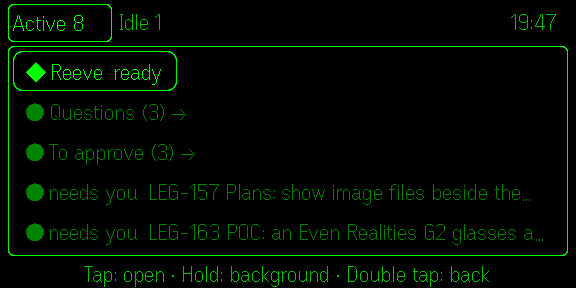
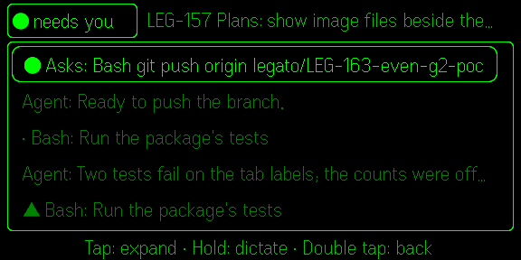

:::caution
This is a proof of concept. It runs in the Even Hub simulator; it has not yet run on real glasses. You build it from source.
:::

The glasses app puts your agents on the display of Even Realities G2 glasses. The ones that need you come first, so a glance tells you whether to go back to your desk. Tap an agent to see what it has been doing, and hold to dictate a message to it.

The glasses app works with the Legato Android app on the same phone. It reads your Legato through that app, so every Legato you paired the phone with works on the glasses. The glasses hold no Legato address or token.



## What it shows

The list has two tabs. **Active**, where the app opens, holds every agent that is not idle, the ones that need you first. It ends with **Idle agents**, which opens the **Idle** tab. Each line shows an agent's state, task ID and as much of its title as fits.

| Mark | State |
| --- | --- |
| `●` | needs you: it is waiting on a permission or a question |
| `▲` | error |
| `▶` | running |
| `▷` | background: its turn ended, and something it started still runs |
| `○` | idle |

The time at the top right is when the list was last read; the app reads it every 5 seconds while it is open. When the Legato app or Legato can't be reached, a note beside the tabs says so, and the last list stays on screen.

Open an agent to see its state in a badge at the top, then its feed: what it asks you for, then what it said and did, newest first, one line each. Tap a line to read it in full. A message that Legato or another agent sent it is shown as theirs, not as yours.



This works for agents that Legato drives natively, such as Claude Code and Codex. For an agent driven through its terminal, the page says there is no conversation to read.

## Dictate a message

1. Open the agent.
2. Hold the touchpad and say your message. The app records from the glasses' microphone while you hold, for up to a minute.
3. Let go. Legato transcribes what you said, and the glasses show it.
4. Tap to send it to the agent, or double tap to drop it.

If the agent can't take the message, because it is busy for example, the glasses say so and keep the message. Tap to send it again.

Legato does the transcription, so it needs `voice.enabled` and `voice.whisper_url` set (see the [configuration reference](/legato/reference/configuration/)). A message reaches only an agent that is running natively; the app never starts an agent.

## The touchpad

| Where | Up, down | Tap | Double tap |
| --- | --- | --- | --- |
| Active tab | Move through the list | Open the agent, or the Idle tab | Ask to leave the app |
| Idle tab | Move through the list | Open the agent | Back to Active |
| An agent's feed | Move through the feed | Open the entry | Back to the list |
| An entry | Scroll | | Back to the feed |
| Recording | | Stop | Drop it |
| The transcript | | Send it | Drop it |
| A problem | | Send it again, if it failed to send | Back to the agent |

On an agent's feed or an entry, hold to record a message; letting go stops the recording.

## Pair the glasses with the Legato app

You need the [Legato Android app](/legato/running/devices/), paired with at least one Legato, on the phone that runs the Even Realities app.

1. In the Legato app, open **Glasses** from the server list and switch on **Even G2 glasses link**. A code appears, and the app keeps the link running in the background, with a notification while it is on.
2. Tap **Copy**.
3. In the Even Realities app, open the Legato glasses app's page, paste the code and tap **Save**. The page says it is paired.

You pair once. **New code** in the Legato app makes a new code and stops the old one working at once; paste the new one to pair again. Switching the link off stops the glasses reading Legato until you switch it on again.

If the glasses say **Can't reach the Legato app on this phone**, the Legato app's link is off or the app is not running. **The Legato app refused the pairing code** means the code on the glasses is not the one the Legato app shows now.

## Try it in the simulator

You need Node 22.13 or later and pnpm 11. In the Legato repository:

```bash
task even-hub:dev   # serves the app with a fake phone: two sample Legatos, sample agents and a sample conversation
task even-hub:sim   # opens the Even Hub simulator on it
```

The fake phone needs no code. Any recording "transcribes" to one sentence, and a sent message goes nowhere. Nothing reaches a real Legato.

## On your glasses

There are two ways to get the app onto real glasses. Neither has been tried yet.

- **From your machine.** Run `VITE_LEGATO_PHONE=real pnpm dev --host 0.0.0.0` in `packages/even-hub/` and scan the QR code that `pnpm exec evenhub qr --url http://<your machine>:5173` prints in the Even Realities app's developer mode. The phone loads the app from your machine, and the app reads the Legato app on the phone. What the app logs is printed by the dev server, since the Even app has no developer tools on Android.
- **As a private build.** `task even-hub:pack` builds `dist/legato.ehpk`. It can reach only the Legato app on the phone, so the one package works with every Legato you paired. Upload it to the Even Hub developer portal and install it from the Even Realities app.

Either way, pair it with the Legato app as above.

The pairing code lets the glasses make only the calls they need: list your Legatos, read agents and conversations, transcribe, and send a message. The Legato app answers only on the phone itself. Each Legato's web token stays in the Legato app; nothing secret is built into the glasses app.

The package's [README](https://github.com/cpave3/legato/blob/main/packages/even-hub/README.md) has the details, and its internals are in [`docs/ai/even-hub.md`](https://github.com/cpave3/legato/blob/main/docs/ai/even-hub.md) on GitHub.
