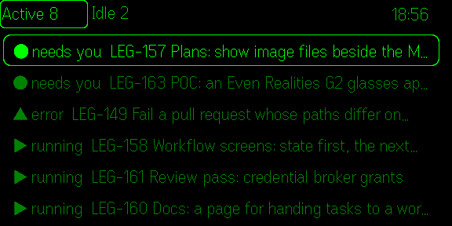
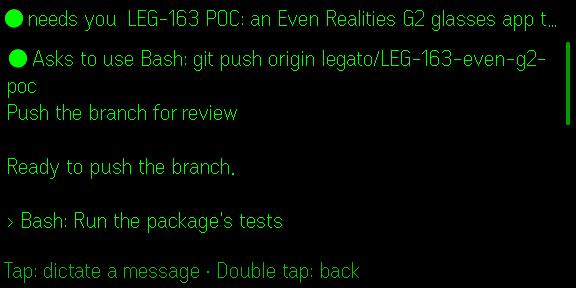

:::caution
This is a proof of concept. It runs in the Even Hub simulator; it has not yet run on real glasses. You build it from source.
:::

The glasses app puts your agents on the display of Even Realities G2 glasses. The ones that need you come first, so a glance tells you whether to go back to your desk. Tap an agent to read what it has been doing, and tap again to dictate a message to it.



## What it shows

The list has two tabs. **Active**, where the app opens, holds every agent that is not idle, the ones that need you first. It ends with **Idle agents**, which opens the **Idle** tab. Each line shows an agent's state, task ID and as much of its title as fits.

| Mark | State |
| --- | --- |
| `●` | needs you: it is waiting on a permission or a question |
| `▲` | error |
| `▶` | running |
| `▷` | background: its turn ended, and something it started still runs |
| `○` | idle |

The time at the top right is when the list was last read; the app reads it every 5 seconds while it is open. When Legato can't be reached, a note beside the tabs says so, and the last list stays on screen.

Open an agent to see what it asks you for, then what it said and did, newest first.



This works for agents that Legato drives natively, such as Claude Code and Codex. For an agent driven through its terminal, the page says there is no conversation to read.

## Dictate a message

1. Open the agent.
2. Tap, and say your message. The app records from the glasses' microphone for up to a minute.
3. Tap again. Legato transcribes what you said, and the glasses show it.
4. Tap to send it to the agent, or double tap to drop it.

Legato does the transcription, so it needs `voice.enabled` and `voice.whisper_url` set (see the [configuration reference](/legato/reference/configuration/)). A message reaches only an agent that is running natively; the app never starts an agent.

## The touchpad

| Where | Up, down | Tap | Double tap |
| --- | --- | --- | --- |
| Active tab | Move through the list | Open the agent, or the Idle tab | Ask to leave the app |
| Idle tab | Move through the list | Open the agent | Back to Active |
| An agent | Scroll | Record a message | Back to the list |
| Recording | | Stop | Drop it |
| The transcript | | Send it | Drop it |

## Try it in the simulator

You need Node 20.17 or later and pnpm. In the Legato repository:

```bash
task even-hub:dev   # serves the app on recorded agents and a recorded conversation
task even-hub:sim   # opens the Even Hub simulator on it
```

On the recorded data, any recording "transcribes" to one sentence, and a sent message goes nowhere.

To use your own Legato instead, set its address and [web token](/legato/security/web-auth/) before `task even-hub:dev`:

```bash
export LEGATO_URL=https://localhost:3080
export LEGATO_TOKEN="$(legato auth token)"
export NODE_EXTRA_CA_CERTS=~/.local/share/legato/certs/ca.pem   # when Legato makes its own certificate
```

The token stays in the dev server. It passes on the app's four calls to Legato and nothing else, and it refuses to send a message unless you also set `LEGATO_ALLOW_SEND=1`. Turn that on only for a Legato whose agents you mean to message.

## On your glasses

There are two ways to get the app onto real glasses. Neither has been tried yet.

- **From your machine.** Run the dev server where your phone can reach it, and scan the QR code that `evenhub qr` prints in the Even Realities app's developer mode. The phone loads the app from your machine. Anyone on that network can then reach your agents through the dev server, so do this only on a network you trust, such as your tailnet.
- **As a private build.** `LEGATO_URL=https://<your Legato> task even-hub:pack` builds `dist/legato.ehpk`, which can reach only that Legato. Upload it to the Even Hub developer portal, install it from the Even Realities app, and enter the web token in the app on your phone.

The phone must reach Legato over HTTPS with a certificate it trusts. Legato's own certificate is not one, unless you install its CA on the phone (see [Devices](/legato/running/devices/)).

The package's [README](https://github.com/cpave3/legato/blob/main/packages/even-hub/README.md) has the details, and its internals are in [`docs/ai/even-hub.md`](https://github.com/cpave3/legato/blob/main/docs/ai/even-hub.md) on GitHub.
