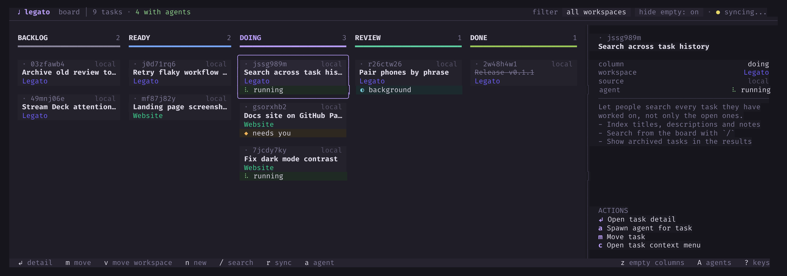
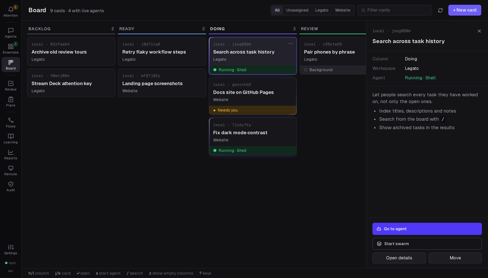

This tour shows the main views of the TUI and where the web UI shows the same thing. It assumes you have [installed Legato](/legato/start/install/) and started it with `legato`. Press `?` in any view to see its keys; the [keyboard reference](/legato/reference/keyboard/) lists them all.

## The board

The board opens first. Each column is a stage of work, and each card is a task.

- Move between columns with `h` and `l`, and between cards with `j` and `k`.
- Press `n` to make a task, `m` to move the selected one to another column, and `/` to search.
- Press `w` to show one [workspace](/legato/using/board/), or all of them.

A card shows where its task comes from (Jira, GitHub or local), its linked pull request, and, at its foot, its agent:

| On the card | Meaning |
| --- | --- |
| running (green) | The agent is working. |
| needs you (amber) | The agent waits for you to allow something or to answer a question. |
| background (cyan) | The turn ended, but a shell or a subagent it started still runs. |
| idle | The agent's session is alive and not working. |

## A task

Press `Enter` on a card to open the task. You see its description, its notes and, for a remote ticket, the provider's fields.

- `y` copies the description, and `Y` copies the full context of the task, for an agent outside Legato.
- `e` edits the description in your editor.
- `esc` goes back to the board.

## Agents

On the board, press `a` to start an agent on the selected task. Choose the tool and the folder, and press `Enter`.

Press `A` to open the agents view. Agents that need you come first, then running ones, then the rest. The terminal of the selected agent is beside the list.

- `Enter` attaches to the agent's terminal. `Ctrl+]` detaches.
- `w` selects the next agent that needs you.
- `m` sends a [macro](/legato/using/agents/), a saved message, to the agent.
- `e` changes to the ensemble, which shows every agent at once.
- `a` asks the [Reeve](/legato/using/reeve/) about the selected agent. `R` opens the Reeve from anywhere.
- `q` goes back to the board.

## Attention, plans and reviews

These views collect what agents give you to decide:

- `I` opens **Attention**: everything that needs you, in one list. `Enter` does the item's main action.
- `P` opens **plans** that agents submitted. Read one, answer its questions, and approve it, or ask for changes.
- `V` opens **review tours** of changes that agents made.
- `!` answers pending **approvals** from any view.

See [Attention and approvals](/legato/using/attention/), [Plans](/legato/using/plans/) and [Reviews](/legato/using/reviews/).

## The web UI

With `web.enabled: true`, the web UI runs beside the TUI at <http://localhost:3080>. It has the same board, agents, Attention, plans and reviews, and some things the TUI does not have:

- The conversation of a Claude Code or Codex agent, with its tool calls, in a native panel.
- The cards, artifacts and videos that agents show with [Legato's tools](/legato/agent-tools/mcp-tools/).
- Workflows, reports, Legato Learn, the credential audit log and settings.

See [The web UI](/legato/using/web-ui/), and [Your phone and other devices](/legato/running/devices/) to use it away from your desk.
