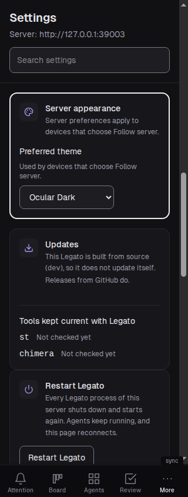
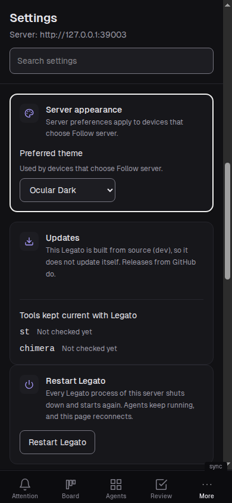

# Server theme / Follow server verification

Verified in an isolated Legato clone on 2026-11-15. No live credentials, production broker/HA configuration, installed app, primary checkout or live Legato process was changed.

## Actual entrypoints

Two scratch `legato serve` instances, each with separate config/database/data/runtime, and a scratch Mochi MQTT broker drove Chromium. `verification.json` records 14 passing checks: MQTT and manual Settings share one persisted preference; only opted-in clients follow it; switching, reload, offline cache and inactive-server events preserve active-server ownership; retained commands cannot mutate state; local fallback and explicit terminal selection survive. Settings fit 320, 390 and 1440 px; screenshots are alongside this report. Scratch servers and broker were stopped, and their instance folders removed afterward.

The broker integration tests exercise discovery, strict payload validation, revision conflicts, nonce rotation/reconnect, retained replay and live retained rejection, bounded queues/rate, disabled control, unchanged aggregate-only ACLs, and actual CLI entrypoints. They use synthetic scratch credentials, not the operator's broker.

## Checks

- `npm_config_cache=/tmp/legato-npm-cache CGO_ENABLED=0 GOCACHE=$PWD/.git/go-cache go test ./...`: passed. The default home npm cache is read-only in this sandbox; an initial final rerun failed only while installing the diagram parser there, then the writable-cache rerun passed.
- Relevant event/service/command race tests: passed.
- Go vet and targeted lint: passed.
- Web: 228 files / 1,698 tests passed; TypeScript, ESLint and production/PWA build passed.
- Desktop: 205 Rust tests passed; TypeScript, production build and canonical theme catalog checks passed. Generated trusted bridge scripts execute in Node, including origin/frame/request guards and all canonical IDs.
- Android: 25 JVM tests passed against actual theme owner, preference serializer, metadata parser and generated bridge scripts. Uses cached Kotlin/JUnit dependencies and a compile-only certificate-adapter stub; this does not validate pinned HTTPS transport.
- Documentation site: built successfully with all internal links valid.

## Test audit

Workers audited their layer's added tests. Android merged duplicate reopen coverage and fixed its offline test to call the production error-completion path. Final parent audit strengthened unsupported/older-server fallback checks to transition from an applied server theme, and made native-owned web coverage wait for metadata processing rather than merely a fetch call. Desktop command coverage derives IDs from the canonical palette registry. The service persistence test name now describes the observable notification/reopen behavior rather than claiming it observes commit timing. Added partial-migration replay coverage caught and fixed a non-idempotent migration. No test-only production seams were added. An additional independent final auditor timed out without a usable report; it is not counted as verification.

Mutation checks caught forced-local Android resolution and removal of the MQTT rate limiter. Targeted regressions were observed red before their fixes, including inactive native delivery and removed-server cache handling.

## Limits

No native GUI, Android device/emulator or installed Home Assistant was tested. Android Gradle tests/APK build are blocked by the missing Android SDK. HA discovery templates were inspected and broker-tested, but not executed inside Home Assistant. Native tests and browser tests are not claims of device verification. Existing Vite chunk-size/Browserslist-age warnings remain.

## Review and integration limits

PR #102 is merged. PR #103 has been rebased onto main `c3619406`, which includes #102 and the Ocular character work from #105. The original screenshots alongside this report show the pre-#102 layout; the rebase checks and current screenshots below cover the combined Settings layout. PR #103 has not been merged or deployed.

The resolved `Settings.tsx` preserves #102's categories, search, wrappers and navigation. `AppThemePicker` stays in **Preferences**; the no-props `ServerThemeSettings` mounts in **Server and maintenance › Server appearance**, beside instance tint. Its `server-theme` search destination is server-owned. The mounted regression saves through the real component, checks that the local fallback remains unchanged, and navigates between categories and search results. MQTT keeps explicit Apply/Cancel behavior with the new separate broker-authority opt-in. Native theme capabilities >=1 remain native-owned; Follow server still requires version2. The duplicate Ocular commit was dropped because its functional changes are already on main; canonical roles, stable IDs and terminal overrides remain intact.

No external code-review approval is claimed. The optional independent final test auditor timed out; worker audits and the parent's applied test audit are documented above. No review tour/handoff packet was created because reviews are disabled for this task.

## CI reconnect regression

The initial PR CI caught a reconnect failure not seen in local full-suite runs: a clean Paho session can discard an in-flight PUBACK waiter when the socket closes. The blocked publish then waits for its deadline before the controller can reconnect. A deterministic test now drives the public `Dial`/`Publish` paths against a scratch TCP broker that drops the connection only after receiving PUBLISH, without PUBACK (and answers normal PINGREQ traffic). It failed at the caller deadline without the fix and passes with it. In-flight publication now cancels when that connection ends; no retry, skipped assertion or larger test timeout was added. The full transport suite and 30 actual-runtime reconnect repetitions pass. Final race/full-suite/PR CI outcomes are recorded in the task notes and PR.

## Full-suite attribution and stdout capture

The new MQTT registry setting grows config-show JSON from **30,984 bytes** (base stack write length `0x7908`) to **31,322** (`0x7a5a`), **+338 bytes**. It can expose/aggravate an existing test-harness defect: `captureStdout` ran the CLI synchronously before reading its output pipe. Untouched base `8e577f8f` reproduced the same blocked write at a shorter 10s diagnostic deadline; full feature validation had blocked there until its unchanged default 10m deadline. Full exact traces are in `diagnostics/`. A later baseline/fixed comparison with identical cache/env/deadline passed both, so the unbounded-pipe failure depends on environment/load; no claim is made that every baseline attempt fails or that the added setting is irrelevant.

The minimal fix drains that existing test helper concurrently and synchronizes its output/error before returning. No production CLI behavior or JSON assertion changed. The actual config-show test passed 20 repetitions and five race repetitions; the full feature Go suite then passed. No timeout increase, retry, skip or lifecycle refactor was used.

The separate CI engram cleanup failure at `fb5b43dd` remains **unattributed**, not established unrelated: untouched base's exact engram test passed 100 repetitions (14.932s). Full baseline comparison and subsequent CI outcomes are recorded in task notes/PR, including any unreproduced failure. No engram lifecycle changes were made. Do not infer attribution from an unchanged file alone.

## Post-#102 rebase integration checks

Validated the combined branch in an isolated worktree, without testing or restarting the operator instance:

- **1,861 web tests /241 files pass**; web TypeScript, production build, ESLint and generated-theme checks pass. The mounted category/search/save regression was observed failing without the server mount, then passing with the resolved integration.
- Go `config`, `themes`, MQTT transport, store, service, server and CLI package checks pass (`go test -short -timeout 10m`, `CGO_ENABLED=0`, writable scratch Go/npm caches). This preserves the missing-PUBACK cancellation and concurrent CLI stdout fixes.
- **67 desktop tests** and TypeScript pass. **25 Android JVM model/bridge tests** pass using cached dependencies and a compile-only adapter that throws if pinned transport is invoked. No Android SDK, native GUI or transport verification is implied.
- Documentation: **57 pages, all internal links valid**.
- **109/109 scratch-browser assertions pass**, including the relocated Server editor, real API persistence, 320/390px bounds, and Preferences › Follow server adoption. Existing Settings/Board/dialog/plan paths and all six sampled themes pass. Zero browser JavaScript exceptions. The harness stopped its own backend/Vite/browser and removed its runtime.

The public integration checks are included in `scripts/verify-web-ui.mjs`. Build a scratch binary and run it through `LEGATO_VERIFY_BIN`; raw results of this rebase run are in `/tmp/pr103-integration-evidence`. Existing physical-device, virtual-keyboard, external-agent and full screen-reader limits remain. No fresh independent review or approval is claimed.

